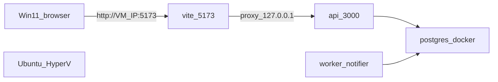

# Always-on local VM (Win 11 Hyper-V) / Долгоживущая локальная VM (Win 11 Hyper-V)

**RU.** Цель: Ubuntu Server 24.04 в Hyper-V крутит Benefitiarium 24/7 (API, web, `worker-notifier`, Postgres). Windows 11 хост — только браузер и provisioning-скрипты.

**EN.** Goal: Ubuntu Server 24.04 in Hyper-V runs Benefitiarium 24/7 (API, web, `worker-notifier`, Postgres). The Windows 11 host is only the browser plus provisioning scripts.



## Host requirements / Требования к хосту

**RU.**

- Windows 11 **Pro / Enterprise / Education** (роль Hyper-V)
- Виртуализация включена в BIOS/UEFI
- ~8 GB RAM свободно под VM (скрипт по умолчанию даёт 6 GB гостю)
- OpenSSH Client (`ssh` / `scp`) и `tar.exe` в PATH
- PowerShell **от администратора** для создания VM

**EN.**

- Windows 11 **Pro / Enterprise / Education** (Hyper-V role)
- Virtualization enabled in BIOS/UEFI
- ~8 GB RAM free for the VM (script defaults to 6 GB guest RAM)
- OpenSSH Client (`ssh` / `scp`) and `tar.exe` on PATH
- **Elevated** PowerShell to create the VM

**RU.** Вложенная виртуализация **не** нужна: гость Linux + Docker Engine.

**EN.** Nested virtualization is **not** required: Linux guest + Docker Engine.

## Layout / Структура

| Path / Путь                                       | Role / Роль                                            |
| ------------------------------------------------- | ------------------------------------------------------ |
| [`infra/vm/cloud-init/`](../infra/vm/cloud-init/) | NoCloud `user-data` / `meta-data` templates            |
| [`infra/vm/systemd/`](../infra/vm/systemd/)       | `benefitiarium-*.service` units                        |
| [`infra/vm/scripts/`](../infra/vm/scripts/)       | Host PowerShell + guest bootstrap                      |
| `infra/vm/out/`                                   | Downloaded cloud image, seed disk, OS VHD (gitignored) |

## One-shot create / Создание с нуля

**RU.**

1. Включите Hyper-V (если ещё нет): _Optional features_ → Hyper-V → reboot.
2. Создайте SSH-ключ, если нет: `ssh-keygen -t ed25519`.
3. Скопируйте `.env.example` → `.env` на хосте и заполните секреты (`ADMIN_API_TOKEN`, T‑Invest, Telegram…).
4. В elevated PowerShell:

**EN.**

1. Enable Hyper-V if needed: _Optional features_ → Hyper-V → reboot.
2. Create an SSH key if needed: `ssh-keygen -t ed25519`.
3. Copy `.env.example` → `.env` on the host and fill secrets (`ADMIN_API_TOKEN`, T‑Invest, Telegram…).
4. In elevated PowerShell:

```powershell
cd <repo>\infra\vm\scripts

.\New-BenefitiariumVm.ps1 `
  -SkipClone `
  -SshPublicKeyPath $env:USERPROFILE\.ssh\id_ed25519.pub `
  -MemoryGB 6 `
  -CpuCount 2

# Wait until the script prints Guest IPv4 (or poll):
# Get-VMNetworkAdapter -VMName benefitiarium-vm | Select-Object -ExpandProperty IPAddresses

.\Set-BenefitiariumEnv.ps1 -VmHost <guest-ip>
.\Deploy-ToVm.ps1 -VmHost <guest-ip>
```

**RU.** Откройте `http://<guest-ip>:5173`. Live Mode **не** автостартует с boot — нажмите Start в UI после поднятия API.

**EN.** Open `http://<guest-ip>:5173`. Live Mode does **not** auto-start on boot — press Start in the UI after the API is up.

### Clone-on-boot alternative / Альтернатива: clone при первом boot

**RU.** Если репозиторий уже на remote:

**EN.** If the repo is already on a remote:

```powershell
.\New-BenefitiariumVm.ps1 `
  -RepoUrl git@github.com:ORG/benefitiarium.git `
  -RepoRef main `
  -SshPublicKeyPath $env:USERPROFILE\.ssh\id_ed25519.pub
.\Set-BenefitiariumEnv.ps1 -VmHost <guest-ip>
# If units did not start (empty secrets at first boot), re-run bootstrap:
ssh benefitiarium@<guest-ip> "sudo /opt/benefitiarium/infra/vm/scripts/guest-bootstrap.sh"
```

## Cloud-init seed / Seed cloud-init

**RU.** `New-CloudInitIso.ps1` (вызывается из `New-BenefitiariumVm.ps1`) собирает NoCloud seed:

**EN.** `New-CloudInitIso.ps1` (called from `New-BenefitiariumVm.ps1`) builds a NoCloud seed:

| Method / Метод  | Artifact / Артефакт     | Notes / Примечания                                 |
| --------------- | ----------------------- | -------------------------------------------------- |
| `Vhd` (default) | FAT VHDX label `CIDATA` | No Windows ADK                                     |
| `Iso`           | ISO label `cidata`      | Needs `oscdimg.exe` (Windows ADK Deployment Tools) |

**RU.** Placeholders в `user-data`: `__SSH_PUBKEY__`, `__REPO_URL__`, `__REPO_REF__`, `__SKIP_CLONE__`. Секреты **не** кладутся в cloud-init — только через `Set-BenefitiariumEnv.ps1` → `/etc/benefitiarium/env`.

**EN.** Placeholders in `user-data`: `__SSH_PUBKEY__`, `__REPO_URL__`, `__REPO_REF__`, `__SKIP_CLONE__`. Secrets are **not** baked into cloud-init — only via `Set-BenefitiariumEnv.ps1` → `/etc/benefitiarium/env`.

## What runs in the guest / Что работает в госте

**RU.**

- Postgres: existing root [`docker-compose.yml`](../docker-compose.yml)
- API: `pnpm --filter @moex/api start` (`benefitiarium-api.service`)
- Web: Vite with `--host 0.0.0.0` / `VITE_DEV_HOST=0.0.0.0` (`benefitiarium-web.service`); proxies `/api` and `/ws` to `127.0.0.1:3000`
- Notifier: `pnpm --filter @moex/worker-notifier start` (`benefitiarium-worker-notifier.service`)
- Firewall (`ufw`): SSH + TCP **5173** (port 3000 stays guest-local)

**EN.**

- Postgres: existing root [`docker-compose.yml`](../docker-compose.yml)
- API: `pnpm --filter @moex/api start` (`benefitiarium-api.service`)
- Web: Vite with `--host 0.0.0.0` / `VITE_DEV_HOST=0.0.0.0` (`benefitiarium-web.service`); proxies `/api` and `/ws` to `127.0.0.1:3000`
- Notifier: `pnpm --filter @moex/worker-notifier start` (`benefitiarium-worker-notifier.service`)
- Firewall (`ufw`): SSH + TCP **5173** (port 3000 stays guest-local)

**RU.** `guest-bootstrap.sh` идемпотентен: `docker compose up -d` → wait → `pnpm install` → build API/notifier graphs → `pnpm db:migrate` → install/enable/restart units.

**EN.** `guest-bootstrap.sh` is idempotent: `docker compose up -d` → wait → `pnpm install` → build API/notifier graphs → `pnpm db:migrate` → install/enable/restart units.

## Day-2 ops / Эксплуатация

**RU.** Обновить код с хоста:

**EN.** Update code from the host:

```powershell
.\Deploy-ToVm.ps1 -VmHost <guest-ip>
```

**RU.** Только env:

**EN.** Env only:

```powershell
.\Set-BenefitiariumEnv.ps1 -VmHost <guest-ip>
```

**RU.** Логи и статус в госте:

**EN.** Logs and status on the guest:

```bash
sudo systemctl status benefitiarium-api benefitiarium-web benefitiarium-worker-notifier
journalctl -u benefitiarium-api -f
docker compose -f /opt/benefitiarium/docker-compose.yml ps
```

**RU.** Сброс Postgres (как в [`infra/docker/README.md`](../infra/docker/README.md)):

**EN.** Postgres reset (same as [`infra/docker/README.md`](../infra/docker/README.md)):

```bash
cd /opt/benefitiarium
docker compose down -v
docker compose up -d
pnpm db:migrate
sudo systemctl restart benefitiarium-api benefitiarium-web benefitiarium-worker-notifier
```

## Security notes / Безопасность

**RU.**

- Токены только в `/etc/benefitiarium/env` (mode `0640`, group `benefitiarium`)
- Defaults из cloud-init: `GLOBAL_KILL_SWITCH=true`, `LIVE_TRADING_ENABLED=false`, sandbox T‑Invest base URL
- Не выставляйте VM в internet-facing DMZ без отдельного hardening
- Live Mode всё ещё требует явный Start в UI

**EN.**

- Tokens only in `/etc/benefitiarium/env` (mode `0640`, group `benefitiarium`)
- Cloud-init defaults: `GLOBAL_KILL_SWITCH=true`, `LIVE_TRADING_ENABLED=false`, sandbox T‑Invest base URL
- Do not put the VM on an internet-facing DMZ without extra hardening
- Live Mode still requires an explicit Start in the UI

## Out of scope / Вне скоупа

**RU.** Win 11 Home / VirtualBox; production Docker images для api/web; autostart Live Mode; CI сборка VM image.

**EN.** Win 11 Home / VirtualBox; production Docker images for api/web; Live Mode autostart; CI-built VM images.
