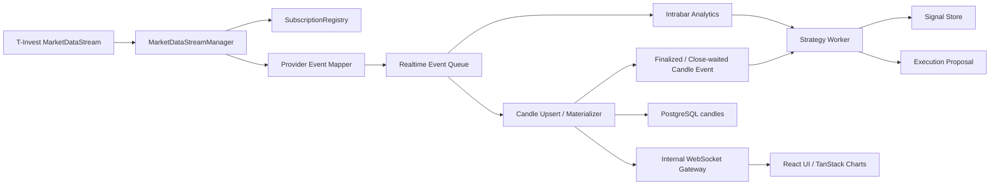
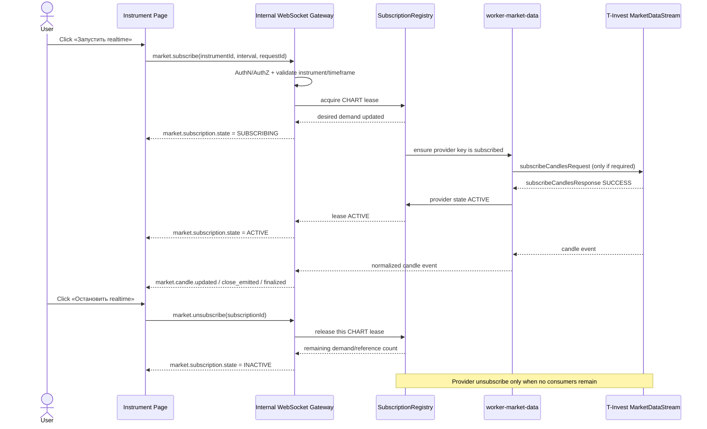

# T-Invest Realtime Candle Stream — Implementation Guide / Поток realtime-свечей T-Invest — руководство по реализации

**RU.** **Проект:** MOEX Trading Platform  
**EN.** **Project:** MOEX Trading Platform

**RU.** **Версия документа:** 1.3  
**EN.** **Document version:** 1.3

**RU.** **Дата сверки документации:** 10 ноября 2026 г.  
**EN.** **Doc alignment date:** 10 November 2026

**RU.** **Назначение:** техническая инструкция для Cursor / AI coding agent по подключению, управлению и эксплуатации realtime-подписок на свечи T-Invest API для аналитики, графиков и генерации торговых сигналов; включает пользовательское включение/выключение live-потока кнопкой на странице инструмента.

**EN.** **Purpose:** technical guide for Cursor / AI coding agents on connecting, managing, and operating T-Invest API realtime candle subscriptions for analytics, charts, and trading signals; includes user Start/Stop live stream on the instrument page.

**RU.**

> Версия 1.3 уточняет контракт realtime `Candle` против исторического `HistoricCandle`: поле `is_complete` присутствует в историческом ответе `GetCandles`, но не документировано в stream-сообщении `Candle`. Поэтому realtime finality нельзя определять чтением несуществующего поля. Также зафиксированы лимиты 32 quote stream connections, 300 subscriptions per stream и 100 subscription requests/minute.
>
> Этот документ дополняет `MOEX Trading Platform — Technical Backlog v1.2`. Он не заменяет его и не меняет существующие ID задач. Основная реализация относится к EPIC E4: `BL-040`–`BL-045`, а проверка SDK и контрактов — к `BL-013`/`BL-014`.

**EN.**

> v1.3 clarifies the realtime `Candle` contract vs historical `HistoricCandle`: `is_complete` exists on `GetCandles` history but is not documented on stream `Candle`. Do not infer realtime bar finality from a non-existent field. Limits: 32 quote stream connections, 300 subscriptions per stream, 100 subscription requests/minute.
>
> This document supplements `MOEX Trading Platform — Technical Backlog v1.2`. It does not replace it or rename task IDs. Main implementation: EPIC E4 `BL-040`–`BL-045`; SDK/contract verification: `BL-013`/`BL-014`.

---

## 0. Brief architecture decision / Краткое архитектурное решение

### One subscription per selected instrument / Важное уточнение: одна подписка на один выбранный инструмент

**RU.** Пользовательский сценарий MVP — получать realtime-свечи **по одному конкретному инструменту (тикеру) на открытой странице инструмента**. Один запрос `market.subscribe` от страницы должен содержать ровно один внутренний `instrumentId` и один выбранный `interval`. Backend разрешает этот внутренний ID в конкретный `instrument_uid` T-Invest и отправляет provider subscribe для этой пары инструмент/интервал. Клиент не передаёт в брокерский API произвольный ticker или FIGI.

**EN.** MVP UX: realtime candles **for one instrument on the instrument page**. One `market.subscribe` carries exactly one internal `instrumentId` and one `interval`. Backend resolves to T-Invest `instrument_uid` and subscribes that pair. The client must not send arbitrary ticker or FIGI to the broker API.

**RU.** Это не означает отдельное T-Invest stream-соединение на каждый тикер. Нужно различать два лимита брокера:

**EN.** This is not one T-Invest stream per ticker. Distinguish two broker limits:

**RU.**

- **до 32 активных stream-соединений сервиса котировок**;
- **до 300 одновременных подписок внутри одного quote stream**, суммарно по свечам, стаканам и обезличенным сделкам.

**EN.**

- **up to 32 active quote stream connections**;
- **up to 300 simultaneous subscriptions on one quote stream** (candles + orderbook + anonymized trades).

**RU.** Дополнительно действует лимит до 100 запросов на подписку в минуту. Следовательно, 300 — это не число stream-соединений. Один realtime-график для одного инструмента и одного интервала занимает одну provider subscription в общем stream. При изменении timeframe клиент освобождает старый lease и создаёт новый для того же инструмента с новым интервалом. Несколько вкладок/пользователей с одинаковой парой `instrument_uid + interval` могут использовать один provider subscription через reference counting.

**EN.** Also up to 100 subscribe requests per minute. 300 is not the connection count. One chart (one instrument + one interval) consumes one provider subscription on a shared stream. Timeframe changes release the old lease and create a new one. Tabs/users with the same `instrument_uid + interval` share one provider subscription via reference counting.

**RU.** Официальные источники: [лимиты T-Invest API](https://developer.tbank.ru/invest/intro/intro/limits), [MarketDataStream](https://developer.tbank.ru/invest/services/quotes/marketdata).

**EN.** Official sources: [T-Invest API limits](https://developer.tbank.ru/invest/intro/intro/limits), [MarketDataStream](https://developer.tbank.ru/invest/services/quotes/marketdata).

**RU.** Для получения realtime-свечей использовать **T-Invest `MarketDataStreamService.MarketDataStream` — bidirectional gRPC stream** через серверный `@ttech-pub/invest-sdk-node`.

**EN.** Use **T-Invest `MarketDataStreamService.MarketDataStream` — bidirectional gRPC stream** via server `@ttech-pub/invest-sdk-node`.

**RU.** Поток подключается и обслуживается только на backend в `apps/worker-market-data`. Браузер не подключается к брокерскому API напрямую и не получает T-Invest token. Пользователь инициирует и прекращает получение live-свечей кнопкой на странице инструмента; frontend отправляет команду во внутренний WebSocket платформы. Backend регистрирует временный demand типа `CHART`, а `SubscriptionRegistry` включает/выключает provider subscription с учётом всех остальных consumers. Frontend получает только нормализованные события от внутреннего WebSocket платформы.

**EN.** Stream is hosted only on backend in `apps/worker-market-data`. The browser never connects to the broker or receives a T-Invest token. User Start/Stop on the instrument page; frontend sends internal WebSocket commands. Backend registers ephemeral `CHART` demand; `SubscriptionRegistry` toggles provider subscriptions with ref counting. Frontend receives only normalized internal WebSocket events.

**RU.** Рекомендуемая цепочка:

**EN.** Recommended pipeline:



**RU.** **Не строить отдельное stream-соединение для каждого инструмента или каждого графика.** Для MVP страница подписывается только на один выбранный ticker + timeframe, но provider connection остаётся общим для backend worker. Подписки разных потребителей агрегируются менеджером соединения; один клиентский запрос не должен случайно подписывать страницу на весь watchlist.

**EN.** **Do not open a separate stream per instrument or chart.** MVP: one ticker + timeframe per page, shared provider connection on the worker. Consumer demands aggregate in the connection manager; one client request must not subscribe the whole watchlist.

### 0.1. Primary uses of the candle stream / Основное назначение свечного потока

**RU.** Поток используется для:

**EN.** The stream is used for:

**RU.**

1. обновления текущей свечи на графике;
2. оперативного расчёта индикаторов и аналитических признаков;
3. обнаружения условий внутри ещё формирующейся свечи — только если стратегия явно поддерживает intrabar mode;
4. фиксации закрытой свечи для расчётов, которые должны выполняться строго один раз на бар;
5. передачи нормализованных market events в Strategy Worker;
6. восстановления недостающих баров после потери соединения;
7. on-demand отображения realtime-свечей на странице инструмента после нажатия пользователем кнопки «Запустить realtime».

**EN.**

1. update the current candle on the chart;
2. compute indicators and analytic features in near real time;
3. detect conditions inside a still-forming bar — only if the strategy explicitly supports intrabar mode;
4. record a closed bar for calculations that must run strictly once per bar;
5. forward normalized market events to Strategy Worker;
6. recover missing bars after connection loss;
7. on-demand realtime candles on the instrument page after the user clicks **Start realtime**.

**RU.** Свечной поток — это агрегированные OHLCV-данные, а не поток каждого тика. Для tick-level/scalping логики нужно отдельно рассматривать `subscribeTradesRequest`, `subscribeLastPriceRequest` и/или стакан.

**EN.** Candle stream is aggregated OHLCV, not every tick. For tick/scalping logic use `subscribeTradesRequest`, `subscribeLastPriceRequest`, and/or order book separately.

---

### 0.1.1. Stream `Candle` vs `HistoricCandle` / Различие stream Candle и HistoricCandle

**RU.** Не переносить поле `is_complete` из исторической модели `HistoricCandle` в realtime stream DTO. По актуальной схеме T-Invest:

**EN.** Do not copy `is_complete` from `HistoricCandle` into realtime stream DTOs. Per current T-Invest schema:

**RU.**

- `MarketDataResponse.candle` содержит потоковый `Candle` с OHLCV, временем, идентификаторами инструмента и source;
- `GetCandlesResponse.candles[]` содержит `HistoricCandle`, у которого документирован `is_complete`.

**EN.**

- `MarketDataResponse.candle` carries stream `Candle` with OHLCV, time, instrument identifiers, and source;
- `GetCandlesResponse.candles[]` carries `HistoricCandle` with documented `is_complete`.

**RU.** Это разные сообщения API. Любой код, который читает `streamCandle.isComplete`, считается дефектом интеграции. В RT-01 добавить contract test на сериализованный реальный response и type-level test, фиксирующий фактическую форму установленной версии generated SDK.

**EN.** These are different API messages. Code reading `streamCandle.isComplete` is an integration defect. RT-01: contract test on a serialized real response plus a type-level test for the pinned generated SDK shape.

## 1. T-Invest API contract / Контракт T-Invest API

### 1.1. Method and transport / Метод и транспорт

**RU.** Используемый метод:

**EN.** Method:

```text
MarketDataStreamService/MarketDataStream
```

**RU.** Тип: **bidirectional streaming**. Клиент отправляет сообщения управления подписками и получает сообщения с результатами подписки и рыночными событиями в том же stream-соединении.

**EN.** Type: **bidirectional streaming**. The client sends subscription control messages and receives subscription results and market events on the same stream connection.

**RU.** Production REST/gRPC gateway, отображённый в документации:

**EN.** Production REST/gRPC gateway per documentation:

```text
https://invest-public-api.tbank.ru/rest/tinkoff.public.invest.api.contract.v1.MarketDataStreamService/MarketDataStream
```

**RU.** SDK должен самостоятельно корректно настроить transport, TLS, metadata и авторизацию. Не реализовывать transport вручную, если это не требуется для fallback.

**EN.** The SDK must configure transport, TLS, metadata, and auth. Do not hand-roll transport unless required for fallback.

**RU.** Для Node.js использовать серверный пакет:

**EN.** For Node.js use the server packages:

```bash
pnpm add @ttech-pub/invest-sdk-node @ttech-pub/invest-core @ttech-pub/grpc-node-client
```

**RU.** Версии пакетов `@ttech-pub/*` нужно зафиксировать в `pnpm-lock.yaml`. Не смешивать произвольные версии SDK, core и grpc client. До реализации проверить совместимость peer dependencies и Node.js runtime по README выбранной версии.

**EN.** Pin `@ttech-pub/*` versions in `pnpm-lock.yaml`. Do not mix arbitrary SDK/core/grpc versions. Verify peer dependencies and Node runtime from the pinned README before implementation.

### 1.2. Why `MarketDataStream`, not `MarketDataServerSideStream` / Почему `MarketDataStream`, а не `MarketDataServerSideStream`

**RU.**

- `MarketDataStream` — основной bidirectional stream. Он подходит для серверного Node.js worker, который должен управлять подписками в течение жизни приложения.
- `MarketDataServerSideStream` — server-side stream, в первую очередь полезен для трансляции данных в браузерные клиенты через gRPC-Web, который не поддерживает bidirectional streaming в том же виде.
- В нашей архитектуре broker stream живёт на backend; frontend получает события через внутренний WebSocket API.

**EN.**

- `MarketDataStream` is the primary bidirectional stream. It fits a server Node.js worker that manages subscriptions for the application lifetime.
- `MarketDataServerSideStream` is server-side streaming, mainly useful for browser clients via gRPC-Web, which does not support bidirectional streaming the same way.
- In our architecture the broker stream lives on the backend; the frontend receives events via the internal WebSocket API.

**RU.** Не открывать broker stream из `apps/web`.

**EN.** Do not open a broker stream from `apps/web`.

### 1.3. Authorization / Авторизация

**RU.** Используется Bearer T-Invest API token. Токен хранится только в backend secret storage / environment secrets.

**EN.** Use Bearer T-Invest API token. Store only in backend secret storage / environment secrets.

**RU.** Пример имён переменных:

**EN.** Example env names:

```dotenv
TINVEST_ENV=production
TINVEST_API_TOKEN=***
TINVEST_API_URL=https://invest-public-api.tbank.ru
```

**RU.** Требования:

- не хранить токен в БД в открытом виде;
- не передавать токен через frontend DTO, URL, query string или WebSocket;
- не логировать `Authorization`, metadata с секретами и полные SDK config objects;
- Sandbox и Production credentials/configuration должны быть раздельными;
- worker должен проверять environment при старте и не допускать неявного переключения endpoint.

**EN.** Requirements:

- do not store plaintext token in DB;
- do not pass token via frontend DTO, URL, query string, or WebSocket;
- do not log `Authorization`, secret metadata, or full SDK config objects;
- keep Sandbox and Production credentials/configuration separate;
- worker must validate environment at startup and forbid implicit endpoint switching.

### 1.4. Instrument identifier / Идентификатор инструмента

**RU.** В каждом элементе `CandleInstrument` передавать `instrument_id`.

**EN.** Pass `instrument_id` in each `CandleInstrument`.

**RU.** Поддерживаются варианты:

- `instrument_uid` — предпочтительный вариант для платформы;
- `figi` — deprecated, не использовать для новых интеграций;
- `ticker + '_' + class_code` — допустимый альтернативный идентификатор, например `SiZ6_SPBFUT`, только если он однозначно сопоставлен с внутренним инструментом.

**EN.** Supported forms:

- `instrument_uid` — preferred for the platform;
- `figi` — deprecated; do not use for new integrations;
- `ticker + '_' + class_code` — allowed alternative, e.g. `SiZ6_SPBFUT`, only when unambiguously mapped to an internal instrument.

**RU.** В домене и БД использовать внутренний `instrument_id` UUID. В T-Invest adapter хранить mapping на `instrument_uid`, ticker и class_code. Не полагаться только на ticker: фьючерсные серии имеют разные даты экспирации и должны оставаться разными инструментами.

**EN.** Use internal UUID `instrument_id` in domain/DB. T-Invest adapter maps `instrument_uid`, ticker, class_code. Do not use ticker alone: futures series differ by expiry and remain distinct instruments.

---

## 2. Supported intervals / Поддерживаемые интервалы

**RU.** Для `SubscriptionInterval` в документации перечислены следующие значения:

| Значение SDK/API                        | Интервал | Рекомендация применения                      |
| --------------------------------------- | -------: | -------------------------------------------- |
| `SUBSCRIPTION_INTERVAL_ONE_MINUTE`      |       1m | Основной быстрый feed для интрадей-аналитики |
| `SUBSCRIPTION_INTERVAL_2_MIN`           |       2m | Краткосрочные стратегии                      |
| `SUBSCRIPTION_INTERVAL_3_MIN`           |       3m | Краткосрочные стратегии                      |
| `SUBSCRIPTION_INTERVAL_FIVE_MINUTES`    |       5m | Основной intraday timeframe                  |
| `SUBSCRIPTION_INTERVAL_10_MIN`          |      10m | Intraday                                     |
| `SUBSCRIPTION_INTERVAL_FIFTEEN_MINUTES` |      15m | Intraday / swing context                     |
| `SUBSCRIPTION_INTERVAL_30_MIN`          |      30m | Старший intraday timeframe                   |
| `SUBSCRIPTION_INTERVAL_ONE_HOUR`        |       1h | Основной старший timeframe                   |
| `SUBSCRIPTION_INTERVAL_2_HOUR`          |       2h | Старший timeframe                            |
| `SUBSCRIPTION_INTERVAL_4_HOUR`          |       4h | Старший timeframe                            |
| `SUBSCRIPTION_INTERVAL_ONE_DAY`         |       1d | Daily context                                |
| `SUBSCRIPTION_INTERVAL_WEEK`            |       1w | Weekly context                               |
| `SUBSCRIPTION_INTERVAL_MONTH`           |       1M | Monthly context                              |

**EN.** Documented `SubscriptionInterval` values:

| SDK/API value                           | Interval | Recommended use                          |
| --------------------------------------- | -------: | ---------------------------------------- |
| `SUBSCRIPTION_INTERVAL_ONE_MINUTE`      |       1m | Primary fast feed for intraday analytics |
| `SUBSCRIPTION_INTERVAL_2_MIN`           |       2m | Short-horizon strategies                 |
| `SUBSCRIPTION_INTERVAL_3_MIN`           |       3m | Short-horizon strategies                 |
| `SUBSCRIPTION_INTERVAL_FIVE_MINUTES`    |       5m | Primary intraday timeframe               |
| `SUBSCRIPTION_INTERVAL_10_MIN`          |      10m | Intraday                                 |
| `SUBSCRIPTION_INTERVAL_FIFTEEN_MINUTES` |      15m | Intraday / swing context                 |
| `SUBSCRIPTION_INTERVAL_30_MIN`          |      30m | Senior intraday timeframe                |
| `SUBSCRIPTION_INTERVAL_ONE_HOUR`        |       1h | Primary senior timeframe                 |
| `SUBSCRIPTION_INTERVAL_2_HOUR`          |       2h | Senior timeframe                         |
| `SUBSCRIPTION_INTERVAL_4_HOUR`          |       4h | Senior timeframe                         |
| `SUBSCRIPTION_INTERVAL_ONE_DAY`         |       1d | Daily context                            |
| `SUBSCRIPTION_INTERVAL_WEEK`            |       1w | Weekly context                           |
| `SUBSCRIPTION_INTERVAL_MONTH`           |       1M | Monthly context                          |

**RU.** Не использовать `SUBSCRIPTION_INTERVAL_UNSPECIFIED`.

**EN.** Do not use `SUBSCRIPTION_INTERVAL_UNSPECIFIED`.

**RU.** **Особенность 2h и 4h:** границы этих свечей в стриме отсчитываются от `00:00 UTC`. Это должно быть отражено в нормализации и UI. Не рассчитывать начало этих баров относительно локальной timezone сервера или браузера.

**EN.** **2h and 4h:** bar boundaries in the stream anchor at `00:00 UTC`. Reflect this in normalization and UI; do not anchor from server/browser local timezone.

**RU.** Рекомендуемый MVP набор для realtime:

- для инструментов, по которым нужны быстрые сигналы: `1m` и `5m`;
- `1h` — как старший контекст, только если стратегия его использует;
- `15m`, `30m`, `2h`, `4h`, `1d` подключать по явной конфигурации стратегии/пользовательской подписки, а не автоматически для каждого инструмента.

**EN.** Recommended MVP realtime set:

- fast-signal instruments: `1m` and `5m`;
- `1h` as senior context only if the strategy uses it;
- enable `15m`, `30m`, `2h`, `4h`, `1d` only via explicit strategy or user subscription config, not automatically per instrument.

**RU.** Историческую глубину загружать через `GetCandles` / исторический importer (BL-031), а не ожидать, что stream заполнит историю. Stream — это live continuation.

**EN.** Load history via `GetCandles` / historical importer (BL-031); do not expect the stream to backfill history. The stream is live continuation.

---

## 3. Candle subscription / Подписка на свечи

### 3.1. Request structure / Структура запроса

**RU.** Для изменения статуса свечных подписок отправляется `subscribeCandlesRequest` со следующими полями:

**EN.** Send `subscribeCandlesRequest` to change candle subscription state with these fields:

| Field / Поле         | Purpose / Назначение                                                 |
| -------------------- | -------------------------------------------------------------------- |
| `subscriptionAction` | `SUBSCRIPTION_ACTION_SUBSCRIBE` or `SUBSCRIPTION_ACTION_UNSUBSCRIBE` |
| `instruments`        | List of instruments and intervals                                    |
| `waitingClose`       | Wait for interval close before emitting the candle                   |
| `candleSourceType`   | Candle source                                                        |

**RU.** Элемент `instruments` содержит:

**EN.** Each `instruments` element contains:

```ts
{
  instrumentId: string;
  interval: SubscriptionInterval;
}
```

**RU.** Не заполнять deprecated `figi`, если известен `instrumentId`.

**EN.** Do not set deprecated `figi` when `instrumentId` is known.

### 3.2. `waitingClose` parameter / Параметр `waitingClose`

**RU.** `waitingClose` задаёт режим доставки свечей на уровне запроса подписки:

**EN.** `waitingClose` sets candle delivery mode on the subscription request:

| Value / Значение | Contract behavior / Поведение по контракту                                                                               | Use / Применение                                              |
| ---------------- | ------------------------------------------------------------------------------------------------------------------------ | ------------------------------------------------------------- |
| `false`          | Receive candle updates in realtime as the bar forms; a closing/correcting message may still arrive after the period ends | Live chart, intrabar analytics                                |
| `true`           | Wait for the interval to close before sending the candle                                                                 | Close-based analytics when broker-side close wait is required |

**RU.** **Критическое уточнение контракта:** в документации stream `Candle` не содержит `is_complete`. Это поле присутствует у `HistoricCandle`, который возвращает unary-метод `GetCandles`. Нельзя писать `if (streamCandle.isComplete)` или считать поле гарантированным в stream payload.

**EN.** **Critical contract note:** stream `Candle` docs omit `is_complete`. `HistoricCandle` from unary `GetCandles` has it. Do not use `if (streamCandle.isComplete)` or assume the field on stream payload.

**RU.** Рекомендации:

- для графика с изменяющейся текущей свечой использовать `waitingClose: false`;
- для отдельного потока, который должен выдавать свечи после закрытия интервала, использовать `waitingClose: true`;
- если один и тот же consumer должен видеть и intrabar updates, и close-only поток, это две разные subscription configurations. До использования обеих одновременно проверить на SDK contract spike, допускает ли API повторную подписку на одинаковые `instrument_uid + interval` с разными `waitingClose`; учитывать каждую как отдельную подписку в лимите;
- не считать `waitingClose: true` гарантией неизменности: документация предупреждает о поздних корректирующих свечах после окончания периода. Каждое сообщение нужно upsert-ить по времени начала интервала, а изменение уже сохранённой свечи учитывать как revision/correction;
- для `waitingClose: false` приложение само определяет lifecycle бара: `UPDATING`, затем `FINALIZED_BY_SCHEDULE` после границы интервала и grace period; пришедшее позднее обновление переводит бар в `CORRECTED` и запускает controlled re-evaluation.

**EN.** Recommendations:

- for a chart with a changing current bar use `waitingClose: false`;
- for a separate feed that emits bars only after interval close use `waitingClose: true`;
- if one consumer needs both intrabar updates and a close-only feed, those are two subscription configurations. Before using both at once, confirm on the SDK contract spike whether the API allows resubscribing to the same `instrument_uid + interval` with different `waitingClose`; count each toward the subscription limit;
- do not treat `waitingClose: true` as immutability: docs warn about late correcting candles after the period ends. Upsert every message by interval start time; treat changes to an already stored bar as revision/correction;
- for `waitingClose: false` the application defines bar lifecycle: `UPDATING`, then `FINALIZED_BY_SCHEDULE` after the interval boundary and grace period; a late update sets `CORRECTED` and triggers controlled re-evaluation.

**RU.** Для автоматических сигналов по закрытию свечи предпочтительно либо использовать отдельную `waitingClose: true` подписку, либо включить серверный finalizer с календарём торгов, временем интервала и grace period. Выбор фиксируется в конфигурации consumer/strategy, а не выводится из несуществующего stream-поля.

**EN.** For automated close-based signals prefer a separate `waitingClose: true` subscription or a server finalizer with trading calendar, interval time, and grace period. Configure per consumer/strategy; do not infer from a non-existent stream field.

### 3.3. Candle source `candleSourceType` / Источник свечей `candleSourceType`

**RU.** В API присутствует выбор источника свечей. Для стратегий на данных MOEX по умолчанию следует использовать **биржевые свечи** (`CANDLE_SOURCE_EXCHANGE`).

**EN.** The API selects candle source. For MOEX data strategies default to **exchange candles** (`CANDLE_SOURCE_EXCHANGE`).

**RU.** Не смешивать без явной политики:

- биржевые данные;
- дилерские данные, в том числе торговлю по выходным, если она доступна для инструмента.

**EN.** Do not mix without an explicit policy:

- exchange data;
- dealer data, including weekend trading when available for the instrument.

**RU.** В документации разных представлений контракта встречаются различающиеся имена для weekend source (`CANDLE_SOURCE_DEALER_WEEKEND` в некоторых protobuf/SDK описаниях и `CANDLE_SOURCE_INCLUDE_WEEKEND` в актуальном REST-представлении). Поэтому:

1. проверить фактический enum в установленной версии `@ttech-pub/grpc-node-client`;
2. использовать enum-константу из установленного пакета, а не magic number;
3. сохранить исходное `candle_source_type` в canonical event;
4. закрепить mapping отдельным contract test;
5. для MOEX-only data set использовать `CANDLE_SOURCE_EXCHANGE`.

**EN.** Contract docs use different names for the weekend source (`CANDLE_SOURCE_DEALER_WEEKEND` in some protobuf/SDK descriptions and `CANDLE_SOURCE_INCLUDE_WEEKEND` in the current REST view). Therefore:

1. verify the actual enum in the pinned `@ttech-pub/grpc-node-client`;
2. use the enum constant from the installed package, not a magic number;
3. preserve original `candle_source_type` in the canonical event;
4. lock mapping with a dedicated contract test;
5. for MOEX-only data use `CANDLE_SOURCE_EXCHANGE`.

**RU.** `CANDLE_SOURCE_UNSPECIFIED` документируется как все источники. Для production стратегий не оставлять его неявным default, если критична чистота exchange-only dataset.

**EN.** `CANDLE_SOURCE_UNSPECIFIED` is documented as all sources. For production strategies do not leave it as an implicit default when exchange-only purity matters.

### 3.4. Subscription response / Ответ на запрос подписки

**RU.** На команду подписки приходит `subscribeCandlesResponse`, содержащий:

- `trackingId` — ID запроса;
- `candlesSubscriptions[]` — статусы отдельных подписок.

**EN.** A subscribe command yields `subscribeCandlesResponse` containing:

- `trackingId` — request ID;
- `candlesSubscriptions[]` — per-subscription statuses.

**RU.** Каждый `CandleSubscription` содержит, в частности:

- `subscriptionStatus`;
- `instrumentUid` / ticker / classCode;
- `interval`;
- `waitingClose`;
- `subscriptionId`;
- `streamId`;
- `subscriptionAction`;
- `candleSourceType`.

**EN.** Each `CandleSubscription` includes, among others:

- `subscriptionStatus`;
- `instrumentUid` / ticker / classCode;
- `interval`;
- `waitingClose`;
- `subscriptionId`;
- `streamId`;
- `subscriptionAction`;
- `candleSourceType`.

**RU.** Подписка считается активной только при `SUBSCRIPTION_STATUS_SUCCESS`. Сам факт того, что `sdk.send()` не выбросил исключение, не означает, что все элементы успешно подписаны.

**EN.** A subscription is active only when `SUBSCRIPTION_STATUS_SUCCESS`. A successful `sdk.send()` without exception does not mean every element subscribed successfully.

**RU.** Обрабатывать статусы:

| Статус                           | Поведение приложения                                                                                 |
| -------------------------------- | ---------------------------------------------------------------------------------------------------- |
| `SUCCESS`                        | Сохранить подтверждённую активную подписку                                                           |
| `INSTRUMENT_NOT_FOUND`           | Пометить конкретный инструмент как rejected; проверить UID/class code                                |
| `SUBSCRIPTION_ACTION_IS_INVALID` | Ошибка клиента/контракта; не повторять автоматически                                                 |
| `INTERVAL_IS_INVALID`            | Исправить конфигурацию интервала                                                                     |
| `LIMIT_IS_EXCEEDED`              | Перераспределить подписки по stream connections с учётом лимитов; не создавать шторм переподключений |
| `INTERNAL_ERROR`                 | Ограниченный retry с backoff; записать correlation/tracking ID                                       |
| `TOO_MANY_REQUESTS`              | Применить rate limit и отложить повтор                                                               |
| `SUBSCRIPTION_NOT_FOUND`         | При unsubscribe проверить локальный registry и фактические subscriptions                             |
| `SOURCE_IS_INVALID`              | Проверить generated enum и mapping source                                                            |

**EN.** Handle statuses:

| Status                           | Application behavior                                                                    |
| -------------------------------- | --------------------------------------------------------------------------------------- |
| `SUCCESS`                        | Persist confirmed active subscription                                                   |
| `INSTRUMENT_NOT_FOUND`           | Reject that instrument; verify UID/class code                                           |
| `SUBSCRIPTION_ACTION_IS_INVALID` | Client/contract error; do not auto-retry                                                |
| `INTERVAL_IS_INVALID`            | Fix interval configuration                                                              |
| `LIMIT_IS_EXCEEDED`              | Rebalance subscriptions across stream connections within limits; avoid reconnect storms |
| `INTERNAL_ERROR`                 | Limited retry with backoff; log correlation/tracking ID                                 |
| `TOO_MANY_REQUESTS`              | Apply rate limit and defer retry                                                        |
| `SUBSCRIPTION_NOT_FOUND`         | On unsubscribe verify local registry and actual subscriptions                           |
| `SOURCE_IS_INVALID`              | Verify generated enum and source mapping                                                |

**RU.** Статусы должны маппиться в внутренний enum, не протаскивать SDK enum в domain layer.

**EN.** Map statuses to an internal enum; do not expose SDK enums into the domain layer.

---

## 4. Node.js / TypeScript SDK connection / Node.js / TypeScript SDK: подключение

**RU.** Раздел описывает выбор `@ttech-pub/invest-sdk-node`, lifecycle bidirectional stream (request sink + response consumer), форму raw subscribe request и требования к обработке Observable без блокировки hot path.

**EN.** Covers `@ttech-pub/invest-sdk-node` selection, bidirectional stream lifecycle (request sink + response consumer), raw subscribe shape, and non-blocking Observable handling.

### 4.1. SDK verification / Проверка SDK

**RU.** Для проекта использовать `@ttech-pub/invest-sdk-node`, а не старый `@tinkoff/invest-js`.

**EN.** Use `@ttech-pub/invest-sdk-node` for this project, not legacy `@tinkoff/invest-js`.

**RU.** В официальной линейке JS/TS SDK:

- `invest-sdk-node` — серверный SDK;
- `invest-core` — общая доменная основа, Decimal и ошибки;
- `grpc-node-client` — low-level Node gRPC-клиент и generated API types;
- stream-команды возвращают RxJS Observable.

**EN.** In the official JS/TS SDK line:

- `invest-sdk-node` — server SDK;
- `invest-core` — shared domain foundation, Decimal and errors;
- `grpc-node-client` — low-level Node gRPC client and generated API types;
- stream commands return RxJS Observable.

**RU.** В репозитории SDK есть отдельные Node и Web пакеты. Пример команды/Observable из Web SDK нельзя автоматически переносить в Node worker: проверить, что соответствующий command/export и поддержка двунаправленной отправки доступны именно в выбранной версии `invest-sdk-node`/`grpc-node-client`. Для Node runtime использовать только подтверждённый серверный клиент и generated types выбранного Node пакета.

**EN.** The SDK repo ships separate Node and Web packages. Do not copy Web SDK command/Observable examples into the Node worker automatically: verify the command/export and bidirectional send support exist in the pinned `invest-sdk-node`/`grpc-node-client`. For Node runtime use only the confirmed server client and generated types from the chosen Node package.

### 4.2. Bidirectional stream connection and lifecycle / Подключение и lifecycle bidirectional stream

**RU.** `MarketDataStream` — bidirectional RPC: клиент отправляет запросы подписки/отписки в уже открытый stream и получает в том же stream подтверждения и market events. Для одного активного stream manager необходимы два независимых направления:

1. **request sink** — сериализованно отправляет `MarketDataRequest` (subscribe, unsubscribe, `GetMySubscriptions`, ping settings);
2. **response consumer** — постоянно читает `MarketDataResponse` и маршрутизирует `subscribeCandlesResponse`, `candle`, `ping` и прочие типы сообщений.

**EN.** `MarketDataStream` is bidirectional RPC: the client sends subscribe/unsubscribe on an open stream and receives acknowledgements and market events on the same stream. One active stream manager needs two independent directions:

1. **request sink** — serially sends `MarketDataRequest` (subscribe, unsubscribe, `GetMySubscriptions`, ping settings);
2. **response consumer** — continuously reads `MarketDataResponse` and routes `subscribeCandlesResponse`, `candle`, `ping`, and other message types.

**RU.** Не реализовывать каждое нажатие UI как новый RPC connection. Не создавать новый `MarketDataStream` для каждого ticker, пользователя или вкладки.

**EN.** Do not treat each UI click as a new RPC connection. Do not open a new `MarketDataStream` per ticker, user, or tab.

**RU.** В проекте использовать серверный `@ttech-pub/invest-sdk-node` и/или `@ttech-pub/grpc-node-client`. **Точные имена exports, способ открытия bidi stream и сигнатуры методов нельзя считать установленными по имени пакета:** их нужно подтвердить на зафиксированной версии `pnpm-lock.yaml`. SDK contract spike обязателен до реализации production adapter.

**EN.** Use server `@ttech-pub/invest-sdk-node` and/or `@ttech-pub/grpc-node-client`. **Export names, bidi open pattern, and method signatures are not established by package name alone:** confirm them against the pinned `pnpm-lock.yaml`. SDK contract spike is mandatory before the production adapter.

**RU.** Рекомендуемая внутренняя абстракция, не являющаяся буквальной сигнатурой T-Invest SDK:

**EN.** Recommended internal abstraction (not a literal T-Invest SDK signature):

```ts
interface TInvestMarketDataStream {
  connect(): Promise<void>;
  send(request: MarketDataRequest): Promise<void>;
  readonly responses: AsyncIterable<MarketDataResponse>;
  close(): Promise<void>;
}
```

**RU.** Адаптер должен гарантировать:

- ровно один reader loop на stream;
- сериализованную отправку управляющих сообщений;
- bounded backpressure между response reader и обработчиками;
- завершение reader и request sink при shutdown;
- один reconnect coordinator на stream;
- корреляцию ответа подписки по `trackingId`, а активного provider state — по инструменту, интервалу, source и `waitingClose`.

**EN.** The adapter must guarantee:

- exactly one reader loop per stream;
- serialized send of control messages;
- bounded backpressure between response reader and handlers;
- reader and request sink teardown on shutdown;
- one reconnect coordinator per stream;
- correlate subscribe responses by `trackingId`; active provider state by instrument, interval, source, and `waitingClose`.

**RU.** Если high-level SDK предоставляет только Observable, проверить, как в этой версии отправлять **последующие** сообщения в уже открытый bidirectional stream. Если high-level command поддерживает лишь начальный request, использовать low-level generated gRPC client из `@ttech-pub/grpc-node-client`. Не открывать новую команду/соединение ради каждого subscribe/unsubscribe без проверки лимитов и поведения SDK.

**EN.** If the high-level SDK exposes only Observable, verify how this version sends **subsequent** messages on an already open bidirectional stream. If the high-level command supports only the initial request, use the low-level generated gRPC client from `@ttech-pub/grpc-node-client`. Do not open a new command/connection for every subscribe/unsubscribe without checking limits and SDK behavior.

**RU.** Для smoke test отправить одну свечную подписку на один `instrument_uid` и один интервал, дождаться `subscribeCandlesResponse`, проверить `subscriptionStatus === SUCCESS`, получить `candle` events, отправить unsubscribe в том же stream и подтвердить соответствующий статус.

**EN.** Smoke test: one candle subscription for one `instrument_uid` and one interval; wait for `subscribeCandlesResponse`; assert `subscriptionStatus === SUCCESS`; receive `candle` events; unsubscribe on the same stream and confirm status.

**RU.** В коде не использовать устаревший `@tinkoff/invest-js`. Не фиксировать неизвестные SDK enum numeric values вручную.

**EN.** Do not use legacy `@tinkoff/invest-js`. Do not hard-code unknown SDK enum numeric values.

### 4.3. Raw request shape / Форма raw request

**RU.** Логический контракт (имена полей в protobuf — `snake_case`, JS SDK обычно использует `camelCase`):

**EN.** Logical contract (protobuf field names are `snake_case`; JS SDK typically uses `camelCase`):

```json
{
  "subscribeCandlesRequest": {
    "subscriptionAction": "SUBSCRIPTION_ACTION_SUBSCRIBE",
    "instruments": [
      {
        "instrumentId": "INSTRUMENT_UID",
        "interval": "SUBSCRIPTION_INTERVAL_ONE_MINUTE"
      }
    ],
    "waitingClose": false,
    "candleSourceType": "CANDLE_SOURCE_EXCHANGE"
  }
}
```

**RU.** Этот фрагмент документирует форму запроса. В production TypeScript использовать generated types/enums из согласованного SDK, а не вручную сериализовать JSON или подставлять числовые enum.

**EN.** This fragment documents request shape only. In production TypeScript use generated types/enums from the agreed SDK; do not hand-serialize JSON or plug numeric enums manually.

### 4.4. Observable handling / Обработка Observable

**RU.** Требования к обработчику:

- подписаться один раз на жизненный цикл stream;
- не блокировать `next` callback операциями БД, вычислением индикаторов или сетевыми вызовами;
- помещать нормализованное событие в bounded queue;
- ограничить размер очереди и иметь метрику backlog;
- при переполнении очереди переводить feed в `DEGRADED`, поднимать alert и выполнять recovery/backfill; не терять события молча;
- корректно вызывать `unsubscribe()` при graceful shutdown;
- после `error` или `complete` проходить единый reconnect flow, не создавать параллельные дублирующие подписки.

**EN.** Handler requirements:

- subscribe once to the stream lifecycle;
- do not block the `next` callback with DB work, indicator computation, or network calls;
- enqueue normalized events in a bounded queue;
- cap queue size and expose a backlog metric;
- on queue overflow set feed to `DEGRADED`, alert, and run recovery/backfill; never drop events silently;
- call `unsubscribe()` correctly on graceful shutdown;
- on `error` or `complete` follow a single reconnect flow; do not create parallel duplicate subscriptions.

---

## 5. Candle format and canonical model / Формат свечи и каноническая модель

**RU.** Нормализация provider `Candle` в `CanonicalCandle`, Decimal для цен, безопасный int64 для объёма, ключ upsert с `candle_source`, поля `deliveryMode`/`barState` без stream `is_complete`.

**EN.** Normalize provider `Candle` to `CanonicalCandle`, Decimal prices, safe int64 volume, upsert key including `candle_source`, `deliveryMode`/`barState` without stream `is_complete`.

### 5.1. Do not mix stream `Candle` and `HistoricCandle` / Не смешивать потоковый `Candle` и исторический `HistoricCandle`

**RU.** Официальная схема различает:

- `MarketDataResponse.candle` — сообщение потока `MarketDataStream`;
- `GetCandlesResponse.candles[]` — массив исторических `HistoricCandle`.

**EN.** The official schema distinguishes:

- `MarketDataResponse.candle` — `MarketDataStream` stream message;
- `GetCandlesResponse.candles[]` — array of historical `HistoricCandle`.

#### Stream `Candle` fields / Поля потокового `Candle`

**RU.**

| Поле                           | Тип / значение         | Обработка                                                 |
| ------------------------------ | ---------------------- | --------------------------------------------------------- |
| `figi`                         | string, legacy ID      | Не использовать как основной ID                           |
| `instrument_uid`               | string                 | Mapping на внутренний instrument ID                       |
| `ticker`                       | string                 | Диагностика / отображение                                 |
| `class_code`                   | string                 | Обязательная metadata для неоднозначных тикеров и futures |
| `interval`                     | `SubscriptionInterval` | Mapping на internal interval                              |
| `open`, `high`, `low`, `close` | `Quotation`            | Decimal string / Decimal                                  |
| `volume`                       | `int64`                | Объём в лотах; безопасное bigint/string представление     |
| `time`                         | `Timestamp`            | Начало интервала в UTC                                    |
| `last_trade_ts`                | `Timestamp`            | Время последней сделки в свече, UTC                       |
| `volume_buy`                   | `int64`                | Объём покупок, если присутствует                          |
| `volume_sell`                  | `int64`                | Объём продаж, если присутствует                           |
| `candle_source_type`           | enum                   | Сохранить источник                                        |

**EN.**

| Field                          | Type / value           | Handling                                            |
| ------------------------------ | ---------------------- | --------------------------------------------------- |
| `figi`                         | string, legacy ID      | Do not use as primary ID                            |
| `instrument_uid`               | string                 | Map to internal instrument ID                       |
| `ticker`                       | string                 | Diagnostics / display                               |
| `class_code`                   | string                 | Required metadata for ambiguous tickers and futures |
| `interval`                     | `SubscriptionInterval` | Map to internal interval                            |
| `open`, `high`, `low`, `close` | `Quotation`            | Decimal string / Decimal                            |
| `volume`                       | `int64`                | Volume in lots; safe bigint/string representation   |
| `time`                         | `Timestamp`            | Interval start in UTC                               |
| `last_trade_ts`                | `Timestamp`            | Last trade time in the candle, UTC                  |
| `volume_buy`                   | `int64`                | Buy volume when present                             |
| `volume_sell`                  | `int64`                | Sell volume when present                            |
| `candle_source_type`           | enum                   | Preserve source                                     |

**RU.** В документированной схеме потокового `Candle` **нет `is_complete`**. Не добавлять его в raw provider DTO и не ожидать от SDK.

**EN.** Documented stream `Candle` schema has **no `is_complete`**. Do not add it to raw provider DTOs or expect it from the SDK.

#### `HistoricCandle` fields from `GetCandles` / Поля исторического `HistoricCandle` из `GetCandles`

**RU.** `HistoricCandle` содержит OHLC, `volume`, `time`, `candle_source_type`, `volume_buy`, `volume_sell` и `is_complete`. Это поле характеризует полноту исторической свечи, полученной unary-методом. Его допустимо сохранять как `historicalProviderIsComplete`, но нельзя путать с полем realtime stream event.

**EN.** `HistoricCandle` includes OHLC, `volume`, `time`, `candle_source_type`, `volume_buy`, `volume_sell`, and `is_complete`. That field describes completeness of a historical bar from the unary method. You may store it as `historicalProviderIsComplete` but must not confuse it with a realtime stream event field.

**RU.** Для определения того, является ли текущая stream-свеча завершённой, использовать режим `waitingClose` и/или внутренний candle finalizer, описанный в разделе 6.

**EN.** To decide whether the current stream bar is complete, use `waitingClose` and/or the internal candle finalizer in section 6.

### 5.2. Quotation and financial precision / Quotation и финансовая точность

**RU.** Не преобразовывать financial prices в JS `number` для хранения, сравнений и расчётов.

**EN.** Do not convert financial prices to JS `number` for storage, comparison, or calculation.

**RU.** Нормализовать `Quotation` в decimal string/Decimal:

**EN.** Normalize `Quotation` to decimal string/Decimal:

```ts
interface PriceValue {
  value: string; // decimal string, no binary float
  currency?: string;
  unit: 'instrument_price' | 'points';
}
```

**RU.** Для фьючерсов T-Invest сообщает цены в пунктах. Денежная стоимость изменения цены рассчитывается с учётом спецификации контракта, в том числе `min_price_increment` и `min_price_increment_amount`. Не умножать futures candle price на lot size как для акций.

**EN.** For futures T-Invest quotes prices in points. Monetary price change uses contract spec including `min_price_increment` and `min_price_increment_amount`. Do not multiply futures candle price by lot size as for equities.

**RU.** `volume` в Candle выражен в лотах. Если модулю нужен объём в контрактах, конвертировать через актуальную версионированную спецификацию инструмента и хранить исходный provider volume отдельно.

**EN.** `volume` on Candle is in lots. If the module needs contracts, convert via the current versioned instrument spec and store original provider volume separately.

**RU.** Для `int64` не предполагать, что значение всегда безопасно помещается в JS `number`. Использовать bigint/string-представление, совместимое с выбранным SDK.

**EN.** Do not assume every `int64` fits in JS `number`. Use bigint/string representation compatible with the chosen SDK.

### 5.3. Canonical candle

**RU.** Предлагаемый внутренний контракт:

**EN.** Proposed internal contract:

```ts
export type CandleInterval =
  | '1m'
  | '2m'
  | '3m'
  | '5m'
  | '10m'
  | '15m'
  | '30m'
  | '1h'
  | '2h'
  | '4h'
  | '1d'
  | '1w'
  | '1M';

export interface CanonicalCandle {
  instrumentId: string; // internal UUID
  provider: 't-invest';
  providerInstrumentId: string; // instrument_uid
  interval: CandleInterval;
  timeStart: string; // ISO UTC start of interval
  open: string;
  high: string;
  low: string;
  close: string;
  volumeLots: string;
  volumeBuyLots?: string;
  volumeSellLots?: string;
  lastTradeAt?: string; // ISO UTC
  deliveryMode: 'LIVE_UPDATES' | 'WAITING_CLOSE';
  barState: 'UPDATING' | 'CLOSE_EMITTED' | 'FINALIZED_BY_SCHEDULE' | 'CORRECTED' | 'UNKNOWN';
  historicalProviderIsComplete?: boolean; // only populated from GetCandles HistoricCandle
  candleSource: 'EXCHANGE' | 'WEEKEND_INCLUDED' | 'UNSPECIFIED';
  receivedAt: string; // ISO UTC, generated locally
  revision: number;
  eventHash: string;
}
```

**RU.** Если проект уже имеет `Candle` в `packages/domain`, расширить существующую модель. Не создавать параллельный тип с несовместимым смыслом.

**EN.** If `packages/domain` already has `Candle`, extend that model. Do not introduce a parallel type with incompatible meaning.

### 5.4. Key and upsert / Ключ и upsert

**RU.** Ключ логической свечи:

**EN.** Logical candle key:

```text
(instrument_id, provider, interval, time_start, candle_source)
```

**RU.** Если текущая таблица `candles` не содержит `candle_source`, добавить его в уникальный ключ миграцией. В противном случае биржевые и weekend-inclusive свечи могут перезаписывать друг друга.

**EN.** If `candles` lacks `candle_source`, add it to the unique key via migration. Otherwise exchange and weekend-inclusive bars may overwrite each other.

**RU.** Рекомендуемая семантика:

- каждое сообщение stream обновляет текущую версию свечи по ключу;
- `revision` увеличивается при фактическом изменении OHLCV/source/bar lifecycle;
- повтор идентичного payload не создаёт новую бизнес-версию;
- сохраняются `received_at`, `last_trade_ts`, `provider`, source, `delivery_mode` и derived `bar_state`;
- `historical_provider_is_complete` заполняется только из `HistoricCandle` ответа `GetCandles`; для stream `Candle` это поле остаётся `NULL`;
- позднее исправление завершённой свечи не игнорируется.

**EN.** Recommended semantics:

- each stream message updates the current candle version by key;
- `revision` increments on actual OHLCV/source/bar lifecycle change;
- identical payload replay does not create a new business version;
- persist `received_at`, `last_trade_ts`, `provider`, source, `delivery_mode`, and derived `bar_state`;
- `historical_provider_is_complete` is set only from `GetCandles` `HistoricCandle`; for stream `Candle` leave `NULL`;
- do not ignore late correction of a finalized bar.

**RU.** Для аудита исправлений допустимо иметь append-only `candle_revisions`/raw event log. Если отдельной таблицы пока нет, хранить текущую свечу и минимум metadata о последнем revision; не терять сам факт correction в observability/audit.

**EN.** For correction audit you may keep an append-only `candle_revisions`/raw event log. Without a separate table, keep the current candle and minimal last-revision metadata; do not lose the correction fact in observability/audit.

---

## 6. Open, closed, and correcting candles / Незакрытые, закрытые и корректирующие свечи

**RU.** Поведение `waitingClose=false` (live snapshots, локальный finalizer) и `waitingClose=true` (close-waited), domain events `updated`/`close_emitted`/`finalized`/`corrected`.

**EN.** `waitingClose=false` live snapshots with local finalizer; `waitingClose=true` close-waited delivery; domain events `updated`/`close_emitted`/`finalized`/`corrected`.

### 6.1. What the stream delivers / Что сообщает stream

**RU.** T-Invest документирует, что свечи в bidirectional stream собираются из ленты обезличенных сделок и передаются не чаще одного раза примерно за 100 мс на подписку, плюс сообщения при завершении периода. Из-за задержки поступления сделок после границы интервала возможны дополнительные корректирующие свечи.

**EN.** T-Invest documents that bidirectional stream candles are built from the anonymized trade feed and are sent at most about once per 100 ms per subscription, plus messages at period end. Late trades after the interval boundary can produce additional correcting candles.

**RU.** Потоковое сообщение содержит OHLCV и временные поля, но в схеме stream `Candle` нет `is_complete`. Значит, backend должен трактовать stream payload как очередной snapshot/revision бара, а не как событие с достоверным provider boolean `complete`.

**EN.** Stream messages carry OHLCV and timestamps but stream `Candle` has no `is_complete`. The backend must treat payload as another bar snapshot/revision, not a trustworthy provider `complete` boolean.

### 6.2. `waitingClose: false` mode — live snapshots / Режим `waitingClose: false` — live snapshots

**RU.** Для графика:

1. принять stream Candle;
2. вычислить canonical key `(instrumentId, interval, timeStart, candleSource)`;
3. upsert тот же бар, не добавлять новую точку на каждый update;
4. поставить `barState=UPDATING`, пока бар находится внутри расчётного интервала;
5. по UTC time boundary, trading calendar и настраиваемому grace period перевести бар в `FINALIZED_BY_SCHEDULE`;
6. если поздний event изменил уже финализированный бар, увеличить revision, поставить `barState=CORRECTED` и выпустить correction event;
7. никогда не отбрасывать коррекции только потому, что бар ранее был помечен закрытым.

**EN.** For the chart:

1. accept stream Candle;
2. compute canonical key `(instrumentId, interval, timeStart, candleSource)`;
3. upsert the same bar; do not append a new point on every update;
4. set `barState=UPDATING` while the bar is inside the interval;
5. on UTC boundary, trading calendar, and configurable grace period move the bar to `FINALIZED_BY_SCHEDULE`;
6. if a late event changes a finalized bar, bump revision, set `barState=CORRECTED`, and emit correction event;
7. never drop corrections only because the bar was previously marked closed.

**RU.** Локальный finalizer должен учитывать не только длительность timeframe, но и торговое расписание конкретного инструмента/секции, вечерние и дневные сессии, выходные и праздники. Для 2h/4h stream документация указывает отсчёт границ от 00:00 UTC. Не создавать нулевые свечи, если в интервале не было сделок.

**EN.** The local finalizer must consider not only timeframe length but instrument/section schedule, evening and day sessions, weekends and holidays. For 2h/4h, docs anchor boundaries at `00:00 UTC`. Do not create zero candles when there were no trades in the interval.

### 6.3. `waitingClose: true` mode — close-waited delivery / Режим `waitingClose: true` — close-waited delivery

**RU.** При этой конфигурации сервис ждёт закрытия временного интервала перед отправкой свечи. Полученное сообщение можно классифицировать как `CLOSE_EMITTED` на основании **конфигурации подписки**, а не поля `is_complete`.

**EN.** With this configuration the service waits for interval close before sending the candle. Classify the message as `CLOSE_EMITTED` from **subscription configuration**, not `is_complete`.

**RU.** Поздние корректировки всё равно возможны. Поэтому:

- upsert по тому же ключу свечи;
- идентичный payload дедуплицировать;
- изменённый payload сохранить как новую revision и выпустить `candle.corrected`;
- close-based strategy должна иметь idempotency key на инструмент, версию стратегии, timeframe и timeStart;
- correction должна запускать контролируемую переоценку/аудит, но не автоматически повторять уже исполненную заявку.

**EN.** Late corrections remain possible. Therefore:

- upsert by the same candle key;
- deduplicate identical payload;
- store changed payload as new revision and emit `candle.corrected`;
- close-based strategy needs idempotency key on instrument, strategy version, timeframe, and timeStart;
- correction triggers controlled re-evaluation/audit but must not automatically repeat an executed order.

### 6.4. Internal lifecycle model / Внутренняя модель lifecycle

**RU.** Вместо provider `is_complete` использовать:

**EN.** Instead of provider `is_complete` use:

```ts
type RealtimeBarState =
  | 'UPDATING' // snapshot свечи в рамках интервала
  | 'CLOSE_EMITTED' // событие получено из подписки waitingClose=true
  | 'FINALIZED_BY_SCHEDULE' // локальный finalizer определил закрытие интервала
  | 'CORRECTED' // изменён уже опубликованный бар
  | 'UNKNOWN'; // невозможно надёжно классифицировать

interface CandleStreamMetadata {
  deliveryMode: 'LIVE_UPDATES' | 'WAITING_CLOSE';
  barState: RealtimeBarState;
  revision: number;
  receivedAt: string;
  lastTradeAt?: string;
}
```

**RU.** Исторический `HistoricCandle.is_complete` маппить отдельно в `historicalProviderIsComplete`. Не переименовывать derived finality в `providerIsComplete`.

**EN.** Map historical `HistoricCandle.is_complete` separately to `historicalProviderIsComplete`. Do not rename derived finality to `providerIsComplete`.

### 6.5. Domain events and strategies / События домена и стратегии

**RU.**

- `candle.updated` — новый snapshot текущего бара из `waitingClose=false`;
- `candle.close_emitted` — сообщение из `waitingClose=true`;
- `candle.finalized` — внутреннее событие от локального finalizer;
- `candle.corrected` — позднее изменение уже опубликованного бара.

**EN.**

- `candle.updated` — new snapshot of the current bar from `waitingClose=false`;
- `candle.close_emitted` — message from `waitingClose=true`;
- `candle.finalized` — internal event from local finalizer;
- `candle.corrected` — late change to an already published bar.

**RU.** `ON_CANDLE_CLOSE` реагирует на `candle.close_emitted` либо `candle.finalized` в соответствии с выбранной стратегией и feed policy. `INTRABAR` реагирует на `candle.updated`. Корректирующая свеча обрабатывается отдельным correction path и не должна безусловно инициировать повторную торговую операцию.

**EN.** `ON_CANDLE_CLOSE` reacts to `candle.close_emitted` or `candle.finalized` per strategy and feed policy. `INTRABAR` reacts to `candle.updated`. Correcting bars use a separate correction path and must not unconditionally trigger a repeat trade.

## 7. Subscription Registry and demand / Subscription Registry и управление подписками

**RU.** Registry агрегирует demand от UI/стратегий, ref-counting provider keys, ephemeral `CHART` leases с TTL, durable `STRATEGY` demand, batching subscribe/unsubscribe.

**EN.** Registry aggregates UI/strategy demand, ref-counts provider keys, ephemeral `CHART` leases with TTL, durable `STRATEGY` demand, batched subscribe/unsubscribe.

### 7.1. Why a registry / Зачем нужен registry

**RU.** UI, Strategy Worker и другие consumers не должны напрямую вызывать T-Invest. Каждый consumer регистрирует собственное желание получать market data во внутреннем сервисе. `SubscriptionRegistry` объединяет желания в набор broker subscriptions.

**EN.** UI, Strategy Worker, and other consumers must not call T-Invest directly. Each registers demand for market data in an internal service. `SubscriptionRegistry` merges demands into broker subscriptions.

**RU.** Пример: два графика и три стратегии могут одновременно требовать одну и ту же комбинацию instrument+interval. На T-Invest должна существовать одна provider subscription, а события должны распределяться нескольким consumers.

**EN.** Example: two charts and three strategies may need the same instrument+interval. T-Invest should have one provider subscription; events fan out to multiple consumers.

### 7.2. Logical subscription model / Логическая модель подписки

```ts
interface CandleSubscriptionKey {
  provider: 't-invest';
  instrumentId: string;
  interval: CandleInterval;
  candleSource: 'EXCHANGE' | 'WEEKEND_INCLUDED';
  waitingClose: boolean;
}

interface CandleSubscriptionDemand {
  key: CandleSubscriptionKey;
  consumerType: 'CHART' | 'STRATEGY' | 'ALERT' | 'SYSTEM';
  consumerId: string; // для CHART — server-generated client lease, не произвольное значение от браузера
  priority: 'LOW' | 'NORMAL' | 'HIGH' | 'CRITICAL';
  createdAt: string;
  expiresAt?: string; // обязателен для временного CHART demand
}
```

**RU.** Правила:

- один provider subscription на одну уникальную subscription key в одном stream;
- несколько consumers увеличивают reference count;
- unsubscribe от брокера выполняется, когда demand count становится 0;
- временные UI subscriptions создаются как leases с TTL/heartbeat; clean WebSocket close освобождает lease сразу, аварийное закрытие/потеря сети — после истечения TTL;
- браузер не передаёт `consumerId`, `userId`, provider subscription ID или T-Invest instrument UID как доверенные поля: gateway выводит владельца из авторизованной сессии и проверяет внутренний `instrumentId`;
- UI lease существует только пока пользователь явно включил realtime для инструмента; загрузка обычной страницы инструмента сама по себе не должна занимать provider subscription;
- стратегические subscriptions не должны исчезать при disconnect frontend;
- durable demand (`STRATEGY`, `ALERT`, `SYSTEM`) сохраняется в PostgreSQL или восстанавливается из durable configuration после рестарта;
- ephemeral `CHART` leases хранятся в TTL-capable shared store (например, Redis) либо в таблице с обязательной проверкой `expiresAt`; нельзя восстанавливать просроченные browser leases как постоянные подписки;
- runtime state (stream ID, provider subscription ID, current status) обновляется после подтверждений брокера.

**EN.** Rules:

- one provider subscription per unique subscription key per stream;
- multiple consumers increase reference count;
- broker unsubscribe when demand count reaches 0;
- ephemeral UI subscriptions are leases with TTL/heartbeat; clean WebSocket close releases immediately; abrupt close/network loss — after TTL;
- browser must not supply trusted `consumerId`, `userId`, provider subscription ID, or T-Invest instrument UID; gateway derives owner from auth session and validates internal `instrumentId`;
- UI lease exists only while user explicitly enabled realtime; plain instrument page load must not hold a provider subscription;
- strategy subscriptions must survive frontend disconnect;
- durable demand (`STRATEGY`, `ALERT`, `SYSTEM`) persists in PostgreSQL or restores from durable config after restart;
- ephemeral `CHART` leases live in TTL-capable shared store (e.g. Redis) or a table with mandatory `expiresAt`; do not revive expired browser leases as permanent subscriptions;
- runtime state (stream ID, provider subscription ID, status) updates after broker acknowledgements.

### 7.3. Subscription states

```text
REQUESTED
  -> SUBSCRIBING
  -> ACTIVE
  -> UNSUBSCRIBING
  -> INACTIVE

SUBSCRIBING -> REJECTED
ACTIVE -> DEGRADED
ACTIVE -> LOST (stream disconnected)
LOST -> SUBSCRIBING (after reconnect)
```

**RU.** Broker state и desired state должны быть раздельными:

- desired state — что нужно приложению;
- actual provider state — что подтверждено брокером;
- health state — можем ли мы полагаться на feed сейчас.

**EN.** Keep broker state and desired state separate:

- desired state — what the application needs;
- actual provider state — what the broker confirmed;
- health state — whether the feed is reliable now.

**RU.** Не считать subscription active только по записи в БД.

**EN.** Do not mark a subscription active from a DB row alone.

### 7.4. Batching and dynamic changes / Batching и динамические изменения

**RU.**

- для текущего UI-сценария одного инструмента отправлять один subscribe request с одним инструментом и выбранным интервалом;
- batching нескольких инструментов/интервалов использовать только для системного восстановления большого desired set или при появлении других consumers;
- использовать один request на один тип подписки: свечи отдельно от orderbook/trades;
- ограничивать отправку subscribe/unsubscribe requests общим rate limiter;
- не отправлять по одному request на каждый инструмент при старте;
- изменения registry агрегировать коротким debounce window (например, 100–300 ms), кроме явно срочных системных подписок;
- до отправки проверять суммарную ёмкость stream.

**EN.**

- for single-instrument UI send one subscribe request with one instrument and chosen interval;
- batch multiple instruments/intervals only for large desired-set recovery or other consumers;
- one request per subscription type: candles separate from orderbook/trades;
- rate-limit subscribe/unsubscribe sends;
- do not send one request per instrument on startup;
- debounce registry changes (e.g. 100–300 ms) except urgent system subscriptions;
- check total stream capacity before send.

---

## 8. Limits and connection strategy / Лимиты и стратегия подключения

**RU.** Согласно актуальной странице лимитов T-Invest API на дату сверки:

| Ограничение                                               |                                      Значение | Реакция платформы                                                                                       |
| --------------------------------------------------------- | --------------------------------------------: | ------------------------------------------------------------------------------------------------------- |
| Активные Market Data stream connections сервиса котировок |                                            32 | Это лимит соединений, а не инструментов; держать небольшое число общих соединений                       |
| Одновременные subscriptions на одном quote stream         | 300 суммарно для candles + orderbook + trades | Один ticker + один interval = одна provider candle subscription; вести capacity accounting до subscribe |
| Subscription requests                                     |                                  100 в минуту | Batch, debounce, token bucket/rate limiter                                                              |
| Частота доставки candle updates                           |              100 ms интервал на одну подписку | Не ожидать тиковую частоту от candle stream                                                             |
| Ping delay                                                |          5 000–180 000 ms, default 120 000 ms | Использовать ping как контроль stream, не как подтверждение рыночной свежести                           |

**EN.** Per T-Invest API limits page as of alignment date:

| Limit                                          |                                  Value | Platform response                                                                                  |
| ---------------------------------------------- | -------------------------------------: | -------------------------------------------------------------------------------------------------- |
| Active quote Market Data stream connections    |                                     32 | Connection limit, not instrument count; keep a small pool of shared connections                    |
| Simultaneous subscriptions on one quote stream | 300 total candles + orderbook + trades | One ticker + one interval = one provider candle subscription; capacity accounting before subscribe |
| Subscription requests                          |                         100 per minute | Batch, debounce, token bucket/rate limiter                                                         |
| Candle update delivery rate                    |               ~100 ms per subscription | Do not expect tick frequency from candle stream                                                    |
| Ping delay                                     |   5 000–180 000 ms, default 120 000 ms | Use ping for stream health, not market freshness                                                   |

**RU.** Подписка Info на торговые статусы не входит в лимит 300 subscriptions, но не следует считать её безлимитной по всем другим ограничениям.

**EN.** Info trading-status subscription is outside the 300 subscription cap but is not unlimited under all other limits.

**RU.** **Архитектурное решение для MVP:** один общий `MarketDataStreamManager` на credential/environment и одно или минимально необходимое число соединений `MarketDataStream`. Не создавать соединение на каждый ticker, вкладку или пользователя. При росте числа provider subscriptions использовать дополнительные stream shards только при необходимости и в рамках лимита 32 активных quote connections. Не шардировать преждевременно.

**EN.** **MVP architecture:** one shared `MarketDataStreamManager` per credential/environment and minimal `MarketDataStream` connections. No connection per ticker, tab, or user. Add stream shards only when needed within 32 active quote connections. Do not shard prematurely.

**RU.** Capacity key должен учитывать все три категории:

**EN.** Capacity key must include all three categories:

```text
active_candles + active_orderbooks + active_trades <= 300 per stream
```

**RU.** Если API вернул `LIMIT_IS_EXCEEDED`, менеджер должен:

1. пометить неуспешные subscriptions;
2. определить, можно ли перенести подписки на другой shard;
3. если места нет — вернуть понятную ошибку caller/consumer;
4. не запускать бесконечный reconnect/retry.

**EN.** On `LIMIT_IS_EXCEEDED` the manager must:

1. mark failed subscriptions;
2. decide whether subscriptions can move to another shard;
3. if no capacity — return a clear error to caller/consumer;
4. do not run infinite reconnect/retry.

**RU.** При `TOO_MANY_REQUESTS` — backoff и уменьшение частоты команд. Не повторять запрос немедленно.

**EN.** On `TOO_MANY_REQUESTS` — backoff and reduce command rate. Do not retry immediately.

---

## 9. Reconnect, subscription recovery, and backfill / Reconnect, subscription recovery и backfill

### 9.1. Stream connection state machine

**RU.** Использовать состояние из backlog BL-040:

**EN.** Use states from backlog BL-040:

```text
DISCONNECTED
  -> CONNECTING
  -> CONNECTED
  -> DEGRADED
  -> RECONNECTING
  -> CONNECTED
```

**RU.** Любое завершение Observable или transport error запускает один reconnect coordinator. Одновременно может выполняться не более одного reconnect на stream shard.

**EN.** Observable completion or transport error starts one reconnect coordinator. At most one reconnect per stream shard at a time.

### 9.2. Reconnect policy

**RU.** Рекомендуемый алгоритм:

- exponential backoff с full jitter;
- стартовая задержка, например 1 s;
- верхняя граница, например 30 s;
- reset backoff только после устойчивого соединения;
- разделять permanent errors (invalid token, unsupported method) и transient errors (network, 5xx, 429);
- `401/403` не ретраить бесконечно — поднять credential incident;
- при 429 уважать rate limit и делать более длинный backoff.

**EN.** Recommended algorithm:

- exponential backoff with full jitter;
- initial delay e.g. 1 s;
- upper bound e.g. 30 s;
- reset backoff only after stable connection;
- separate permanent errors (invalid token, unsupported method) from transient (network, 5xx, 429);
- do not retry `401/403` forever — raise credential incident;
- on 429 respect rate limit with longer backoff.

**RU.** Конкретные параметры должны быть конфигурируемыми и покрыты тестами.

**EN.** Parameters must be configurable and covered by tests.

### 9.3. Subscription recovery / Восстановление подписок

**RU.** После reconnect:

1. установить stream;
2. получить `getMySubscriptions`, если этот вызов поддержан используемой версией клиента и применим к новому соединению;
3. восстановить полный desired set из SubscriptionRegistry;
4. сгруппировать и отправить subscribe requests;
5. проверить `subscriptionStatus` каждого элемента;
6. установить `ACTIVE` только после success response;
7. запустить historical backfill от последнего подтверждённого watermark;
8. снять DEGRADED только после восстановления data freshness и обработки backlog.

**EN.** After reconnect:

1. establish stream;
2. call `getMySubscriptions` if supported by client version and applicable to the new connection;
3. restore full desired set from SubscriptionRegistry;
4. batch and send subscribe requests;
5. verify each `subscriptionStatus`;
6. set `ACTIVE` only after success response;
7. run historical backfill from last confirmed watermark;
8. clear DEGRADED only after data freshness and backlog are handled.

**RU.** `getMySubscriptions` нужен для контроля фактических подписок; он не заменяет свой durable registry.

**EN.** `getMySubscriptions` verifies actual subscriptions; it does not replace the durable registry.

### 9.4. Backfill after connection loss / Backfill после потери соединения

**RU.** MarketDataStream не должен считаться replayable event log. После потери соединения нельзя предполагать, что все пропущенные события придут автоматически.

**EN.** Do not treat MarketDataStream as a replayable event log. After disconnect, missing events will not all arrive automatically.

**RU.** Для каждой пары instrument+interval хранить:

- `last_received_at`;
- `last_candle_time_start`;
- `last_complete_candle_time_start`;
- `last_complete_revision`;
- provider/source.

**EN.** For each instrument+interval pair store:

- `last_received_at`;
- `last_candle_time_start`;
- `last_complete_candle_time_start`;
- `last_complete_revision`;
- provider/source.

**RU.** При reconnect:

1. найти последнюю complete candle;
2. запросить `GetCandles` на небольшой overlapping range от предыдущего бара до текущего времени;
3. использовать тот же candle source/interval;
4. выполнить upsert по canonical key;
5. проверить gaps в пределах торговых сессий;
6. только затем разрешить close-based strategy processing для восстановленного диапазона;
7. не считать отсутствие сделок автоматически нулевой свечой.

**EN.** On reconnect:

1. find last complete candle;
2. call `GetCandles` for a small overlapping range from the previous bar to now;
3. use the same candle source/interval;
4. upsert by canonical key;
5. check gaps within trading sessions;
6. only then allow close-based strategy processing for the recovered range;
7. do not treat no trades as an automatic zero candle.

**RU.** Для overlapping range сигнал dedupe должен исключать повторную генерацию уже обработанного сигнала.

**EN.** Overlapping range signal dedupe must prevent regenerating an already processed signal.

**RU.** Backfill должен учитывать, что API может вернуть историческую/уточнённую версию бара, отличающуюся от realtime event. Сверка делается по provider/source/time/interval, а различия сохраняются как correction/reconciliation outcome.

**EN.** Backfill must account for API returning a historical/refined bar that differs from the realtime event. Reconcile by provider/source/time/interval; persist differences as correction/reconciliation outcome.

---

## 10. Market data quality and stale state / Market data quality и stale state

**RU.** Отсутствие нового candle event не обязательно означает outage: инструмент может не торговаться, быть в клиринге, находиться вне торговой сессии или не иметь сделок в интервале.

**EN.** Missing a new candle event is not necessarily an outage: the instrument may not trade, may be in clearing, may be outside the session, or may have no trades in the interval.

**RU.** Для оценки freshness учитывать:

- trading schedule инструмента/секции;
- торговый статус;
- время последней сделки в candle (`last_trade_ts`);
- время получения (`received_at`);
- ожидаемый interval;
- состояние stream connection;
- последнюю активность по другим подпискам на том же stream.

**EN.** For freshness consider:

- instrument/section trading schedule;
- trading status;
- last trade time on the candle (`last_trade_ts`);
- receive time (`received_at`);
- expected interval;
- stream connection state;
- last activity on other subscriptions on the same stream.

**RU.** Состояния feed:

**EN.** Feed states:

```ts
type FeedHealth = 'HEALTHY' | 'STALE' | 'DEGRADED' | 'DISCONNECTED' | 'UNKNOWN' | 'OUT_OF_SESSION';
```

**RU.** Не помечать feed stale только из-за отсутствия свечи в период отсутствия торгов/сделок. Порог stale — конфигурация по instrument class, interval и trading session, а не один глобальный timeout.

**EN.** Do not mark feed stale only because no candle arrived during no trading/no trades. Stale threshold is per instrument class, interval, and session — not one global timeout.

**RU.** Перед генерацией actionable signal Strategy Worker обязан проверить feed health. Для `STALE`, `DISCONNECTED`, `UNKNOWN` actionable signal либо блокируется, либо получает статус `NON_ACTIONABLE`; выбор должен быть явным policy.

**EN.** Before actionable signals Strategy Worker must check feed health. For `STALE`, `DISCONNECTED`, `UNKNOWN`, block actionable signals or mark `NON_ACTIONABLE` per explicit policy.

---

## 11. Persistence: minimal PostgreSQL changes / Persistence: минимальные изменения PostgreSQL

**RU.** В backlog v1.2 таблица `candles` уже определена. Не создавать вторую таблицу только для stream. Расширить существующую модель и при необходимости добавить таблицы subscription registry и stream status.

**EN.** Backlog v1.2 already defines `candles`. Do not add a stream-only table. Extend the existing model and add subscription registry and stream status tables if needed.

### 11.1. Recommended `candles` fields / Рекомендуемые поля `candles`

**RU.** Проверить наличие следующих полей и добавить недостающие миграцией:

**EN.** Verify the following fields and add missing ones via migration:

```sql
-- Illustrative migration fragment; adapt names/types to existing schema.
ALTER TABLE candles
  ADD COLUMN IF NOT EXISTS candle_source TEXT NOT NULL DEFAULT 'UNSPECIFIED',
  ADD COLUMN IF NOT EXISTS historical_provider_is_complete BOOLEAN NULL,
  ADD COLUMN IF NOT EXISTS delivery_mode TEXT NULL,
  ADD COLUMN IF NOT EXISTS bar_state TEXT NOT NULL DEFAULT 'UNKNOWN',
  ADD COLUMN IF NOT EXISTS last_trade_at TIMESTAMPTZ,
  ADD COLUMN IF NOT EXISTS received_at TIMESTAMPTZ,
  ADD COLUMN IF NOT EXISTS revision INTEGER NOT NULL DEFAULT 1,
  ADD COLUMN IF NOT EXISTS event_hash TEXT;

-- Before applying uniqueness, inspect and reconcile existing duplicates.
-- Final logical uniqueness should include source:
-- (instrument_id, provider, interval, time_start, candle_source)
```

**RU.** OHLC поля должны быть `NUMERIC`, volume — `BIGINT` (либо совместимое безопасное представление), event timestamps — `TIMESTAMPTZ`.

**EN.** OHLC columns should be `NUMERIC`, volume `BIGINT` (or compatible safe representation), event timestamps `TIMESTAMPTZ`.

**RU.** Не применять этот fragment вслепую: текущая схема backlog является blueprint, фактическую Drizzle schema нужно проверить до миграции.

**EN.** Do not apply this fragment blindly: backlog schema is a blueprint; verify actual Drizzle schema before migration.

### 11.2. `market_data_subscriptions` table / Таблица `market_data_subscriptions`

**RU.** Логическая структура:

**EN.** Logical structure:

```sql
CREATE TABLE market_data_subscriptions (
  id UUID PRIMARY KEY DEFAULT gen_random_uuid(),
  provider TEXT NOT NULL,
  instrument_id UUID NOT NULL REFERENCES instruments(id),
  data_type TEXT NOT NULL CHECK (data_type IN ('CANDLE','ORDERBOOK','TRADES','LAST_PRICE','INFO')),
  interval TEXT,
  candle_source TEXT,
  waiting_close BOOLEAN,
  desired_state TEXT NOT NULL,
  provider_state TEXT NOT NULL,
  health_state TEXT NOT NULL,
  provider_subscription_id TEXT,
  provider_stream_id TEXT,
  last_event_at TIMESTAMPTZ,
  last_error_code TEXT,
  last_error_message TEXT,
  metadata JSONB NOT NULL DEFAULT '{}'::jsonb,
  created_at TIMESTAMPTZ NOT NULL DEFAULT now(),
  updated_at TIMESTAMPTZ NOT NULL DEFAULT now()
);
```

**RU.** Реализация может нормализовать consumers в отдельную таблицу `market_data_subscription_consumers` с FK на subscription ID. Это предпочтительно для reference counting.

**EN.** Implementation may normalize consumers into `market_data_subscription_consumers` with FK to subscription ID — preferred for reference counting.

### 11.3. Stream health table / Таблица stream health

**RU.** Можно хранить heartbeat/connection state в Prometheus и runtime memory, но последний operational status должен быть доступен UI. Допускается отдельная таблица `market_data_stream_instances`:

- provider/environment/credential alias;
- stream shard ID;
- state;
- connected_at/disconnected_at;
- last_message_at/last_ping_at;
- active candle/book/trade subscription counts;
- reconnect_count;
- last_error;
- updated_at.

**EN.** Heartbeat/connection state may live in Prometheus and runtime memory, but latest operational status must be visible in UI. Optional table `market_data_stream_instances`:

- provider/environment/credential alias;
- stream shard ID;
- state;
- connected_at/disconnected_at;
- last_message_at/last_ping_at;
- active candle/book/trade subscription counts;
- reconnect_count;
- last_error;
- updated_at.

**RU.** Не сохранять token в этой таблице.

**EN.** Do not store token in this table.

---

## 12. Internal events and API / Внутренние события и API

**RU.** Внутренние `market.*` events, REST demand API, WebSocket chart protocol, обязательный UX Start/Stop live на странице инструмента (раздел 12.4).

**EN.** Internal `market.*` events, REST demand API, WebSocket chart protocol, mandatory Instrument page Start/Stop live UX (section 12.4).

### 12.1. Internal events / Внутренние events

**RU.** Минимальный набор:

**EN.** Minimum set:

```text
market.candle.updated
market.candle.close_emitted
market.candle.finalized
market.candle.corrected
market.feed.health_changed
market.subscription.state_changed
market.stream.state_changed
```

**RU.** Пример event envelope:

**EN.** Example event envelope:

```ts
interface MarketEventEnvelope<T> {
  eventId: string;
  eventType: string;
  schemaVersion: 1;
  provider: 't-invest';
  environment: 'production' | 'sandbox';
  instrumentId: string;
  occurredAt: string; // provider candle/event time when applicable
  receivedAt: string; // local receive time
  correlationId: string;
  payload: T;
}
```

**RU.** События должны быть versioned. Не включать provider SDK objects в публичный API.

**EN.** Events must be versioned. Do not expose provider SDK objects in the public API.

### 12.2. REST API for demand management / REST API для управления demand

**RU.** Предлагаемые backend endpoints (уточнить существующие route conventions):

**EN.** Proposed backend endpoints (align with existing route conventions):

```text
POST   /api/market-data/subscriptions
GET    /api/market-data/subscriptions
GET    /api/market-data/subscriptions/:id
DELETE /api/market-data/subscriptions/:id
GET    /api/market-data/health
```

**RU.** `POST` принимает внутренний `instrumentId`, interval, dataType, consumerType/consumerId, source и режим close/intrabar. Endpoint не вызывает T-Invest синхронно: он регистрирует demand/command, а `worker-market-data` управляет provider subscription.

**EN.** `POST` accepts internal `instrumentId`, interval, dataType, consumerType/consumerId, source, and close/intrabar mode. The endpoint does not call T-Invest synchronously: it registers demand/command; `worker-market-data` manages the provider subscription.

**RU.** В production пользователь не должен иметь возможность подписаться на любой инструмент без server-side authorization, instrument validation и capacity check.

**EN.** In production users must not subscribe to arbitrary instruments without server-side authorization, instrument validation, and capacity check.

### 12.3. WebSocket API for charts / WebSocket API для графиков

**RU.** Внутренний WebSocket gateway публикует только данные по подписанным пользователем инструментам и timeframe. Broker token и raw provider stream в браузер не передаются. Один авторизованный WebSocket connection должен multiplex-ить несколько пользовательских подписок, если это требуется интерфейсу; не открывать отдельный browser socket на каждый инструмент.

**EN.** The internal WebSocket gateway publishes only user-subscribed instruments and timeframes. Broker token and raw provider stream are not sent to the browser. One authorized WebSocket should multiplex user subscriptions when the UI requires it; do not open a browser socket per instrument.

**RU.** Frontend должен различать:

- `candle.updated` — новый snapshot текущего бара (`waitingClose=false`);
- `candle.close_emitted` — сообщение из подписки `waitingClose=true`;
- `candle.finalized` — внутренний event от серверного finalizer;
- `candle.corrected` — ранее полученный бар пересмотрен;
- `feed.health` — fresh/stale/disconnected/etc.

**EN.** Frontend must distinguish:

- `candle.updated` — new snapshot of current bar (`waitingClose=false`);
- `candle.close_emitted` — message from `waitingClose=true` subscription;
- `candle.finalized` — internal event from server finalizer;
- `candle.corrected` — previously received bar revised;
- `feed.health` — fresh/stale/disconnected/etc.

**RU.** TanStack Charts получает уже нормализованную историю и realtime updates. Не соединять chart library напрямую с T-Invest SDK.

**EN.** TanStack Charts receives normalized history and realtime updates. Do not wire the chart library directly to T-Invest SDK.

### 12.4. User button subscription on instrument page / Пользовательская подписка по кнопке на странице инструмента

**RU.** **Это обязательный пользовательский сценарий MVP.** На странице информации об инструменте пользователь сам включает live-обновления нажатием кнопки.

**EN.** **Mandatory MVP user flow.** On the instrument page the user explicitly enables live updates via a button. A normal page load shows historical chart only; no realtime demand is created automatically.

#### UX flow / UX-сценарий

**RU.**

1. Пользователь открывает `/instruments/:instrumentId`.
2. Frontend получает карточку инструмента и исторические свечи через обычный REST endpoint. График отображается в историческом режиме.
3. Пользователь выбирает timeframe графика (например, `1m` или `5m`).
4. Нажимает **«Запустить realtime»**.
5. Frontend отправляет внутреннюю команду `market.subscribe` через авторизованный WebSocket платформы.
6. Backend валидирует пользователя, инструмент, timeframe, доступность market data и лимиты; регистрирует временный demand `CHART`.
7. `SubscriptionRegistry` увеличивает reference count существующей provider subscription или создаёт новую. `worker-market-data` отправляет T-Invest subscribe только если для соответствующего provider key ещё нет активной/запрашиваемой подписки.
8. До подтверждения T-Invest UI показывает `SUBSCRIBING`. После успешного provider acknowledgement backend отправляет `ACTIVE`; затем идут события свечей.
9. При нажатии **«Остановить realtime»** frontend отправляет `market.unsubscribe`. Backend освобождает только lease этого клиента. Provider unsubscribe отправляется лишь если reference count стал равен нулю и нет demand от стратегий/алертов/других клиентов.
10. При уходе со страницы компонент освобождает lease. При аварийном закрытии вкладки lease очищается по TTL.

**EN.**

1. User opens `/instruments/:instrumentId`.
2. Frontend loads instrument card and historical candles via REST. Chart shows historical mode.
3. User selects chart timeframe (e.g. `1m` or `5m`).
4. Clicks **Start realtime**.
5. Frontend sends internal `market.subscribe` over authorized platform WebSocket.
6. Backend validates user, instrument, timeframe, market data availability, and limits; registers ephemeral `CHART` demand.
7. `SubscriptionRegistry` increments ref count on existing provider subscription or creates one. `worker-market-data` sends T-Invest subscribe only if no active/pending subscription for that provider key.
8. Until T-Invest confirms, UI shows `SUBSCRIBING`. After provider acknowledgement backend sends `ACTIVE`; then candle events flow.
9. On **Stop realtime** frontend sends `market.unsubscribe`. Backend releases only this client lease. Provider unsubscribe only when ref count is zero and no strategy/alert/other client demand remains.
10. On page leave the component releases the lease. On abrupt tab close the lease expires via TTL.

#### Single-ticker semantics / Точная семантика «один тикер»

**RU.**

- На странице инструмента активен один `CHART` lease: один `instrumentId` + один `interval`.
- Если пользователь меняет timeframe, frontend отправляет `market.unsubscribe` для прежнего `subscriptionId`; после подтверждения `INACTIVE` отправляет новый `market.subscribe` с тем же `instrumentId` и новым `interval`. Допускается оптимизированная серверная команда `market.switchInterval`, но она должна быть атомарной по отношению к lease и provider state.
- Если пользователь переходит на другой инструмент, старый lease освобождается, новый создаётся для нового `instrumentId`. События предыдущего инструмента отбрасываются по `subscriptionId` и `instrumentId`.
- В provider key обязательно включать как минимум environment, credential/account scope, `instrument_uid`, candle interval и `waiting_close`/режим обработки, если он влияет на фактическую подписку.
- В T-Invest запрос передавать один элемент `instruments[]`. Если в одном запросе API можно передать несколько инструментов, это не является требованием для данного UI-сценария.
- Внутренний ticker не использовать как единственный идентификатор: backend должен разрешить его через каталог инструментов в точный `instrument_uid`; если тикер неоднозначен, требовать class code/market при создании или выборе инструмента.
- Для одной пары `instrument_uid + interval` существующая provider subscription переиспользуется. UI вкладки и стратегии — consumers одного provider feed, а не отдельные broker connections.

**EN.**

- Instrument page holds one `CHART` lease: one `instrumentId` + one `interval`.
- On timeframe change frontend sends `market.unsubscribe` for the old `subscriptionId`; after `INACTIVE` sends new `market.subscribe` with same `instrumentId` and new `interval`. Optional server `market.switchInterval` must be atomic for lease and provider state.
- On instrument change release old lease and create new one for new `instrumentId`. Drop previous instrument events by `subscriptionId` and `instrumentId`.
- Provider key must include at least environment, credential/account scope, `instrument_uid`, candle interval, and `waiting_close`/processing mode when it affects the actual subscription.
- Send one `instruments[]` element to T-Invest. API may allow multiple instruments per request; this UI scenario does not require that.
- Do not use internal ticker as sole ID: backend resolves via instrument catalog to `instrument_uid`; require class code/market when ticker is ambiguous.
- Reuse provider subscription for one `instrument_uid + interval` pair. UI tabs and strategies are consumers of one provider feed, not separate broker connections.



#### Client command protocol / Протокол клиентских команд

**RU.** Команды передаются по уже авторизованному внутреннему WebSocket `/ws/market-data`. Имена сообщений — внутренний контракт платформы, не названия protobuf сообщений T-Invest.

**EN.** Commands go over authorized internal WebSocket `/ws/market-data`. Message names are platform contract, not T-Invest protobuf names.

**RU.** Запрос на включение (строго один инструмент на команду):

**EN.** Enable request (exactly one instrument per command):

```ts
interface ClientMarketSubscribe {
  type: 'market.subscribe';
  requestId: string; // UUID для correlation/idempotency
  instrumentId: string; // один внутренний UUID инструмента, не массив тикеров
  interval: CandleInterval; // один интервал, например '1m' | '5m' | '1h'
  candleSource?: 'EXCHANGE'; // MVP: только биржевой источник
}
```

**RU.** Успешный ответ о регистрации demand (не означает, что T-Invest уже подтвердил подписку):

**EN.** Successful demand registration response (does not mean T-Invest has confirmed subscription yet):

```ts
interface ClientMarketSubscriptionState {
  type: 'market.subscription.state';
  requestId: string;
  subscriptionId: string; // server-generated lease ID
  instrumentId: string;
  interval: CandleInterval;
  status: 'PENDING' | 'SUBSCRIBING' | 'ACTIVE' | 'DEGRADED' | 'REJECTED' | 'INACTIVE';
  reason?:
    | 'PROVIDER_LIMIT'
    | 'PROVIDER_REJECTED'
    | 'INVALID_INSTRUMENT'
    | 'UNAUTHORIZED'
    | 'UNSUPPORTED_INTERVAL'
    | 'RATE_LIMITED'
    | 'INTERNAL_ERROR';
  message?: string;
  updatedAt: string;
}
```

**RU.** Запрос на выключение:

**EN.** Disable request:

```ts
interface ClientMarketUnsubscribe {
  type: 'market.unsubscribe';
  requestId: string;
  subscriptionId: string;
}
```

**RU.** Ответ на unsubscribe использует `market.subscription.state` со статусом `INACTIVE`. Команда должна быть идемпотентной: повторный unsubscribe уже освобождённого lease возвращает `INACTIVE`, а не ошибку, которая ломает UI.

**EN.** Unsubscribe response uses `market.subscription.state` with `INACTIVE`. Command must be idempotent: repeat unsubscribe on released lease returns `INACTIVE`, not a UI-breaking error.

**RU.** Рыночные события отправляются только после проверки, что WebSocket connection владеет активным lease:

**EN.** Market events are sent only after verifying the WebSocket connection owns an active lease:

```ts
interface ClientCandleEvent<T> {
  type:
    | 'market.candle.updated'
    | 'market.candle.close_emitted'
    | 'market.candle.finalized'
    | 'market.candle.corrected';
  subscriptionId: string;
  instrumentId: string;
  interval: CandleInterval;
  eventId: string;
  occurredAt: string;
  receivedAt: string;
  payload: T; // CanonicalCandle; не raw SDK object
}
```

**RU.** `feed.health` отправляется отдельным событием и связывается с `subscriptionId`/instrument. События должны содержать `eventId` для дедупликации на клиенте. Backend обязан отбрасывать/не отправлять сообщения по уже закрытому lease.

**EN.** `feed.health` is a separate event tied to `subscriptionId`/instrument. Events must include `eventId` for client dedupe. Backend must drop/not send messages for a closed lease.

#### Backend gateway rules / Правила backend gateway

**RU.**

- `userId`, tenant/workspace, `connectionId` и `consumerId` всегда извлекаются сервером из auth context; клиент не может подставить чужой идентификатор.
- `subscriptionId` генерируется сервером и принадлежит только тому пользователю/сессии, которая создала lease.
- `requestId` используется для idempotency в рамках пользователя и короткого окна; повтор команды не создаёт второй lease.
- Перед `acquire` проверить существование `instrumentId`, наличие provider mapping (`instrument_uid`), разрешённый интервал, источник свечей и лимиты пользователя/соединения/провайдера.
- Если provider subscription уже `ACTIVE`, новый UI lease получает `ACTIVE` без повторной команды T-Invest.
- Если provider subscription в `SUBSCRIBING`, новый lease присоединяется к той же операции и получает статус после provider acknowledgement.
- При provider rejection отправить `REJECTED` с нормализованной причиной и освободить demand, чтобы не удерживать capacity.
- Для UI-demand использовать короткоживущие leases; clean socket close удаляет их немедленно. При сетевом обрыве использовать настраиваемый TTL, например 60 секунд, и heartbeat/connection liveness. Это конфигурационное значение приложения, а не лимит T-Invest.
- Reconnect браузера создаёт новый WebSocket connection. Frontend повторно отправляет `market.subscribe` для всё ещё включённых на странице пользовательских intent; старые leases очищаются close handler/TTL.
- Стратегические `STRATEGY` demand независимы от UI и не освобождаются при уходе пользователя со страницы.
- Если UI отключил realtime, но стратегия продолжает использовать тот же instrument+interval, Registry не отправляет provider unsubscribe.
- При достижении provider capacity команда отклоняется управляемо; не переключать UI в `ACTIVE` до фактического provider acknowledgement.

**EN.**

- `userId`, tenant/workspace, `connectionId`, and `consumerId` come from server auth context; client cannot impersonate another user.
- `subscriptionId` is server-generated and owned by the user/session that created the lease.
- `requestId` provides idempotency per user in a short window; repeat command must not create a second lease.
- Before `acquire` verify `instrumentId`, provider mapping (`instrument_uid`), allowed interval, candle source, and user/connection/provider limits.
- If provider subscription is `ACTIVE`, new UI lease gets `ACTIVE` without another T-Invest command.
- If provider subscription is `SUBSCRIBING`, new lease joins the same operation and gets status after provider acknowledgement.
- On provider rejection send `REJECTED` with normalized reason and release demand to free capacity.
- UI demand uses short-lived leases; clean socket close removes immediately. On network loss use configurable TTL (e.g. 60 s) and heartbeat/liveness — application config, not a T-Invest limit.
- Browser reconnect opens new WebSocket. Frontend resends `market.subscribe` for still-enabled user intent; old leases cleared by close handler/TTL.
- `STRATEGY` demand is independent of UI and survives page leave.
- If UI stopped realtime but strategy still uses same instrument+interval, Registry does not send provider unsubscribe.
- On provider capacity limit reject command cleanly; do not set UI `ACTIVE` before provider acknowledgement.

#### Frontend state machine and button / Frontend state machine и кнопка

**RU.** Состояние кнопки не должно вычисляться только по локальному boolean `isLive`. Использовать подтверждённое серверное состояние подписки.

**EN.** Button state must not rely on local `isLive` alone. Use confirmed server subscription state.

**RU.**

| State                     | Текст/вид кнопки                       | Поведение                                                          |
| ------------------------- | -------------------------------------- | ------------------------------------------------------------------ |
| `INACTIVE`                | «Запустить realtime»                   | Доступна команда subscribe                                         |
| `PENDING` / `SUBSCRIBING` | «Подключение…»                         | Кнопка disabled; spinner; повторный click не создаёт новый request |
| `ACTIVE`                  | «Остановить realtime» + индикатор LIVE | Получать candle events и обновлять график                          |
| `DEGRADED`                | «Переподключение…» / warning           | Показывать stale/degraded статус и время последнего события        |
| `REJECTED`                | «Повторить» либо «Запустить realtime»  | Показать понятное сообщение причины; не скрывать ошибку            |
| `UNSUBSCRIBING`           | «Остановка…»                           | Не отправлять повторные команды                                    |
| `INACTIVE` после stop     | «Запустить realtime»                   | Сохранить график и историю; прекратить только live updates         |

**EN.**

| State                     | Button label                   | Behavior                                                           |
| ------------------------- | ------------------------------ | ------------------------------------------------------------------ |
| `INACTIVE`                | Start realtime                 | Subscribe available                                                |
| `PENDING` / `SUBSCRIBING` | Connecting…                    | Button disabled; spinner; repeat click does not create new request |
| `ACTIVE`                  | Stop realtime + LIVE indicator | Receive candle events and update chart                             |
| `DEGRADED`                | Reconnecting… / warning        | Show stale/degraded and last event time                            |
| `REJECTED`                | Retry or Start realtime        | Show clear reason; do not hide error                               |
| `UNSUBSCRIBING`           | Stopping…                      | Do not send duplicate commands                                     |
| `INACTIVE` after stop     | Start realtime                 | Keep chart and history; stop only live updates                     |

**RU.** Обязательные UI элементы:

- кнопка запуска/остановки live-подписки в контексте выбранного инструмента;
- отображение выбранного timeframe, на который создаётся demand;
- визуальный индикатор `LIVE`, `CONNECTING`, `STALE`, `DISCONNECTED`;
- время последнего полученного market event (`receivedAt`), а не только timestamp свечи;
- понятные ошибки: недоступен инструмент, нет provider mapping, лимит подписок, provider rejection, потеря соединения;
- при смене timeframe активный lease старого timeframe освобождается, новый lease создаётся; во время переключения UI показывает transition state и не смешивает интервалы;
- при смене инструмента lease предыдущего инструмента освобождается;
- при unmount/закрытии страницы выполняется best-effort unsubscribe; TTL — страховка от аварийного закрытия, а не основной механизм.

**EN.** Required UI elements:

- start/stop live subscription button for the selected instrument;
- display selected timeframe used for demand;
- visual `LIVE`, `CONNECTING`, `STALE`, `DISCONNECTED` indicator;
- last received market event time (`receivedAt`), not only candle timestamp;
- clear errors: unavailable instrument, no provider mapping, subscription limit, provider rejection, connection loss;
- on timeframe change release old lease and create new; show transition state; do not mix intervals;
- on instrument change release previous instrument lease;
- on unmount/page close best-effort unsubscribe; TTL is backup for abrupt close, not primary mechanism.

**RU.** Frontend hook/component contract (подстроить под существующие conventions проекта):

**EN.** Frontend hook/component contract (match existing project conventions):

```ts
interface UseLiveCandleSubscriptionArgs {
  instrumentId: string;
  interval: CandleInterval;
  enabledByUser: boolean;
}

interface UseLiveCandleSubscriptionResult {
  status:
    | 'INACTIVE'
    | 'PENDING'
    | 'SUBSCRIBING'
    | 'ACTIVE'
    | 'DEGRADED'
    | 'REJECTED'
    | 'UNSUBSCRIBING';
  lastReceivedAt: string | null;
  error: { code: string; message: string } | null;
  start: () => void;
  stop: () => void;
}
```

**RU.** Реализовать через существующий frontend WebSocket client/store, не создавать отдельный WebSocket на каждый React component. Hook должен:

- отправлять subscribe только после явного действия пользователя (или `enabledByUser=true`, выставленного кнопкой);
- сохранять текущий пользовательский intent при кратковременном reconnect и повторять subscribe после восстановления socket;
- игнорировать события с чужим/устаревшим `subscriptionId` и дубли по `eventId`;
- очищать handlers и отправлять unsubscribe в cleanup;
- не сбрасывать исторические данные графика при stop/disconnect;
- не считать `SUBSCRIBING` состоянием успешной подписки;
- не допускать гонку старого ответа subscribe после смены instrument/timeframe (сверять `requestId` и subscription context).

**EN.** Implement via existing frontend WebSocket client/store; no WebSocket per React component. Hook must:

- send subscribe only after explicit user action (or `enabledByUser=true` from button);
- preserve user intent on brief reconnect and resubscribe after socket recovery;
- ignore foreign/stale `subscriptionId` events and duplicate `eventId`;
- clean handlers and send unsubscribe on cleanup;
- do not clear chart history on stop/disconnect;
- do not treat `SUBSCRIBING` as successful subscription;
- prevent stale subscribe ack race after instrument/timeframe change (match `requestId` and subscription context).

**RU.** TanStack Charts должен получать начальный исторический dataset и live deltas как отдельные потоки изменений. Для текущей свечи выполнять upsert по `(instrumentId, interval, candleTime, source)`; не добавлять каждое обновление как новую свечу. Событие `candle.close_emitted` или `candle.finalized` переводит бар в закрытое состояние по выбранной политике; `candle.corrected` обновляет соответствующий исторический bar.

**EN.** TanStack Charts gets initial historical dataset and live deltas as separate change streams. Upsert current candle by `(instrumentId, interval, candleTime, source)`; do not append each update as a new candle. `candle.close_emitted` or `candle.finalized` closes the bar per policy; `candle.corrected` updates the matching historical bar.

#### Client data flow

```text
Instrument Page Mount
  -> GET instrument details + historical candles
  -> render historical chart; button = INACTIVE

User clicks Start Realtime
  -> internal WebSocket market.subscribe
  -> Gateway authorization + validation
  -> Registry.acquire(CHART lease)
  -> shared provider subscription (reuse or create)
  -> provider acknowledgement
  -> market.subscription.state = ACTIVE
  -> stream canonical candle events to this client
  -> TanStack Charts upsert current bar

User clicks Stop / navigates away
  -> internal WebSocket market.unsubscribe / cleanup
  -> Registry.release(CHART lease)
  -> provider unsubscribe only if no other demand remains
  -> historical chart remains visible
```

### 12.5. REST API vs WebSocket by demand type / REST API и WebSocket — назначение по типу demand

**RU.**

- Внутренний WebSocket control protocol из раздела 12.4 использовать для эфемерной пользовательской chart subscription: она привязана к активной UI-сессии и должна автоматически исчезать после disconnect/TTL.
- REST endpoints из раздела 12.2 оставить для durable/system demand, диагностики, административного просмотра и управления теми подписками, у которых жизненный цикл не привязан к открытому browser socket.
- Не создавать одновременно REST demand и WebSocket lease для одного нажатия кнопки: это приведёт к двойному reference count.
- Для админки можно показывать объединённый registry view, но ephemeral UI leases должны быть помечены как `CHART` и иметь владельца/connection metadata без раскрытия чувствительных auth данных.

**EN.**

- Use section 12.4 WebSocket control for ephemeral user chart subscription tied to active UI session; auto-expire on disconnect/TTL.
- Keep section 12.2 REST for durable/system demand, diagnostics, admin view, and subscriptions not tied to an open browser socket.
- Do not create both REST demand and WebSocket lease for one button click — double reference count.
- Admin may show merged registry view; ephemeral UI leases must be labeled `CHART` with owner/connection metadata without exposing sensitive auth data.

---

## 13. Candles to analytics and signals / Передача свечей в аналитику и генерацию сигналов

### 13.1. Separation of computation / Разделение вычислений

**RU.** `worker-market-data` отвечает за transport, normalization, persistence, freshness и публикацию событий.

**EN.** `worker-market-data` handles transport, normalization, persistence, freshness, and event publication.

**RU.** `worker-strategy` отвечает за индикаторы, признаки, условия стратегий и signals.

**EN.** `worker-strategy` handles indicators, features, strategy conditions, and signals.

**RU.** Не исполнять стратегию непосредственно в обработчике gRPC Observable. Это создаст coupling и риск блокировки при всплеске сообщений.

**EN.** Do not run strategy logic inside the gRPC Observable handler. That couples layers and risks blocking on message bursts.

### 13.2. Close-based strategy pipeline / Pipeline для close-based strategy

```text
Provider Candle
  -> Normalize
  -> Upsert candle
  -> Apply waitingClose / server-side candle finalizer
  -> Publish market.candle.close_emitted or market.candle.finalized
  -> Strategy Worker
  -> Load required lookback window
  -> Update indicators
  -> Evaluate strategy version
  -> Persist signal (dedupe)
  -> Risk / freshness validation
  -> Trade proposal (not order)
```

### 13.3. Intrabar strategy pipeline / Pipeline для intrabar strategy

```text
Provider Candle (waitingClose=false snapshot)
  -> Normalize
  -> Upsert current candle state
  -> Publish market.candle.updated
  -> Incremental indicator update (if supported)
  -> Evaluate INTRABAR rules
  -> Persist/update provisional signal
  -> UI notification
```

**RU.** Для intrabar режима пересчитывать индикаторы инкрементально только при доказанной корректности. Иначе пересчитать ограниченное окно баров; но не перечитывать всю историю на каждое обновление.

**EN.** For intrabar mode incrementally update indicators only when correctness is proven. Otherwise recompute a limited bar window; do not reload full history on every update.

### 13.4. Determinism requirements / Требования к детерминизму

**RU.** Для воспроизводимости сохранить:

- strategy code/config hash;
- indicator version/config;
- canonical candle revision/hash;
- event receive time;
- feed health;
- provider/environment/source;
- evaluation mode;
- данные lookback, необходимые для объяснения решения.

**EN.** For reproducibility persist:

- strategy code/config hash;
- indicator version/config;
- canonical candle revision/hash;
- event receive time;
- feed health;
- provider/environment/source;
- evaluation mode;
- lookback data needed to explain the decision.

**RU.** Backtest и realtime strategy engine должны использовать одни и те же domain indicator implementations. Разница должна быть только в event source/scheduler, а не в математике индикатора.

**EN.** Backtest and realtime strategy engine must share the same domain indicator implementations. Difference is only event source/scheduler, not indicator math.

---

## 14. Futures-specific rules / Правила для фьючерсов

**RU.** Поскольку платформа ориентирована в том числе на товарные и индексные фьючерсы, проверить stream на реальных фьючерсных UID, а не только на акциях.

**EN.** The platform targets commodity and index futures among other instruments; verify the stream on real futures UIDs, not equities alone.

**RU.** Обязательные проверки:

1. товарный фьючерс, например природный газ или нефть;
2. индексный фьючерс, например фьючерс на индекс MOEX;
3. активный контракт;
4. истёкший контракт — только если API и статус инструмента позволяют получить его stream; иначе это явно фиксируется как unsupported, а история берётся через GetCandles/archive;
5. `1m`, `5m`, `1h`;
6. источник exchange-only;
7. корректный `instrument_uid`, ticker и class code;
8. цена в пунктах, объём в лотах;
9. проверка перехода торговой сессии и отсутствия сделок.

**EN.** Mandatory checks:

1. commodity future, e.g. natural gas or oil;
2. index future, e.g. MOEX index future;
3. active contract;
4. expired contract — only if API and instrument status allow stream; otherwise mark unsupported and use GetCandles/archive for history;
5. `1m`, `5m`, `1h`;
6. exchange-only source;
7. correct `instrument_uid`, ticker, and class code;
8. price in points, volume in lots;
9. session transition and no-trade intervals.

**RU.** Нельзя автоматически использовать synthetic continuous futures как provider `instrument_id`: подписка осуществляется на конкретный реальный контракт. Continuous futures строится внутренним marketdata layer поверх отдельных contract series и не является исполнимым инструментом.

**EN.** Do not use synthetic continuous futures as provider `instrument_id` automatically: subscribe to a specific real contract. Continuous futures is built by internal marketdata layer across contract series and is not a tradable instrument.

---

## 15. Observability and operational metrics / Observability и operational metrics

**RU.** Минимальные метрики:

| Метрика                                           | Назначение                                   |
| ------------------------------------------------- | -------------------------------------------- |
| `marketdata_stream_connected`                     | Состояние stream shard                       |
| `marketdata_stream_reconnect_total`               | Количество reconnect                         |
| `marketdata_stream_last_message_age_seconds`      | Возраст последнего сообщения                 |
| `marketdata_stream_events_total{type}`            | Число входящих событий                       |
| `marketdata_candle_updates_total{interval}`       | Число обновлений свечей                      |
| `marketdata_candle_close_emitted_total{interval}` | Свечи из `waitingClose=true`                 |
| `marketdata_candle_finalized_total{interval}`     | Свечи, финализированные локальным scheduler  |
| `marketdata_candle_corrections_total`             | Число коррекций закрытых баров               |
| `marketdata_subscription_active{type}`            | Количество активных provider subscriptions   |
| `marketdata_subscription_rejected_total{reason}`  | Ошибки подтверждения подписок                |
| `marketdata_queue_depth`                          | Backlog очереди                              |
| `marketdata_persist_latency_seconds`              | Задержка сохранения                          |
| `marketdata_strategy_event_lag_seconds`           | Задержка между candle и обработкой стратегии |
| `marketdata_backfill_total{status}`               | Результат gap recovery                       |

**EN.** Minimum metrics:

| Metric                                            | Purpose                            |
| ------------------------------------------------- | ---------------------------------- |
| `marketdata_stream_connected`                     | Stream shard state                 |
| `marketdata_stream_reconnect_total`               | Reconnect count                    |
| `marketdata_stream_last_message_age_seconds`      | Last message age                   |
| `marketdata_stream_events_total{type}`            | Incoming event count               |
| `marketdata_candle_updates_total{interval}`       | Candle update count                |
| `marketdata_candle_close_emitted_total{interval}` | Candles from `waitingClose=true`   |
| `marketdata_candle_finalized_total{interval}`     | Bars finalized by local scheduler  |
| `marketdata_candle_corrections_total`             | Closed bar correction count        |
| `marketdata_subscription_active{type}`            | Active provider subscription count |
| `marketdata_subscription_rejected_total{reason}`  | Subscribe acknowledgement errors   |
| `marketdata_queue_depth`                          | Queue backlog                      |
| `marketdata_persist_latency_seconds`              | Persist latency                    |
| `marketdata_strategy_event_lag_seconds`           | Candle-to-strategy lag             |
| `marketdata_backfill_total{status}`               | Gap recovery outcome               |

**RU.** Логи по каждому event писать не обязательно. Предпочтительны counters, histograms, sampled debug logs и structured error logs.

**EN.** Per-event logs are optional. Prefer counters, histograms, sampled debug logs, and structured error logs.

**RU.** В логах должны быть instrument ID, interval, stream shard, subscription ID, tracking ID, correlation ID, error code. Не должно быть API token.

**EN.** Logs must include instrument ID, interval, stream shard, subscription ID, tracking ID, correlation ID, error code. Must not include API token.

---

## 16. Errors and recovery matrix / Ошибки и recovery matrix

**RU.**

| Сценарий                          | Реакция                                                                  |
| --------------------------------- | ------------------------------------------------------------------------ |
| Invalid token / `UNAUTHENTICATED` | Остановить retry loop; credential alert                                  |
| Permission denied                 | Отметить credential/scope problem; не повторять бесконечно               |
| Instrument not found              | Отклонить конкретную подписку; проверить mapping/UID                     |
| Invalid interval                  | Исправить конфигурацию, contract test                                    |
| Limit exceeded                    | Capacity rebalance / shard policy                                        |
| Too many requests                 | Rate limiter + backoff                                                   |
| Network timeout / stream complete | Reconnect coordinator + restore desired subscriptions + backfill         |
| DB unavailable                    | Bounded queue; перейти DEGRADED; не сообщать strategy healthy            |
| Queue full                        | Alert + recovery; запрещено silently drop                                |
| Duplicate candle event            | Idempotent upsert, no duplicate signal                                   |
| Late candle correction            | Increment revision, correction event, no duplicate order                 |
| No trades in interval             | Не генерировать искусственную свечу; оценить trading session/data health |
| Market closed / clearing          | OUT_OF_SESSION по schedule/status; не считать автоматически outage       |

**EN.**

| Scenario                          | Response                                                             |
| --------------------------------- | -------------------------------------------------------------------- |
| Invalid token / `UNAUTHENTICATED` | Stop retry loop; credential alert                                    |
| Permission denied                 | Mark credential/scope problem; no infinite retry                     |
| Instrument not found              | Reject that subscription; verify mapping/UID                         |
| Invalid interval                  | Fix configuration; contract test                                     |
| Limit exceeded                    | Capacity rebalance / shard policy                                    |
| Too many requests                 | Rate limiter + backoff                                               |
| Network timeout / stream complete | Reconnect coordinator + restore desired subscriptions + backfill     |
| DB unavailable                    | Bounded queue; go DEGRADED; do not report strategy healthy           |
| Queue full                        | Alert + recovery; no silent drop                                     |
| Duplicate candle event            | Idempotent upsert; no duplicate signal                               |
| Late candle correction            | Increment revision; correction event; no duplicate order             |
| No trades in interval             | Do not generate artificial candle; assess session/data health        |
| Market closed / clearing          | OUT_OF_SESSION per schedule/status; do not treat as automatic outage |

---

## 17. Implementation plan for Cursor / AI Agent / Пошаговый план реализации для Cursor / AI Agent

**RU.** Реализовывать вертикальными срезами. Не просить агента «сразу сделать весь realtime pipeline».

**EN.** Implement vertical slices. Do not ask the agent to build the entire realtime pipeline at once.

### RT-01 — SDK contract spike

**RU.** **Связано с:** BL-013, BL-014.  
**RU.** **Результат:** `docs/API_CONTRACTS.md` и небольшой executable script.

**EN.** **Related:** BL-013, BL-014.  
**EN.** **Deliverable:** `docs/API_CONTRACTS.md` and a small executable script.

**RU.** Задачи:

**EN.** Tasks:

1. Зафиксировать версии `@ttech-pub/invest-sdk-node`, `@ttech-pub/invest-core`, `@ttech-pub/grpc-node-client`.
2. Проверить Node runtime/peer dependencies.
3. Создать Node SDK client с token из env.
4. Подписаться на свечи одного equity и одного futures UID.
5. Проверить `1m`, `5m`, `1h`.
6. Получить `subscribeCandlesResponse`, проверить `SUCCESS`.
7. Получить несколько stream `Candle` events, проверить поля OHLCV, `time`, `lastTradeTs`, source и UTC timestamps; подтвердить, что stream DTO не требует `isComplete`. Отдельно проверить `HistoricCandle.isComplete` через `GetCandles`.
8. Проверить exchange candle source enum.
9. Проверить unsubscribe.
10. Проверить, как SDK реализует дополнительные client messages в уже открытом bidi stream. Если high-level API не позволяет отправлять следующие messages, проверить low-level grpc client.
11. Проверить graceful shutdown и reconnect.

12. Pin `@ttech-pub/invest-sdk-node`, `@ttech-pub/invest-core`, `@ttech-pub/grpc-node-client` versions.
13. Verify Node runtime/peer dependencies.
14. Create Node SDK client with token from env.
15. Subscribe to candles for one equity and one futures UID.
16. Exercise `1m`, `5m`, `1h`.
17. Receive `subscribeCandlesResponse`, verify `SUCCESS`.
18. Receive stream `Candle` events; verify OHLCV, `time`, `lastTradeTs`, source, UTC timestamps; confirm stream DTO has no `isComplete`. Separately verify `HistoricCandle.isComplete` via `GetCandles`.
19. Verify exchange candle source enum.
20. Verify unsubscribe.
21. Verify how SDK sends further client messages on an open bidi stream; if high-level API cannot, verify low-level grpc client.
22. Verify graceful shutdown and reconnect.

**RU.** **Acceptance:** скрипт стабильно подписывается/отписывается, версия/enum/shape/реальное поведение задокументированы, credentials не попали в logs/repo.

**EN.** **Acceptance:** script reliably subscribes/unsubscribes; version/enum/shape/real behavior documented; credentials not in logs/repo.

### RT-02 — StreamConnectionManager

**RU.** **Связано с:** BL-040.

**EN.** **Related:** BL-040.

**RU.** Задачи:

1. Реализовать один manager per credential/environment.
2. Реализовать lifecycle state machine.
3. Добавить reconnect backoff + jitter.
4. Добавить ping/last message monitoring.
5. Добавить graceful shutdown.
6. Запретить несколько параллельных соединений для одного manager instance.

**EN.** Tasks:

1. One manager per credential/environment.
2. Lifecycle state machine.
3. Reconnect backoff + jitter.
4. Ping/last message monitoring.
5. Graceful shutdown.
6. Forbid parallel connections for one manager instance.

**RU.** **Acceptance:** unit и integration tests на disconnect, network error, duplicate reconnect, token failure и clean shutdown.

**EN.** **Acceptance:** unit and integration tests for disconnect, network error, duplicate reconnect, token failure, and clean shutdown.

### RT-03 — SubscriptionRegistry

**RU.** **Связано с:** BL-041.

**EN.** **Related:** BL-041.

**RU.** Задачи:

1. Добавить desired subscriptions и consumer references.
2. Deduplicate одинаковые instrument+interval+source+waitingClose.
3. Реализовать batch subscribe/unsubscribe.
4. Ввести capacity accounting 300/stream и request rate limiter 100/min.
5. Сохранять provider ack/status/subscription ID.
6. Восстанавливать desired set после рестарта.
7. Проверить динамическое управление подписками в рамках одного bidi stream.

**EN.** Tasks:

1. Desired subscriptions and consumer references.
2. Deduplicate same instrument+interval+source+waitingClose.
3. Batch subscribe/unsubscribe.
4. Capacity accounting 300/stream and rate limiter 100/min.
5. Store provider ack/status/subscription ID.
6. Restore desired set after restart.
7. Dynamic subscription control on one bidi stream.

**RU.** **Acceptance:** несколько consumers используют одну broker subscription; после reconnect все desired subscriptions восстановлены; превышение лимита приводит к контролируемому rejection/sharding.

**EN.** **Acceptance:** multiple consumers share one broker subscription; after reconnect all desired subscriptions restore; limit breach yields controlled rejection/sharding.

### RT-04 — Candle Mapper & Persistence

**RU.** **Связано с:** BL-030, BL-042.

**EN.** **Related:** BL-030, BL-042.

**RU.** Задачи:

1. Map provider Candle → CanonicalCandle.
2. Сохранять source/provider timestamps/receive time и derived bar lifecycle metadata; не ожидать stream `is_complete`.
3. Нормализовать Decimal без JS `number`.
4. Хранить volume в безопасном int64 формате и документировать unit `lots`.
5. Upsert по logical key с источником в ключе.
6. Обрабатывать revision/correction.
7. Добавить fixtures из реальных sanitized provider responses.

**EN.** Tasks:

1. Map provider Candle → CanonicalCandle.
2. Store source/provider timestamps/receive time and bar lifecycle metadata; do not expect stream `is_complete`.
3. Normalize Decimal without JS `number`.
4. Store volume as safe int64; document `lots` unit.
5. Upsert by logical key including source.
6. Handle revision/correction.
7. Fixtures from sanitized provider responses.

**RU.** **Acceptance:** повторный event не дублирует свечу; correction обновляет revision; futures сохраняют points/lots semantics; timezone tests проходят.

**EN.** **Acceptance:** repeat event does not duplicate candle; correction updates revision; futures keep points/lots semantics; timezone tests pass.

### RT-05 — Closed vs intrabar event processing

**RU.** **Связано с:** BL-042, BL-052/BL-053 соответствующего E5.

**EN.** **Related:** BL-042, BL-052/BL-053 of the corresponding E5.

**RU.** Задачи:

1. Публиковать `candle.updated`, `candle.close_emitted`, `candle.finalized`, `candle.corrected`.
2. Реализовать `ON_CANDLE_CLOSE` и `INTRABAR`.
3. Добавить strategy signal dedupe.
4. Не допускать повторного trade proposal по duplicate/replayed candle.
5. Сохранять source candle revision/hash в signal.

**EN.** Tasks:

1. Publish `candle.updated`, `candle.close_emitted`, `candle.finalized`, `candle.corrected`.
2. Implement `ON_CANDLE_CLOSE` and `INTRABAR`.
3. Strategy signal dedupe.
4. No repeat trade proposal on duplicate/replayed candle.
5. Store source candle revision/hash on signal.

**RU.** **Acceptance:** одна закрытая свеча даёт максимум одну initial evaluation на версию стратегии; intrabar updates не создают дубли сигналов; correction обрабатывается отдельно.

**EN.** **Acceptance:** one closed bar yields at most one initial evaluation per strategy version; intrabar updates do not duplicate signals; correction has separate handling.

### RT-06 — Reconnect & Gap Backfill

**RU.** **Связано с:** BL-045.

**EN.** **Related:** BL-045.

**RU.** Задачи:

1. Сохранять watermarks по instrument+interval.
2. При reconnect вызывать GetCandles overlapping range.
3. Восстанавливать пропущенные события через canonical upsert.
4. Проверять gaps по trading calendar/status.
5. Запускать strategy reprocessing в определённом порядке.

**EN.** Tasks:

1. Watermarks per instrument+interval.
2. On reconnect call GetCandles overlapping range.
3. Recover missed events via canonical upsert.
4. Check gaps against trading calendar/status.
5. Strategy reprocessing in defined order.

**RU.** **Acceptance:** намеренный разрыв сети не приводит к пропуску закрытых свечей в БД и к двойным signals.

**EN.** **Acceptance:** intentional network loss does not skip closed candles in DB or produce duplicate signals.

### RT-07 — Feed Health

**RU.** **Связано с:** BL-043.

**EN.** **Related:** BL-043.

**RU.** Задачи:

1. Связать stream health, session schedule, last trade timestamp и last receive timestamp.
2. Реализовать HEALTHY/STALE/DEGRADED/DISCONNECTED/UNKNOWN/OUT_OF_SESSION.
3. Запретить actionable signal на неизвестном/stale feed.
4. Экспортировать metrics.

**EN.** Tasks:

1. Tie stream health, session schedule, last trade and last receive timestamps.
2. Implement HEALTHY/STALE/DEGRADED/DISCONNECTED/UNKNOWN/OUT_OF_SESSION.
3. Block actionable signals on unknown/stale feed.
4. Export metrics.

**RU.** **Acceptance:** отсутствие сделок вне торговой активности не маркируется как авария; реальная потеря stream обнаруживается; Strategy Worker получает health state.

**EN.** **Acceptance:** no trades outside trading activity is not flagged as outage; real stream loss is detected; Strategy Worker receives health state.

### RT-08 — UI fan-out

**RU.** **Связано с:** BL-044.

**EN.** **Related:** BL-044.

**RU.** Задачи:

1. API WebSocket публикует internal events.
2. Клиент подписывается по instrument/timeframe с authorization.
3. Reconnect frontend восстанавливает свои subscriptions без создания broker subscriptions на каждый browser tab.
4. TanStack Charts получает обновления текущей свечи и закрытые бары.
5. Показывать `receivedAt`, provider, source и feed health.

**EN.** Tasks:

1. WebSocket API publishes internal events.
2. Client subscribes by instrument/timeframe with authorization.
3. Frontend reconnect restores subscriptions without broker subscription per tab.
4. TanStack Charts gets current candle updates and closed bars.
5. Show `receivedAt`, provider, source, and feed health.

**RU.** **Acceptance:** два browser clients получают один shared feed; закрытие одного клиента не снимает subscription, используемую стратегией или вторым клиентом.

**EN.** **Acceptance:** two browser clients receive one shared feed; closing one client does not unsubscribe strategy or the other client.

### RT-09 — Client-triggered live candle subscription on Instrument Page

**RU.** **Связано с:** BL-041, BL-044, BL-045; зависит от RT-03, RT-04, RT-08.  
**RU.** **Приоритет:** P1 для графического realtime MVP.  
**RU.** **Результат:** пользователь включает/выключает live свечи кнопкой на странице инструмента; backend переиспользует shared T-Invest subscription и отправляет события только клиенту с активным lease.

**EN.** **Related:** BL-041, BL-044, BL-045; depends on RT-03, RT-04, RT-08.  
**EN.** **Priority:** P1 for chart realtime MVP.  
**EN.** **Deliverable:** user Start/Stop live candles on instrument page; backend reuses shared T-Invest subscription and sends events only to clients with an active lease.

**RU.** Задачи:

1. Реализовать внутренний WebSocket control messages `market.subscribe` и `market.unsubscribe` с correlation `requestId`.
2. Создавать server-owned ephemeral lease `consumerType=CHART`; не принимать `userId`/`consumerId` из payload.
3. Добавить user/session ownership check для `subscriptionId` и проверку доступа к инструменту/timeframe.
4. Связать lease с SubscriptionRegistry reference counting; не дублировать provider subscription при наличии стратегии/другого клиента.
5. Реализовать lease cleanup при clean disconnect и TTL cleanup при аварийном disconnect.
6. Реализовать frontend hook/store и кнопку на Instrument Details page со state machine из раздела 12.4.
7. Реализовать resubscribe по user intent после WebSocket reconnect, с защитой от stale ack и duplicate events.
8. Добавить TanStack Charts adapter: historical initial dataset + live candle upsert/correction.
9. Добавить обработку смены инструмента/timeframe и cleanup при unmount.
10. Не отправлять T-Invest unsubscribe, пока остаются другие потребители provider key.

**EN.** Tasks:

1. Internal WebSocket `market.subscribe` / `market.unsubscribe` with `requestId` correlation.
2. Server-owned ephemeral lease `consumerType=CHART`; reject `userId`/`consumerId` from payload.
3. User/session ownership for `subscriptionId`; instrument/timeframe access checks.
4. Lease + SubscriptionRegistry ref counting; no duplicate provider subscription when strategy/other client exists.
5. Lease cleanup on clean disconnect and TTL on abrupt disconnect.
6. Frontend hook/store and Instrument Details button with section 12.4 state machine.
7. Resubscribe user intent after WebSocket reconnect; guard stale ack and duplicate events.
8. TanStack Charts adapter: historical dataset + live upsert/correction.
9. Instrument/timeframe change handling and unmount cleanup.
10. No T-Invest unsubscribe while other consumers remain on provider key.

**RU.** **Acceptance:**

- Страница инструмента по умолчанию показывает историю, не создавая realtime demand.
- Один `market.subscribe` от страницы содержит ровно один `instrumentId` и один timeframe; произвольные списки тикеров из UI не принимаются.
- Для одного ticker + timeframe backend создаёт/переиспользует ровно одну provider candle subscription; новый T-Invest connection на каждое нажатие/тикер не открывается.
- Только явное нажатие пользователем запускает `CHART` lease.
- UI отображает `SUBSCRIBING` до успешного provider acknowledgement и `ACTIVE` после него.
- Активная кнопка позволяет остановить live обновления без очистки исторического графика.
- Два пользователя/две вкладки могут получать один provider feed; остановка одного lease не влияет на остальные.
- Если активна стратегия на том же инструменте и интервале, stop UI не прекращает стратегическую подписку.
- При закрытии вкладки lease освобождается clean close либо автоматически истекает по TTL.
- После frontend WebSocket reconnect пользовательский intent восстанавливается без дубля provider subscription.
- Изменение timeframe/instrument не смешивает события старой и новой подписки.
- Клиент не может подписаться от имени другого пользователя или отправить arbitrary provider identifiers.
- Browser bundle/network payloads не содержат T-Invest credentials или raw SDK messages.

**EN.** **Acceptance:**

- Instrument page shows history by default without realtime demand.
- One page `market.subscribe` has exactly one `instrumentId` and one timeframe; arbitrary ticker lists from UI rejected.
- One ticker + timeframe yields one provider candle subscription; no new T-Invest connection per click/ticker.
- Only explicit user click starts `CHART` lease.
- UI shows `SUBSCRIBING` until provider acknowledgement, then `ACTIVE`.
- Active button stops live updates without clearing historical chart.
- Two users/tabs may share one provider feed; stopping one lease does not affect others.
- Strategy on same instrument+interval survives UI stop.
- Tab close releases lease via clean close or TTL.
- After WebSocket reconnect user intent restores without duplicate provider subscription.
- Timeframe/instrument change does not mix old and new subscription events.
- Client cannot subscribe as another user or send arbitrary provider identifiers.
- Browser bundle/network payloads contain no T-Invest credentials or raw SDK messages.

---

## 18. Required test cases / Обязательные тест-кейсы

### Unit tests

**RU.**

- map каждого `SubscriptionInterval` в internal interval;
- map enum `SubscriptionStatus`;
- map CandleSource enum;
- Quotation → Decimal;
- Timestamp → UTC ISO;
- volume int64 → safe string/bigint;
- dedupe key;
- candle upsert;
- revision при изменении payload;
- `waitingClose=false` stream update → candle.updated;
- `waitingClose=true` stream event → candle.close_emitted;
- local calendar/grace finalizer → candle.finalized;
- late correction → candle.corrected;
- 2h/4h UTC boundary;
- futures point/lot metadata.

**EN.**

- map each `SubscriptionInterval` to internal interval;
- map `SubscriptionStatus` enum;
- map CandleSource enum;
- Quotation → Decimal;
- Timestamp → UTC ISO;
- volume int64 → safe string/bigint;
- dedupe key;
- candle upsert;
- revision on payload change;
- `waitingClose=false` stream update → candle.updated;
- `waitingClose=true` stream event → candle.close_emitted;
- local calendar/grace finalizer → candle.finalized;
- late correction → candle.corrected;
- 2h/4h UTC boundary;
- futures point/lot metadata.

### Integration tests with mocked stream / Integration tests с мокированным stream

- successful subscribe ack;
- один инструмент rejected, остальные success / one instrument rejected, others success;
- 429 / TOO_MANY_REQUESTS;
- limit exceeded;
- duplicate candle;
- provisional → complete;
- complete → corrected;
- disconnect → reconnect → restore subscriptions;
- reconnect → historical backfill;
- shutdown закрывает Observable/stream / shutdown closes Observable/stream;
- два consumer demand используют одну provider subscription / two consumer demands share one provider subscription;
- браузер не имеет доступа к provider token / browser has no access to provider token.

### Frontend / WebSocket client-subscription tests

- initial Instrument Page load fetches history but creates no `CHART` demand;
- click Start sends exactly one `market.subscribe` command;
- repeated click while `SUBSCRIBING` does not create duplicate lease;
- `PENDING`/`SUBSCRIBING` is not rendered as `LIVE`;
- provider SUCCESS transitions UI to `ACTIVE`;
- provider rejection transitions UI to `REJECTED` and renders normalized error;
- click Stop sends one unsubscribe and retains chart history;
- repeated unsubscribe is idempotent;
- lease cleanup happens on component unmount/navigation;
- clean socket close releases all connection-owned UI leases;
- abrupt disconnect releases lease after configured TTL;
- reconnect resubscribes only current user intents;
- stale acknowledgement from previous instrument/timeframe is ignored;
- duplicate `eventId` does not cause duplicate chart points;
- repeated updates to same candle time upsert the same bar;
- timeframe switch releases old lease and only renders new interval events;
- two clients sharing provider key increment/decrement reference count correctly;
- stop UI lease does not unsubscribe provider while a strategy demand remains;
- unauthorized `subscriptionId` cannot be used to receive events or unsubscribe another user's lease;
- capacity rejection displays useful UI error and does not leave an orphan lease.

### Sandbox / real market smoke tests

**RU.** Sandbox trade environment не следует считать генератором синтетических котировок. Рыночные данные должны тестироваться по доступному market-data endpoint и реальным инструментам с учётом режима/разрешений токена.

**EN.** Do not treat the sandbox trade environment as a synthetic quote generator. Test market data on the available market-data endpoint and real instruments per token mode/permissions.

**RU.** Для первых smoke tests использовать небольшой whitelist инструментов, например одну ликвидную акцию и один активный фьючерс. Не подписывать сотни инструментов до подтверждения лимитов и корректного backpressure.

**EN.** For first smoke tests use a small instrument whitelist, e.g. one liquid equity and one active future. Do not subscribe hundreds of instruments before confirming limits and backpressure.

---

## 19. Definition of Done / Критерии готовности

**RU.** Интеграция свечного stream считается готовой для realtime analytics, когда выполнены все условия:

**EN.** Candle stream integration is ready for realtime analytics when all items below are satisfied:

**RU.**

- [ ] Используется `MarketDataStream` на backend.
- [ ] T-Invest SDK и все `@ttech-pub/*` версии зафиксированы.
- [ ] Реальный `instrument_uid` используется вместо deprecated FIGI.
- [ ] Subscribe/unsubscribe подтверждаются отдельными статустами на каждый инструмент.
- [ ] Реализованы все используемые интервалы и mapping.
- [ ] `waitingClose` корректно управляет режимом доставки; realtime stream `Candle` не предполагает наличия `is_complete`; закрытие для live snapshots определяется локальным finalizer.
- [ ] Candle source явно задан и хранится.
- [ ] Цены и объёмы нормализуются без потери точности.
- [ ] Futures price unit/volume lots обработаны корректно.
- [ ] Есть shared stream manager и SubscriptionRegistry.
- [ ] Соблюдаются лимиты 32 connections, 300 subscriptions per stream, 100 subscribe requests/min.
- [ ] Есть reconnect, restore subscriptions и gap backfill.
- [ ] Дубликаты и corrections не создают повторных заявок.
- [ ] Feed health влияет на actionable signals.
- [ ] UI получает события только через внутренний WebSocket API.
- [ ] На Instrument Details page есть явная кнопка Start/Stop realtime; initial page load не создаёт CHART demand.
- [ ] UI подписывается ровно на один выбранный инструмент и один timeframe; backend разрешает ticker в instrument_uid и не создаёт отдельный provider connection на тикер.
- [ ] Клиентский `market.subscribe` создаёт server-owned ephemeral lease с authorization, idempotency и TTL cleanup.
- [ ] Provider subscription shared/ref-counted между CHART и STRATEGY consumers; stop одного клиента не отключает остальных.
- [ ] Frontend корректно восстанавливает текущий пользовательский intent после WebSocket reconnect.
- [ ] TanStack Charts upsert-ит текущую свечу и обрабатывает updated/close_emitted/finalized/corrected events без дублирования.
- [ ] В логах и браузере нет broker token.
- [ ] Unit/integration/E2E tests и operational metrics реализованы.
- [ ] Реальные smoke tests выполнены на акции, commodity future и index future.

**EN.**

- [ ] `MarketDataStream` is used on the backend.
- [ ] T-Invest SDK and all `@ttech-pub/*` versions are pinned.
- [ ] Real `instrument_uid` is used instead of deprecated FIGI.
- [ ] Subscribe/unsubscribe acknowledgements are per instrument.
- [ ] All used intervals and mapping are implemented.
- [ ] `waitingClose` controls delivery mode; realtime stream `Candle` does not assume `is_complete`; live bar close uses local finalizer.
- [ ] Candle source is explicit and stored.
- [ ] Prices and volumes normalize without precision loss.
- [ ] Futures price unit/volume lots handled correctly.
- [ ] Shared stream manager and SubscriptionRegistry exist.
- [ ] Limits respected: 32 connections, 300 subscriptions per stream, 100 subscribe requests/min.
- [ ] Reconnect, restore subscriptions, and gap backfill exist.
- [ ] Duplicates and corrections do not create repeat orders.
- [ ] Feed health affects actionable signals.
- [ ] UI receives events only via internal WebSocket API.
- [ ] Instrument Details has explicit Start/Stop realtime; initial load does not create CHART demand.
- [ ] UI subscribes to exactly one instrument and one timeframe; backend resolves ticker to `instrument_uid`; no separate provider connection per ticker.
- [ ] Client `market.subscribe` creates server-owned ephemeral lease with authorization, idempotency, TTL cleanup.
- [ ] Provider subscription shared/ref-counted between CHART and STRATEGY; one client stop does not disconnect others.
- [ ] Frontend restores user intent after WebSocket reconnect.
- [ ] TanStack Charts upserts current candle and handles updated/close_emitted/finalized/corrected without duplication.
- [ ] No broker token in logs or browser.
- [ ] Unit/integration/E2E tests and operational metrics implemented.
- [ ] Real smoke tests on equity, commodity future, and index future.

**RU.** До выполнения DoD разрешить графическое отображение feed в development, но не использовать его как единственный источник для автоматической LIVE-торговли.

**EN.** Before DoD, chart feed display in development is allowed but must not be the sole source for automated LIVE trading.

---

## 20. Recommended MVP defaults / Рекомендованные значения по умолчанию для MVP

**RU.**

| Параметр               | Значение                                                                                                            |
| ---------------------- | ------------------------------------------------------------------------------------------------------------------- |
| Provider               | `t-invest`                                                                                                          |
| Runtime                | Node.js worker                                                                                                      |
| SDK                    | `@ttech-pub/invest-sdk-node`                                                                                        |
| Stream                 | `MarketDataStream` bidirectional                                                                                    |
| ID                     | `instrument_uid`                                                                                                    |
| Candle source          | `CANDLE_SOURCE_EXCHANGE`                                                                                            |
| Fast interval          | `1m`                                                                                                                |
| Main intraday interval | `5m`                                                                                                                |
| Context interval       | `1h` (только по demand)                                                                                             |
| `waitingClose`         | `false` для live chart feed; Strategy Worker использует `waitingClose=true` либо серверный calendar/grace finalizer |
| Storage                | PostgreSQL `candles` upsert                                                                                         |
| Event distribution     | внутренняя очередь / outbox, затем Strategy Worker + WS gateway                                                     |
| Browser access         | только internal API/WebSocket; subscribe on explicit button click                                                   |
| UI demand              | ephemeral `CHART` lease; clean-close + configurable TTL cleanup                                                     |
| Client transport       | один multiplexed internal WebSocket connection per app session (не per chart)                                       |
| Reconnect              | exponential backoff + jitter                                                                                        |
| Recovery               | resubscribe + `GetCandles` overlap backfill                                                                         |
| Signal default         | `ON_CANDLE_CLOSE`                                                                                                   |
| Intrabar trading       | выключен по умолчанию                                                                                               |

**EN.**

| Parameter              | Value                                                                                                    |
| ---------------------- | -------------------------------------------------------------------------------------------------------- |
| Provider               | `t-invest`                                                                                               |
| Runtime                | Node.js worker                                                                                           |
| SDK                    | `@ttech-pub/invest-sdk-node`                                                                             |
| Stream                 | `MarketDataStream` bidirectional                                                                         |
| ID                     | `instrument_uid`                                                                                         |
| Candle source          | `CANDLE_SOURCE_EXCHANGE`                                                                                 |
| Fast interval          | `1m`                                                                                                     |
| Main intraday interval | `5m`                                                                                                     |
| Context interval       | `1h` (on demand only)                                                                                    |
| `waitingClose`         | `false` for live chart feed; Strategy Worker uses `waitingClose=true` or server calendar/grace finalizer |
| Storage                | PostgreSQL `candles` upsert                                                                              |
| Event distribution     | internal queue / outbox, then Strategy Worker + WS gateway                                               |
| Browser access         | internal API/WebSocket only; subscribe on explicit button click                                          |
| UI demand              | ephemeral `CHART` lease; clean-close + configurable TTL cleanup                                          |
| Client transport       | one multiplexed internal WebSocket per app session (not per chart)                                       |
| Reconnect              | exponential backoff + jitter                                                                             |
| Recovery               | resubscribe + `GetCandles` overlap backfill                                                              |
| Signal default         | `ON_CANDLE_CLOSE`                                                                                        |
| Intrabar trading       | disabled by default                                                                                      |

**RU.** Значения выше — стартовая конфигурация проекта, а не универсальные ограничения API. Интервалы/инструменты включаются только при наличии потребителя и свободной subscription capacity.

**EN.** Values above are project defaults, not universal API limits. Intervals/instruments enable only when a consumer exists and subscription capacity is available.

---

## 21. Instructions for Cursor / AI Agent / Инструкция для Cursor / AI Agent

**RU.** Использовать следующий prompt при реализации RT-01, затем RT-02 и далее по одному этапу.

**EN.** Use the following prompt for RT-01, then RT-02, one stage at a time.

**RU.** Текст prompt (русский):

```text
Ты работаешь в проекте MOEX Trading Platform. Перед реализацией прочитай:
- docs/TECHNICAL_BACKLOG.md;
- docs/API_CONTRACTS.md;
- docs/realtime/TINVEST_REALTIME_CANDLE_STREAM.md;
- релевантные ADR и существующие domain/provider contracts.

Цель текущей задачи: реализовать только указанный RT-этап. Для пользовательского realtime на странице инструмента ориентируйся на RT-09 и разделы 7.2, 12.4–12.5.

Обязательные правила:
1. Не придумывай сигнатуры T-Invest SDK. Проверь установленные версии
   @ttech-pub/invest-sdk-node, @ttech-pub/invest-core и
   @ttech-pub/grpc-node-client, их exports/types и примеры.
2. Используй instrument_uid; FIGI deprecated.
3. Не подключай T-Invest SDK из frontend; браузер может отправлять только внутренние `market.subscribe`/`market.unsubscribe` команды через авторизованный WebSocket.
4. Не смешивай Sandbox и Production endpoint/credentials.
5. Не используй JS number для финансовых значений.
6. Не ожидай `is_complete` в stream Candle: это поле относится к историческому HistoricCandle из GetCandles. Используй waitingClose или серверный finalizer по trading calendar + grace period; принимай поздние corrections.
7. Не генерируй искусственные нулевые свечи при отсутствии сделок.
8. Все subscribe acknowledgements проверяй по каждому инструменту.
9. Соблюдай лимиты stream connections/subscriptions/subscribe requests.
10. Не допускай повторных сигналов или заявок от duplicate/replayed events.
11. Для UI chart demand используй server-owned ephemeral lease и reference counting; не создавай provider unsubscribe, если остаются другие consumers.
12. Не делай рефакторинг несвязанных модулей.

Порядок работы:
- исследуй текущую структуру и существующие контракты;
- перечисли конкретные файлы, которые изменишь;
- реализуй задачу;
- добавь unit/integration tests;
- выполни typecheck, lint, tests и build соответствующих workspace packages;
- обнови docs/API_CONTRACTS.md реальными sanitized API shapes и версиями;
- обнови docs/STATUS.md и backlog status, не меняя ID задач;
- в итоговом отчёте укажи фактически выполненное, команды проверок,
  ограничения и невыполненные критерии.

Не помечай задачу DONE, если acceptance criteria не прошли.
```

**EN.** Prompt text (English):

```text
You work on the MOEX Trading Platform. Before implementing, read:
- docs/TECHNICAL_BACKLOG.md;
- docs/API_CONTRACTS.md;
- docs/realtime/TINVEST_REALTIME_CANDLE_STREAM.md;
- relevant ADRs and existing domain/provider contracts.

Goal: implement only the specified RT stage. For user realtime on the instrument page follow RT-09 and sections 7.2, 12.4–12.5.

Rules:
1. Do not invent T-Invest SDK signatures. Verify pinned @ttech-pub/* packages, exports, types, examples.
2. Use instrument_uid; FIGI is deprecated.
3. No T-Invest SDK in frontend; browser sends only internal market.subscribe/market.unsubscribe over authorized WebSocket.
4. Do not mix Sandbox and Production endpoints/credentials.
5. No JS number for financial values.
6. Do not expect is_complete on stream Candle; use waitingClose or server finalizer; accept late corrections.
7. Do not generate artificial zero candles when there are no trades.
8. Verify subscribe acknowledgements per instrument.
9. Respect stream connection/subscription/request limits.
10. No duplicate signals or orders from duplicate/replayed events.
11. UI chart demand: server-owned ephemeral lease and ref counting; no provider unsubscribe while consumers remain.
12. No unrelated module refactors.

Workflow: explore codebase and contracts; list files to change; implement; add tests; run typecheck, lint, tests, build; update docs/API_CONTRACTS.md and docs/STATUS.md without changing task IDs; report what was done, commands run, limits, and open acceptance items.

Do not mark DONE unless acceptance criteria pass.
```

---

## Change log / Журнал изменений

### v1.3 — 10 November 2026 / 10 ноября 2026 г.

**RU.**

- Уточнён лимит: 32 активных quote stream connections, 300 одновременных подписок на одном stream суммарно по candles/orderbook/trades, 100 запросов подписки в минуту.
- Зафиксирован пользовательский scope: одна UI-команда `market.subscribe` содержит один внутренний `instrumentId` и один timeframe; backend разрешает его в `instrument_uid`.
- Исправлена модель данных: потоковый `Candle` и исторический `HistoricCandle` — разные сообщения. `is_complete` относится к `HistoricCandle` в ответе `GetCandles`, а не к realtime stream payload.
- Переписаны realtime lifecycle, domain events, DB metadata, strategy pipeline и тесты без предположения о stream `is_complete`.
- `waitingClose=false` используется для изменяющихся intrabar snapshots; `waitingClose=true` — для доставки после завершения интервала. Поздние corrections принимаются в обоих режимах.
- SDK snippet заменён на контрактную абстракцию: конкретные exports и bidi request-sink API должны быть проверены на зафиксированной версии `@ttech-pub/*`; нельзя придумывать сигнатуры SDK.

**EN.**

- Clarified limits: 32 quote stream connections, 300 subscriptions per stream (candles + orderbook + trades), 100 subscribe requests/minute.
- User scope: one `market.subscribe` carries one internal `instrumentId` and one timeframe; backend resolves to `instrument_uid`.
- Data model: stream `Candle` vs `HistoricCandle` are different messages; `is_complete` is for `GetCandles` history, not stream payload.
- Realtime lifecycle, domain events, DB metadata, strategy pipeline, and tests no longer assume stream `is_complete`.
- `waitingClose=false` for intrabar snapshots; `waitingClose=true` for post-interval delivery; late corrections in both modes.
- SDK snippet replaced with contract abstraction: verify exports and bidi request-sink on pinned `@ttech-pub/*`; do not invent SDK signatures.

## 22. Official sources / Официальные источники

**RU.** Все контракты нужно повторно сверить с установленной версией SDK перед merge: названия protobuf enums и публичные exports могут отличаться между REST/OpenAPI представлением и generated Node package.

**EN.** Re-verify all contracts against the pinned SDK before merge: protobuf enum names and public exports may differ between REST/OpenAPI docs and the generated Node package.

**RU.**

1. [T-Invest — gRPC методы MarketDataService и MarketDataStreamService; schemas `Candle` vs `HistoricCandle`](https://developer.tbank.ru/invest/services/quotes/marketdata)
2. [T-Invest — описание сервиса котировок, `waiting_close`, corrections и контроль активных подписок](https://developer.tbank.ru/invest/services/quotes/head-marketdata)
3. [MarketDataStream — bidirectional stream API](https://developer.tbank.ru/invest/api/market-data-stream-service-market-data-stream)
4. [MarketDataServerSideStream — server-side stream API](https://developer.tbank.ru/invest/api/market-data-stream-service-market-data-server-side-stream)
5. [Лимиты T-Invest API — 32 active quote stream connections, 300 subscriptions per stream, 100 subscribe requests/min](https://developer.tbank.ru/invest/intro/intro/limits)
6. [FAQ по котировкам: цены, пункты, лоты и исторические свечи](https://developer.tbank.ru/invest/services/quotes/faq_marketdata)
7. [JS/TS SDK FAQ](https://developer.tbank.ru/invest/sdk/faq_js)
8. [Репозиторий invest-js](https://opensource.tbank.ru/invest/invest-js)
9. [@ttech-pub/invest-sdk-node](https://www.npmjs.com/package/@ttech-pub/invest-sdk-node)
10. [@ttech-pub/invest-sdk-web — публичный пример stream command и RxJS Observable API](https://www.npmjs.com/package/@ttech-pub/invest-sdk-web)
11. [@ttech-pub/grpc-node-client](https://www.npmjs.com/package/@ttech-pub/grpc-node-client)

**EN.**

1. [T-Invest — MarketDataService and MarketDataStreamService gRPC; `Candle` vs `HistoricCandle` schemas](https://developer.tbank.ru/invest/services/quotes/marketdata)
2. [T-Invest — quotes service, `waiting_close`, corrections, active subscription control](https://developer.tbank.ru/invest/services/quotes/head-marketdata)
3. [MarketDataStream — bidirectional stream API](https://developer.tbank.ru/invest/api/market-data-stream-service-market-data-stream)
4. [MarketDataServerSideStream — server-side stream API](https://developer.tbank.ru/invest/api/market-data-stream-service-market-data-server-side-stream)
5. [T-Invest API limits — 32 quote stream connections, 300 subscriptions per stream, 100 subscribe requests/min](https://developer.tbank.ru/invest/intro/intro/limits)
6. [Market data FAQ — prices, points, lots, historical candles](https://developer.tbank.ru/invest/services/quotes/faq_marketdata)
7. [JS/TS SDK FAQ](https://developer.tbank.ru/invest/sdk/faq_js)
8. [invest-js repository](https://opensource.tbank.ru/invest/invest-js)
9. [@ttech-pub/invest-sdk-node](https://www.npmjs.com/package/@ttech-pub/invest-sdk-node)
10. [@ttech-pub/invest-sdk-web — public stream command and RxJS Observable example](https://www.npmjs.com/package/@ttech-pub/invest-sdk-web)
11. [@ttech-pub/grpc-node-client](https://www.npmjs.com/package/@ttech-pub/grpc-node-client)

---

## 23. Final decision / Итоговое решение

**RU.** Realtime-свечи T-Invest должны стать частью общего market-data pipeline, а не отдельной функции графика.

**EN.** T-Invest realtime candles belong in the shared market-data pipeline, not as a chart-only feature.

**RU.** **Одна provider subscription должна обслуживать несколько потребителей:** chart, indicators, strategies и alerts. В UI-сценарии один открытый экран инструмента подписывается на один выбранный `instrument_uid` и один timeframe; пользователь включает chart consumer кнопкой на странице инструмента, что создаёт ephemeral `CHART` lease через внутренний WebSocket. Stream manager отвечает за подключение и лимиты, SubscriptionRegistry — за desired/actual subscriptions и reference counting, Candle Mapper — за canonical data, а Strategy Worker — за аналитику и signals. Остановка realtime в UI освобождает только пользовательский lease; broker unsubscribe выполняется лишь при отсутствии других consumers.

**EN.** **One provider subscription serves multiple consumers:** chart, indicators, strategies, alerts. UI: one instrument screen, one `instrument_uid` and timeframe; user Start creates ephemeral `CHART` lease over internal WebSocket. Stream manager: connections and limits; SubscriptionRegistry: desired/actual and ref counting; Candle Mapper: canonical data; Strategy Worker: analytics and signals. UI Stop releases only the user lease; broker unsubscribe when no consumers remain.

**RU.** Для close-based стратегий использовать отдельную подписку с `waitingClose=true` либо серверный finalizer на feed `waitingClose=false`. Не читать `is_complete` из stream Candle: оно предусмотрено для исторического HistoricCandle в `GetCandles`. Intrabar-сигналы считать предварительными. После разрыва связи восстанавливать subscriptions и заполнять пропуски через `GetCandles`; не полагаться на stream как на гарантированный replay.

**EN.** Close-based strategies: separate `waitingClose=true` subscription or server finalizer on `waitingClose=false` feed. Do not read `is_complete` from stream `Candle` (it belongs to `HistoricCandle` from `GetCandles`). Treat intrabar signals as provisional. After disconnect, restore subscriptions and gap-fill via `GetCandles`; do not treat the stream as a replay log.

**RU.** Это обеспечивает воспроизводимую аналитику, предотвращает дубли сигналов и оставляет возможность использовать один поток данных одновременно для графиков, технических индикаторов, сигналов и последующей автоматической торговли.

**EN.** This yields reproducible analytics, prevents duplicate signals, and lets one feed serve charts, indicators, signals, and later automated trading.
