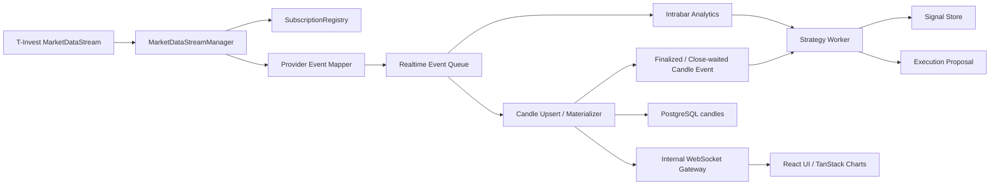
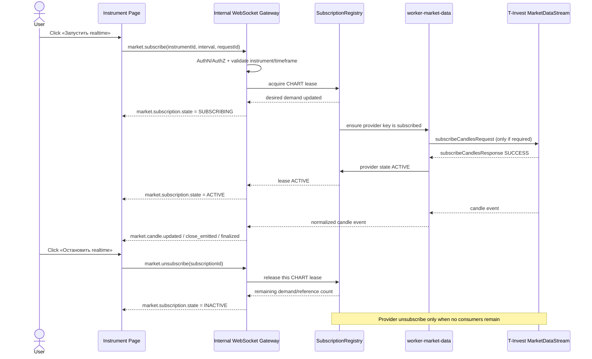

# T-Invest Realtime Candle Stream — Implementation Guide

**Проект:** MOEX Trading Platform  
**Версия документа:** 1.3  
**Дата сверки документации:** 10 ноября 2026 г.  
**Назначение:** техническая инструкция для Cursor / AI coding agent по подключению, управлению и эксплуатации realtime-подписок на свечи T-Invest API для аналитики, графиков и генерации торговых сигналов; включает пользовательское включение/выключение live-потока кнопкой на странице инструмента.

> Версия 1.3 уточняет контракт realtime `Candle` против исторического `HistoricCandle`: поле `is_complete` присутствует в историческом ответе `GetCandles`, но не документировано в stream-сообщении `Candle`. Поэтому realtime finality нельзя определять чтением несуществующего поля. Также зафиксированы лимиты 32 quote stream connections, 300 subscriptions per stream и 100 subscription requests/minute.
>
> Этот документ дополняет `MOEX Trading Platform — Technical Backlog v1.2`. Он не заменяет его и не меняет существующие ID задач. Основная реализация относится к EPIC E4: `BL-040`–`BL-045`, а проверка SDK и контрактов — к `BL-013`/`BL-014`.

---

## 0. Краткое архитектурное решение

### Важное уточнение: одна подписка на один выбранный инструмент

Пользовательский сценарий MVP — получать realtime-свечи **по одному конкретному инструменту (тикеру) на открытой странице инструмента**. Один запрос `market.subscribe` от страницы должен содержать ровно один внутренний `instrumentId` и один выбранный `interval`. Backend разрешает этот внутренний ID в конкретный `instrument_uid` T-Invest и отправляет provider subscribe для этой пары инструмент/интервал. Клиент не передаёт в брокерский API произвольный ticker или FIGI.

Это не означает отдельное T-Invest stream-соединение на каждый тикер. Нужно различать два лимита брокера:

- **до 32 активных stream-соединений сервиса котировок**;
- **до 300 одновременных подписок внутри одного quote stream**, суммарно по свечам, стаканам и обезличенным сделкам.

Дополнительно действует лимит до 100 запросов на подписку в минуту. Следовательно, 300 — это не число stream-соединений. Один realtime-график для одного инструмента и одного интервала занимает одну provider subscription в общем stream. При изменении timeframe клиент освобождает старый lease и создаёт новый для того же инструмента с новым интервалом. Несколько вкладок/пользователей с одинаковой парой `instrument_uid + interval` могут использовать один provider subscription через reference counting.

Официальные источники: [лимиты T-Invest API](https://developer.tbank.ru/invest/intro/intro/limits), [MarketDataStream](https://developer.tbank.ru/invest/services/quotes/marketdata).

Для получения realtime-свечей использовать **T-Invest `MarketDataStreamService.MarketDataStream` — bidirectional gRPC stream** через серверный `@ttech-pub/invest-sdk-node`.

Поток подключается и обслуживается только на backend в `apps/worker-market-data`. Браузер не подключается к брокерскому API напрямую и не получает T-Invest token. Пользователь инициирует и прекращает получение live-свечей кнопкой на странице инструмента; frontend отправляет команду во внутренний WebSocket платформы. Backend регистрирует временный demand типа `CHART`, а `SubscriptionRegistry` включает/выключает provider subscription с учётом всех остальных consumers. Frontend получает только нормализованные события от внутреннего WebSocket платформы.

Рекомендуемая цепочка:



**Не строить отдельное stream-соединение для каждого инструмента или каждого графика.** Для MVP страница подписывается только на один выбранный ticker + timeframe, но provider connection остаётся общим для backend worker. Подписки разных потребителей агрегируются менеджером соединения; один клиентский запрос не должен случайно подписывать страницу на весь watchlist.

### 0.1. Основное назначение свечного потока

Поток используется для:

1. обновления текущей свечи на графике;
2. оперативного расчёта индикаторов и аналитических признаков;
3. обнаружения условий внутри ещё формирующейся свечи — только если стратегия явно поддерживает intrabar mode;
4. фиксации закрытой свечи для расчётов, которые должны выполняться строго один раз на бар;
5. передачи нормализованных market events в Strategy Worker;
6. восстановления недостающих баров после потери соединения;
7. on-demand отображения realtime-свечей на странице инструмента после нажатия пользователем кнопки «Запустить realtime».

Свечной поток — это агрегированные OHLCV-данные, а не поток каждого тика. Для tick-level/scalping логики нужно отдельно рассматривать `subscribeTradesRequest`, `subscribeLastPriceRequest` и/или стакан.

---

### 0.1.1. Различие stream Candle и HistoricCandle

Не переносить поле `is_complete` из исторической модели `HistoricCandle` в realtime stream DTO. По актуальной схеме T-Invest:

- `MarketDataResponse.candle` содержит потоковый `Candle` с OHLCV, временем, идентификаторами инструмента и source;
- `GetCandlesResponse.candles[]` содержит `HistoricCandle`, у которого документирован `is_complete`.

Это разные сообщения API. Любой код, который читает `streamCandle.isComplete`, считается дефектом интеграции. В RT-01 добавить contract test на сериализованный реальный response и type-level test, фиксирующий фактическую форму установленной версии generated SDK.

## 1. Контракт T-Invest API

### 1.1. Метод и транспорт

Используемый метод:

```text
MarketDataStreamService/MarketDataStream
```

Тип: **bidirectional streaming**. Клиент отправляет сообщения управления подписками и получает сообщения с результатами подписки и рыночными событиями в том же stream-соединении.

Production REST/gRPC gateway, отображённый в документации:

```text
https://invest-public-api.tbank.ru/rest/tinkoff.public.invest.api.contract.v1.MarketDataStreamService/MarketDataStream
```

SDK должен самостоятельно корректно настроить transport, TLS, metadata и авторизацию. Не реализовывать transport вручную, если это не требуется для fallback.

Для Node.js использовать серверный пакет:

```bash
pnpm add @ttech-pub/invest-sdk-node @ttech-pub/invest-core @ttech-pub/grpc-node-client
```

Версии пакетов `@ttech-pub/*` нужно зафиксировать в `pnpm-lock.yaml`. Не смешивать произвольные версии SDK, core и grpc client. До реализации проверить совместимость peer dependencies и Node.js runtime по README выбранной версии.

### 1.2. Почему `MarketDataStream`, а не `MarketDataServerSideStream`

- `MarketDataStream` — основной bidirectional stream. Он подходит для серверного Node.js worker, который должен управлять подписками в течение жизни приложения.
- `MarketDataServerSideStream` — server-side stream, в первую очередь полезен для трансляции данных в браузерные клиенты через gRPC-Web, который не поддерживает bidirectional streaming в том же виде.
- В нашей архитектуре broker stream живёт на backend; frontend получает события через внутренний WebSocket API.

Не открывать broker stream из `apps/web`.

### 1.3. Авторизация

Используется Bearer T-Invest API token. Токен хранится только в backend secret storage / environment secrets.

Пример имён переменных:

```dotenv
TINVEST_ENV=production
TINVEST_API_TOKEN=***
TINVEST_API_URL=https://invest-public-api.tbank.ru
```

Требования:

- не хранить токен в БД в открытом виде;
- не передавать токен через frontend DTO, URL, query string или WebSocket;
- не логировать `Authorization`, metadata с секретами и полные SDK config objects;
- Sandbox и Production credentials/configuration должны быть раздельными;
- worker должен проверять environment при старте и не допускать неявного переключения endpoint.

### 1.4. Идентификатор инструмента

В каждом элементе `CandleInstrument` передавать `instrument_id`.

Поддерживаются варианты:

- `instrument_uid` — предпочтительный вариант для платформы;
- `figi` — deprecated, не использовать для новых интеграций;
- `ticker + '_' + class_code` — допустимый альтернативный идентификатор, например `SiZ6_SPBFUT`, только если он однозначно сопоставлен с внутренним инструментом.

В домене и БД использовать внутренний `instrument_id` UUID. В T-Invest adapter хранить mapping на `instrument_uid`, ticker и class_code. Не полагаться только на ticker: фьючерсные серии имеют разные даты экспирации и должны оставаться разными инструментами.

---

## 2. Поддерживаемые интервалы

Для `SubscriptionInterval` в документации перечислены следующие значения:

| Значение SDK/API                        | Интервал | Рекомендация применения                      |
| --------------------------------------- | -------: | -------------------------------------------- |
| `SUBSCRIPTION_INTERVAL_ONE_MINUTE`      |       1m | Основной быстрый feed для интрадей-аналитики |
| `SUBSCRIPTION_INTERVAL_2_MIN`           |       2m | Краткосрочные стратегии                      |
| `SUBSCRIPTION_INTERVAL_3_MIN`           |       3m | Краткосрочные стратегии                      |
| `SUBSCRIPTION_INTERVAL_FIVE_MINUTES`    |       5m | Основной intraday timeframe                  |
| `SUBSCRIPTION_INTERVAL_10_MIN`          |      10m | Intraday                                     |
| `SUBSCRIPTION_INTERVAL_FIFTEEN_MINUTES` |      15m | Intraday / swing context                     |
| `SUBSCRIPTION_INTERVAL_30_MIN`          |      30m | Старший intraday timeframe                   |
| `SUBSCRIPTION_INTERVAL_ONE_HOUR`        |       1h | Основной старший timeframe                   |
| `SUBSCRIPTION_INTERVAL_2_HOUR`          |       2h | Старший timeframe                            |
| `SUBSCRIPTION_INTERVAL_4_HOUR`          |       4h | Старший timeframe                            |
| `SUBSCRIPTION_INTERVAL_ONE_DAY`         |       1d | Daily context                                |
| `SUBSCRIPTION_INTERVAL_WEEK`            |       1w | Weekly context                               |
| `SUBSCRIPTION_INTERVAL_MONTH`           |       1M | Monthly context                              |

Не использовать `SUBSCRIPTION_INTERVAL_UNSPECIFIED`.

**Особенность 2h и 4h:** границы этих свечей в стриме отсчитываются от `00:00 UTC`. Это должно быть отражено в нормализации и UI. Не рассчитывать начало этих баров относительно локальной timezone сервера или браузера.

Рекомендуемый MVP набор для realtime:

- для инструментов, по которым нужны быстрые сигналы: `1m` и `5m`;
- `1h` — как старший контекст, только если стратегия его использует;
- `15m`, `30m`, `2h`, `4h`, `1d` подключать по явной конфигурации стратегии/пользовательской подписки, а не автоматически для каждого инструмента.

Историческую глубину загружать через `GetCandles` / исторический importer (BL-031), а не ожидать, что stream заполнит историю. Stream — это live continuation.

---

## 3. Подписка на свечи

### 3.1. Структура запроса

Для изменения статуса свечных подписок отправляется `subscribeCandlesRequest` со следующими полями:

| Поле                 | Назначение                                                             |
| -------------------- | ---------------------------------------------------------------------- |
| `subscriptionAction` | `SUBSCRIPTION_ACTION_SUBSCRIBE` либо `SUBSCRIPTION_ACTION_UNSUBSCRIBE` |
| `instruments`        | Список инструментов и интервалов                                       |
| `waitingClose`       | Ожидать закрытия временного интервала перед отправкой свечи            |
| `candleSourceType`   | Источник свечей                                                        |

Элемент `instruments` содержит:

```ts
{
  instrumentId: string;
  interval: SubscriptionInterval;
}
```

Не заполнять deprecated `figi`, если известен `instrumentId`.

### 3.2. Параметр `waitingClose`

`waitingClose` задаёт режим доставки свечей на уровне запроса подписки:

| Значение | Поведение по контракту                                                                                                                       | Применение                                                                                 |
| -------- | -------------------------------------------------------------------------------------------------------------------------------------------- | ------------------------------------------------------------------------------------------ |
| `false`  | Получать обновления свечи в realtime по мере её формирования; после окончания периода также может прийти закрывающая/корректирующая передача | Live-график, intrabar analytics                                                            |
| `true`   | Ожидать закрытия временного интервала перед отправкой свечи                                                                                  | Поток для close-based analytics, если отдельное ожидание закрытия нужно на стороне брокера |

**Критическое уточнение контракта:** в документации stream `Candle` не содержит `is_complete`. Это поле присутствует у `HistoricCandle`, который возвращает unary-метод `GetCandles`. Нельзя писать `if (streamCandle.isComplete)` или считать поле гарантированным в stream payload.

Рекомендации:

- для графика с изменяющейся текущей свечой использовать `waitingClose: false`;
- для отдельного потока, который должен выдавать свечи после закрытия интервала, использовать `waitingClose: true`;
- если один и тот же consumer должен видеть и intrabar updates, и close-only поток, это две разные subscription configurations. До использования обеих одновременно проверить на SDK contract spike, допускает ли API повторную подписку на одинаковые `instrument_uid + interval` с разными `waitingClose`; учитывать каждую как отдельную подписку в лимите;
- не считать `waitingClose: true` гарантией неизменности: документация предупреждает о поздних корректирующих свечах после окончания периода. Каждое сообщение нужно upsert-ить по времени начала интервала, а изменение уже сохранённой свечи учитывать как revision/correction;
- для `waitingClose: false` приложение само определяет lifecycle бара: `UPDATING`, затем `FINALIZED_BY_SCHEDULE` после границы интервала и grace period; пришедшее позднее обновление переводит бар в `CORRECTED` и запускает controlled re-evaluation.

Для автоматических сигналов по закрытию свечи предпочтительно либо использовать отдельную `waitingClose: true` подписку, либо включить серверный finalizer с календарём торгов, временем интервала и grace period. Выбор фиксируется в конфигурации consumer/strategy, а не выводится из несуществующего stream-поля.

### 3.3. Источник свечей `candleSourceType`

В API присутствует выбор источника свечей. Для стратегий на данных MOEX по умолчанию следует использовать **биржевые свечи** (`CANDLE_SOURCE_EXCHANGE`).

Не смешивать без явной политики:

- биржевые данные;
- дилерские данные, в том числе торговлю по выходным, если она доступна для инструмента.

В документации разных представлений контракта встречаются различающиеся имена для weekend source (`CANDLE_SOURCE_DEALER_WEEKEND` в некоторых protobuf/SDK описаниях и `CANDLE_SOURCE_INCLUDE_WEEKEND` в актуальном REST-представлении). Поэтому:

1. проверить фактический enum в установленной версии `@ttech-pub/grpc-node-client`;
2. использовать enum-константу из установленного пакета, а не magic number;
3. сохранить исходное `candle_source_type` в canonical event;
4. закрепить mapping отдельным contract test;
5. для MOEX-only data set использовать `CANDLE_SOURCE_EXCHANGE`.

`CANDLE_SOURCE_UNSPECIFIED` документируется как все источники. Для production стратегий не оставлять его неявным default, если критична чистота exchange-only dataset.

### 3.4. Ответ на запрос подписки

На команду подписки приходит `subscribeCandlesResponse`, содержащий:

- `trackingId` — ID запроса;
- `candlesSubscriptions[]` — статусы отдельных подписок.

Каждый `CandleSubscription` содержит, в частности:

- `subscriptionStatus`;
- `instrumentUid` / ticker / classCode;
- `interval`;
- `waitingClose`;
- `subscriptionId`;
- `streamId`;
- `subscriptionAction`;
- `candleSourceType`.

Подписка считается активной только при `SUBSCRIPTION_STATUS_SUCCESS`. Сам факт того, что `sdk.send()` не выбросил исключение, не означает, что все элементы успешно подписаны.

Обрабатывать статусы:

| Статус                           | Поведение приложения                                                                                 |
| -------------------------------- | ---------------------------------------------------------------------------------------------------- |
| `SUCCESS`                        | Сохранить подтверждённую активную подписку                                                           |
| `INSTRUMENT_NOT_FOUND`           | Пометить конкретный инструмент как rejected; проверить UID/class code                                |
| `SUBSCRIPTION_ACTION_IS_INVALID` | Ошибка клиента/контракта; не повторять автоматически                                                 |
| `INTERVAL_IS_INVALID`            | Исправить конфигурацию интервала                                                                     |
| `LIMIT_IS_EXCEEDED`              | Перераспределить подписки по stream connections с учётом лимитов; не создавать шторм переподключений |
| `INTERNAL_ERROR`                 | Ограниченный retry с backoff; записать correlation/tracking ID                                       |
| `TOO_MANY_REQUESTS`              | Применить rate limit и отложить повтор                                                               |
| `SUBSCRIPTION_NOT_FOUND`         | При unsubscribe проверить локальный registry и фактические subscriptions                             |
| `SOURCE_IS_INVALID`              | Проверить generated enum и mapping source                                                            |

Статусы должны маппиться в внутренний enum, не протаскивать SDK enum в domain layer.

---

## 4. Node.js / TypeScript SDK: подключение

### 4.1. Проверка SDK

Для проекта использовать `@ttech-pub/invest-sdk-node`, а не старый `@tinkoff/invest-js`.

В официальной линейке JS/TS SDK:

- `invest-sdk-node` — серверный SDK;
- `invest-core` — общая доменная основа, Decimal и ошибки;
- `grpc-node-client` — low-level Node gRPC-клиент и generated API types;
- stream-команды возвращают RxJS Observable.

В репозитории SDK есть отдельные Node и Web пакеты. Пример команды/Observable из Web SDK нельзя автоматически переносить в Node worker: проверить, что соответствующий command/export и поддержка двунаправленной отправки доступны именно в выбранной версии `invest-sdk-node`/`grpc-node-client`. Для Node runtime использовать только подтверждённый серверный клиент и generated types выбранного Node пакета.

### 4.2. Подключение и lifecycle bidirectional stream

`MarketDataStream` — bidirectional RPC: клиент отправляет запросы подписки/отписки в уже открытый stream и получает в том же stream подтверждения и market events. Для одного активного stream manager необходимы два независимых направления:

1. **request sink** — сериализованно отправляет `MarketDataRequest` (subscribe, unsubscribe, `GetMySubscriptions`, ping settings);
2. **response consumer** — постоянно читает `MarketDataResponse` и маршрутизирует `subscribeCandlesResponse`, `candle`, `ping` и прочие типы сообщений.

Не реализовывать каждое нажатие UI как новый RPC connection. Не создавать новый `MarketDataStream` для каждого ticker, пользователя или вкладки.

В проекте использовать серверный `@ttech-pub/invest-sdk-node` и/или `@ttech-pub/grpc-node-client`. **Точные имена exports, способ открытия bidi stream и сигнатуры методов нельзя считать установленными по имени пакета:** их нужно подтвердить на зафиксированной версии `pnpm-lock.yaml`. SDK contract spike обязателен до реализации production adapter.

Рекомендуемая внутренняя абстракция, не являющаяся буквальной сигнатурой T-Invest SDK:

```ts
interface TInvestMarketDataStream {
  connect(): Promise<void>;
  send(request: MarketDataRequest): Promise<void>;
  readonly responses: AsyncIterable<MarketDataResponse>;
  close(): Promise<void>;
}
```

Адаптер должен гарантировать:

- ровно один reader loop на stream;
- сериализованную отправку управляющих сообщений;
- bounded backpressure между response reader и обработчиками;
- завершение reader и request sink при shutdown;
- один reconnect coordinator на stream;
- корреляцию ответа подписки по `trackingId`, а активного provider state — по инструменту, интервалу, source и `waitingClose`.

Если high-level SDK предоставляет только Observable, проверить, как в этой версии отправлять **последующие** сообщения в уже открытый bidirectional stream. Если high-level command поддерживает лишь начальный request, использовать low-level generated gRPC client из `@ttech-pub/grpc-node-client`. Не открывать новую команду/соединение ради каждого subscribe/unsubscribe без проверки лимитов и поведения SDK.

Для smoke test отправить одну свечную подписку на один `instrument_uid` и один интервал, дождаться `subscribeCandlesResponse`, проверить `subscriptionStatus === SUCCESS`, получить `candle` events, отправить unsubscribe в том же stream и подтвердить соответствующий статус.

В коде не использовать устаревший `@tinkoff/invest-js`. Не фиксировать неизвестные SDK enum numeric values вручную.

### 4.3. Форма raw request

Логический контракт (имена полей в protobuf — `snake_case`, JS SDK обычно использует `camelCase`):

```json
{
  "subscribeCandlesRequest": {
    "subscriptionAction": "SUBSCRIPTION_ACTION_SUBSCRIBE",
    "instruments": [
      {
        "instrumentId": "INSTRUMENT_UID",
        "interval": "SUBSCRIPTION_INTERVAL_ONE_MINUTE"
      }
    ],
    "waitingClose": false,
    "candleSourceType": "CANDLE_SOURCE_EXCHANGE"
  }
}
```

Этот фрагмент документирует форму запроса. В production TypeScript использовать generated types/enums из согласованного SDK, а не вручную сериализовать JSON или подставлять числовые enum.

### 4.4. Обработка Observable

Требования к обработчику:

- подписаться один раз на жизненный цикл stream;
- не блокировать `next` callback операциями БД, вычислением индикаторов или сетевыми вызовами;
- помещать нормализованное событие в bounded queue;
- ограничить размер очереди и иметь метрику backlog;
- при переполнении очереди переводить feed в `DEGRADED`, поднимать alert и выполнять recovery/backfill; не терять события молча;
- корректно вызывать `unsubscribe()` при graceful shutdown;
- после `error` или `complete` проходить единый reconnect flow, не создавать параллельные дублирующие подписки.

---

## 5. Формат свечи и каноническая модель

### 5.1. Не смешивать потоковый `Candle` и исторический `HistoricCandle`

Официальная схема различает:

- `MarketDataResponse.candle` — сообщение потока `MarketDataStream`;
- `GetCandlesResponse.candles[]` — массив исторических `HistoricCandle`.

#### Поля потокового `Candle`

| Поле                           | Тип / значение         | Обработка                                                 |
| ------------------------------ | ---------------------- | --------------------------------------------------------- |
| `figi`                         | string, legacy ID      | Не использовать как основной ID                           |
| `instrument_uid`               | string                 | Mapping на внутренний instrument ID                       |
| `ticker`                       | string                 | Диагностика / отображение                                 |
| `class_code`                   | string                 | Обязательная metadata для неоднозначных тикеров и futures |
| `interval`                     | `SubscriptionInterval` | Mapping на internal interval                              |
| `open`, `high`, `low`, `close` | `Quotation`            | Decimal string / Decimal                                  |
| `volume`                       | `int64`                | Объём в лотах; безопасное bigint/string представление     |
| `time`                         | `Timestamp`            | Начало интервала в UTC                                    |
| `last_trade_ts`                | `Timestamp`            | Время последней сделки в свече, UTC                       |
| `volume_buy`                   | `int64`                | Объём покупок, если присутствует                          |
| `volume_sell`                  | `int64`                | Объём продаж, если присутствует                           |
| `candle_source_type`           | enum                   | Сохранить источник                                        |

В документированной схеме потокового `Candle` **нет `is_complete`**. Не добавлять его в raw provider DTO и не ожидать от SDK.

#### Поля исторического `HistoricCandle` из `GetCandles`

`HistoricCandle` содержит OHLC, `volume`, `time`, `candle_source_type`, `volume_buy`, `volume_sell` и `is_complete`. Это поле характеризует полноту исторической свечи, полученной unary-методом. Его допустимо сохранять как `historicalProviderIsComplete`, но нельзя путать с полем realtime stream event.

Для определения того, является ли текущая stream-свеча завершённой, использовать режим `waitingClose` и/или внутренний candle finalizer, описанный в разделе 6.

### 5.2. Quotation и финансовая точность

Не преобразовывать financial prices в JS `number` для хранения, сравнений и расчётов.

Нормализовать `Quotation` в decimal string/Decimal:

```ts
interface PriceValue {
  value: string; // decimal string, no binary float
  currency?: string;
  unit: 'instrument_price' | 'points';
}
```

Для фьючерсов T-Invest сообщает цены в пунктах. Денежная стоимость изменения цены рассчитывается с учётом спецификации контракта, в том числе `min_price_increment` и `min_price_increment_amount`. Не умножать futures candle price на lot size как для акций.

`volume` в Candle выражен в лотах. Если модулю нужен объём в контрактах, конвертировать через актуальную версионированную спецификацию инструмента и хранить исходный provider volume отдельно.

Для `int64` не предполагать, что значение всегда безопасно помещается в JS `number`. Использовать bigint/string-представление, совместимое с выбранным SDK.

### 5.3. Canonical candle

Предлагаемый внутренний контракт:

```ts
export type CandleInterval =
  | '1m'
  | '2m'
  | '3m'
  | '5m'
  | '10m'
  | '15m'
  | '30m'
  | '1h'
  | '2h'
  | '4h'
  | '1d'
  | '1w'
  | '1M';

export interface CanonicalCandle {
  instrumentId: string; // internal UUID
  provider: 't-invest';
  providerInstrumentId: string; // instrument_uid
  interval: CandleInterval;
  timeStart: string; // ISO UTC start of interval
  open: string;
  high: string;
  low: string;
  close: string;
  volumeLots: string;
  volumeBuyLots?: string;
  volumeSellLots?: string;
  lastTradeAt?: string; // ISO UTC
  deliveryMode: 'LIVE_UPDATES' | 'WAITING_CLOSE';
  barState: 'UPDATING' | 'CLOSE_EMITTED' | 'FINALIZED_BY_SCHEDULE' | 'CORRECTED' | 'UNKNOWN';
  historicalProviderIsComplete?: boolean; // only populated from GetCandles HistoricCandle
  candleSource: 'EXCHANGE' | 'WEEKEND_INCLUDED' | 'UNSPECIFIED';
  receivedAt: string; // ISO UTC, generated locally
  revision: number;
  eventHash: string;
}
```

Если проект уже имеет `Candle` в `packages/domain`, расширить существующую модель. Не создавать параллельный тип с несовместимым смыслом.

### 5.4. Ключ и upsert

Ключ логической свечи:

```text
(instrument_id, provider, interval, time_start, candle_source)
```

Если текущая таблица `candles` не содержит `candle_source`, добавить его в уникальный ключ миграцией. В противном случае биржевые и weekend-inclusive свечи могут перезаписывать друг друга.

Рекомендуемая семантика:

- каждое сообщение stream обновляет текущую версию свечи по ключу;
- `revision` увеличивается при фактическом изменении OHLCV/source/bar lifecycle;
- повтор идентичного payload не создаёт новую бизнес-версию;
- сохраняются `received_at`, `last_trade_ts`, `provider`, source, `delivery_mode` и derived `bar_state`;
- `historical_provider_is_complete` заполняется только из `HistoricCandle` ответа `GetCandles`; для stream `Candle` это поле остаётся `NULL`;
- позднее исправление завершённой свечи не игнорируется.

Для аудита исправлений допустимо иметь append-only `candle_revisions`/raw event log. Если отдельной таблицы пока нет, хранить текущую свечу и минимум metadata о последнем revision; не терять сам факт correction в observability/audit.

---

## 6. Незакрытые, закрытые и корректирующие свечи

### 6.1. Что сообщает stream

T-Invest документирует, что свечи в bidirectional stream собираются из ленты обезличенных сделок и передаются не чаще одного раза примерно за 100 мс на подписку, плюс сообщения при завершении периода. Из-за задержки поступления сделок после границы интервала возможны дополнительные корректирующие свечи.

Потоковое сообщение содержит OHLCV и временные поля, но в схеме stream `Candle` нет `is_complete`. Значит, backend должен трактовать stream payload как очередной snapshot/revision бара, а не как событие с достоверным provider boolean `complete`.

### 6.2. Режим `waitingClose: false` — live snapshots

Для графика:

1. принять stream Candle;
2. вычислить canonical key `(instrumentId, interval, timeStart, candleSource)`;
3. upsert тот же бар, не добавлять новую точку на каждый update;
4. поставить `barState=UPDATING`, пока бар находится внутри расчётного интервала;
5. по UTC time boundary, trading calendar и настраиваемому grace period перевести бар в `FINALIZED_BY_SCHEDULE`;
6. если поздний event изменил уже финализированный бар, увеличить revision, поставить `barState=CORRECTED` и выпустить correction event;
7. никогда не отбрасывать коррекции только потому, что бар ранее был помечен закрытым.

Локальный finalizer должен учитывать не только длительность timeframe, но и торговое расписание конкретного инструмента/секции, вечерние и дневные сессии, выходные и праздники. Для 2h/4h stream документация указывает отсчёт границ от 00:00 UTC. Не создавать нулевые свечи, если в интервале не было сделок.

### 6.3. Режим `waitingClose: true` — close-waited delivery

При этой конфигурации сервис ждёт закрытия временного интервала перед отправкой свечи. Полученное сообщение можно классифицировать как `CLOSE_EMITTED` на основании **конфигурации подписки**, а не поля `is_complete`.

Поздние корректировки всё равно возможны. Поэтому:

- upsert по тому же ключу свечи;
- идентичный payload дедуплицировать;
- изменённый payload сохранить как новую revision и выпустить `candle.corrected`;
- close-based strategy должна иметь idempotency key на инструмент, версию стратегии, timeframe и timeStart;
- correction должна запускать контролируемую переоценку/аудит, но не автоматически повторять уже исполненную заявку.

### 6.4. Внутренняя модель lifecycle

Вместо provider `is_complete` использовать:

```ts
type RealtimeBarState =
  | 'UPDATING' // snapshot свечи в рамках интервала
  | 'CLOSE_EMITTED' // событие получено из подписки waitingClose=true
  | 'FINALIZED_BY_SCHEDULE' // локальный finalizer определил закрытие интервала
  | 'CORRECTED' // изменён уже опубликованный бар
  | 'UNKNOWN'; // невозможно надёжно классифицировать

interface CandleStreamMetadata {
  deliveryMode: 'LIVE_UPDATES' | 'WAITING_CLOSE';
  barState: RealtimeBarState;
  revision: number;
  receivedAt: string;
  lastTradeAt?: string;
}
```

Исторический `HistoricCandle.is_complete` маппить отдельно в `historicalProviderIsComplete`. Не переименовывать derived finality в `providerIsComplete`.

### 6.5. События домена и стратегии

- `candle.updated` — новый snapshot текущего бара из `waitingClose=false`;
- `candle.close_emitted` — сообщение из `waitingClose=true`;
- `candle.finalized` — внутреннее событие от локального finalizer;
- `candle.corrected` — позднее изменение уже опубликованного бара.

`ON_CANDLE_CLOSE` реагирует на `candle.close_emitted` либо `candle.finalized` в соответствии с выбранной стратегией и feed policy. `INTRABAR` реагирует на `candle.updated`. Корректирующая свеча обрабатывается отдельным correction path и не должна безусловно инициировать повторную торговую операцию.

## 7. Subscription Registry и управление подписками

### 7.1. Зачем нужен registry

UI, Strategy Worker и другие consumers не должны напрямую вызывать T-Invest. Каждый consumer регистрирует собственное желание получать market data во внутреннем сервисе. `SubscriptionRegistry` объединяет желания в набор broker subscriptions.

Пример: два графика и три стратегии могут одновременно требовать одну и ту же комбинацию instrument+interval. На T-Invest должна существовать одна provider subscription, а события должны распределяться нескольким consumers.

### 7.2. Логическая модель подписки

```ts
interface CandleSubscriptionKey {
  provider: 't-invest';
  instrumentId: string;
  interval: CandleInterval;
  candleSource: 'EXCHANGE' | 'WEEKEND_INCLUDED';
  waitingClose: boolean;
}

interface CandleSubscriptionDemand {
  key: CandleSubscriptionKey;
  consumerType: 'CHART' | 'STRATEGY' | 'ALERT' | 'SYSTEM';
  consumerId: string; // для CHART — server-generated client lease, не произвольное значение от браузера
  priority: 'LOW' | 'NORMAL' | 'HIGH' | 'CRITICAL';
  createdAt: string;
  expiresAt?: string; // обязателен для временного CHART demand
}
```

Правила:

- один provider subscription на одну уникальную subscription key в одном stream;
- несколько consumers увеличивают reference count;
- unsubscribe от брокера выполняется, когда demand count становится 0;
- временные UI subscriptions создаются как leases с TTL/heartbeat; clean WebSocket close освобождает lease сразу, аварийное закрытие/потеря сети — после истечения TTL;
- браузер не передаёт `consumerId`, `userId`, provider subscription ID или T-Invest instrument UID как доверенные поля: gateway выводит владельца из авторизованной сессии и проверяет внутренний `instrumentId`;
- UI lease существует только пока пользователь явно включил realtime для инструмента; загрузка обычной страницы инструмента сама по себе не должна занимать provider subscription;
- стратегические subscriptions не должны исчезать при disconnect frontend;
- durable demand (`STRATEGY`, `ALERT`, `SYSTEM`) сохраняется в PostgreSQL или восстанавливается из durable configuration после рестарта;
- ephemeral `CHART` leases хранятся в TTL-capable shared store (например, Redis) либо в таблице с обязательной проверкой `expiresAt`; нельзя восстанавливать просроченные browser leases как постоянные подписки;
- runtime state (stream ID, provider subscription ID, current status) обновляется после подтверждений брокера.

### 7.3. Subscription states

```text
REQUESTED
  -> SUBSCRIBING
  -> ACTIVE
  -> UNSUBSCRIBING
  -> INACTIVE

SUBSCRIBING -> REJECTED
ACTIVE -> DEGRADED
ACTIVE -> LOST (stream disconnected)
LOST -> SUBSCRIBING (after reconnect)
```

Broker state и desired state должны быть раздельными:

- desired state — что нужно приложению;
- actual provider state — что подтверждено брокером;
- health state — можем ли мы полагаться на feed сейчас.

Не считать subscription active только по записи в БД.

### 7.4. Batching и динамические изменения

- для текущего UI-сценария одного инструмента отправлять один subscribe request с одним инструментом и выбранным интервалом;
- batching нескольких инструментов/интервалов использовать только для системного восстановления большого desired set или при появлении других consumers;
- использовать один request на один тип подписки: свечи отдельно от orderbook/trades;
- ограничивать отправку subscribe/unsubscribe requests общим rate limiter;
- не отправлять по одному request на каждый инструмент при старте;
- изменения registry агрегировать коротким debounce window (например, 100–300 ms), кроме явно срочных системных подписок;
- до отправки проверять суммарную ёмкость stream.

---

## 8. Лимиты и стратегия подключения

Согласно актуальной странице лимитов T-Invest API на дату сверки:

| Ограничение                                               |                                      Значение | Реакция платформы                                                                                       |
| --------------------------------------------------------- | --------------------------------------------: | ------------------------------------------------------------------------------------------------------- |
| Активные Market Data stream connections сервиса котировок |                                            32 | Это лимит соединений, а не инструментов; держать небольшое число общих соединений                       |
| Одновременные subscriptions на одном quote stream         | 300 суммарно для candles + orderbook + trades | Один ticker + один interval = одна provider candle subscription; вести capacity accounting до subscribe |
| Subscription requests                                     |                                  100 в минуту | Batch, debounce, token bucket/rate limiter                                                              |
| Частота доставки candle updates                           |              100 ms интервал на одну подписку | Не ожидать тиковую частоту от candle stream                                                             |
| Ping delay                                                |          5 000–180 000 ms, default 120 000 ms | Использовать ping как контроль stream, не как подтверждение рыночной свежести                           |

Подписка Info на торговые статусы не входит в лимит 300 subscriptions, но не следует считать её безлимитной по всем другим ограничениям.

**Архитектурное решение для MVP:** один общий `MarketDataStreamManager` на credential/environment и одно или минимально необходимое число соединений `MarketDataStream`. Не создавать соединение на каждый ticker, вкладку или пользователя. При росте числа provider subscriptions использовать дополнительные stream shards только при необходимости и в рамках лимита 32 активных quote connections. Не шардировать преждевременно.

Capacity key должен учитывать все три категории:

```text
active_candles + active_orderbooks + active_trades <= 300 per stream
```

Если API вернул `LIMIT_IS_EXCEEDED`, менеджер должен:

1. пометить неуспешные subscriptions;
2. определить, можно ли перенести подписки на другой shard;
3. если места нет — вернуть понятную ошибку caller/consumer;
4. не запускать бесконечный reconnect/retry.

При `TOO_MANY_REQUESTS` — backoff и уменьшение частоты команд. Не повторять запрос немедленно.

---

## 9. Reconnect, subscription recovery и backfill

### 9.1. Stream connection state machine

Использовать состояние из backlog BL-040:

```text
DISCONNECTED
  -> CONNECTING
  -> CONNECTED
  -> DEGRADED
  -> RECONNECTING
  -> CONNECTED
```

Любое завершение Observable или transport error запускает один reconnect coordinator. Одновременно может выполняться не более одного reconnect на stream shard.

### 9.2. Reconnect policy

Рекомендуемый алгоритм:

- exponential backoff с full jitter;
- стартовая задержка, например 1 s;
- верхняя граница, например 30 s;
- reset backoff только после устойчивого соединения;
- разделять permanent errors (invalid token, unsupported method) и transient errors (network, 5xx, 429);
- `401/403` не ретраить бесконечно — поднять credential incident;
- при 429 уважать rate limit и делать более длинный backoff.

Конкретные параметры должны быть конфигурируемыми и покрыты тестами.

### 9.3. Восстановление подписок

После reconnect:

1. установить stream;
2. получить `getMySubscriptions`, если этот вызов поддержан используемой версией клиента и применим к новому соединению;
3. восстановить полный desired set из SubscriptionRegistry;
4. сгруппировать и отправить subscribe requests;
5. проверить `subscriptionStatus` каждого элемента;
6. установить `ACTIVE` только после success response;
7. запустить historical backfill от последнего подтверждённого watermark;
8. снять DEGRADED только после восстановления data freshness и обработки backlog.

`getMySubscriptions` нужен для контроля фактических подписок; он не заменяет свой durable registry.

### 9.4. Backfill после потери соединения

MarketDataStream не должен считаться replayable event log. После потери соединения нельзя предполагать, что все пропущенные события придут автоматически.

Для каждой пары instrument+interval хранить:

- `last_received_at`;
- `last_candle_time_start`;
- `last_complete_candle_time_start`;
- `last_complete_revision`;
- provider/source.

При reconnect:

1. найти последнюю complete candle;
2. запросить `GetCandles` на небольшой overlapping range от предыдущего бара до текущего времени;
3. использовать тот же candle source/interval;
4. выполнить upsert по canonical key;
5. проверить gaps в пределах торговых сессий;
6. только затем разрешить close-based strategy processing для восстановленного диапазона;
7. не считать отсутствие сделок автоматически нулевой свечой.

Для overlapping range сигнал dedupe должен исключать повторную генерацию уже обработанного сигнала.

Backfill должен учитывать, что API может вернуть историческую/уточнённую версию бара, отличающуюся от realtime event. Сверка делается по provider/source/time/interval, а различия сохраняются как correction/reconciliation outcome.

---

## 10. Market data quality и stale state

Отсутствие нового candle event не обязательно означает outage: инструмент может не торговаться, быть в клиринге, находиться вне торговой сессии или не иметь сделок в интервале.

Для оценки freshness учитывать:

- trading schedule инструмента/секции;
- торговый статус;
- время последней сделки в candle (`last_trade_ts`);
- время получения (`received_at`);
- ожидаемый interval;
- состояние stream connection;
- последнюю активность по другим подпискам на том же stream.

Состояния feed:

```ts
type FeedHealth = 'HEALTHY' | 'STALE' | 'DEGRADED' | 'DISCONNECTED' | 'UNKNOWN' | 'OUT_OF_SESSION';
```

Не помечать feed stale только из-за отсутствия свечи в период отсутствия торгов/сделок. Порог stale — конфигурация по instrument class, interval и trading session, а не один глобальный timeout.

Перед генерацией actionable signal Strategy Worker обязан проверить feed health. Для `STALE`, `DISCONNECTED`, `UNKNOWN` actionable signal либо блокируется, либо получает статус `NON_ACTIONABLE`; выбор должен быть явным policy.

---

## 11. Persistence: минимальные изменения PostgreSQL

В backlog v1.2 таблица `candles` уже определена. Не создавать вторую таблицу только для stream. Расширить существующую модель и при необходимости добавить таблицы subscription registry и stream status.

### 11.1. Рекомендуемые поля `candles`

Проверить наличие следующих полей и добавить недостающие миграцией:

```sql
-- Illustrative migration fragment; adapt names/types to existing schema.
ALTER TABLE candles
  ADD COLUMN IF NOT EXISTS candle_source TEXT NOT NULL DEFAULT 'UNSPECIFIED',
  ADD COLUMN IF NOT EXISTS historical_provider_is_complete BOOLEAN NULL,
  ADD COLUMN IF NOT EXISTS delivery_mode TEXT NULL,
  ADD COLUMN IF NOT EXISTS bar_state TEXT NOT NULL DEFAULT 'UNKNOWN',
  ADD COLUMN IF NOT EXISTS last_trade_at TIMESTAMPTZ,
  ADD COLUMN IF NOT EXISTS received_at TIMESTAMPTZ,
  ADD COLUMN IF NOT EXISTS revision INTEGER NOT NULL DEFAULT 1,
  ADD COLUMN IF NOT EXISTS event_hash TEXT;

-- Before applying uniqueness, inspect and reconcile existing duplicates.
-- Final logical uniqueness should include source:
-- (instrument_id, provider, interval, time_start, candle_source)
```

OHLC поля должны быть `NUMERIC`, volume — `BIGINT` (либо совместимое безопасное представление), event timestamps — `TIMESTAMPTZ`.

Не применять этот fragment вслепую: текущая схема backlog является blueprint, фактическую Drizzle schema нужно проверить до миграции.

### 11.2. Таблица `market_data_subscriptions`

Логическая структура:

```sql
CREATE TABLE market_data_subscriptions (
  id UUID PRIMARY KEY DEFAULT gen_random_uuid(),
  provider TEXT NOT NULL,
  instrument_id UUID NOT NULL REFERENCES instruments(id),
  data_type TEXT NOT NULL CHECK (data_type IN ('CANDLE','ORDERBOOK','TRADES','LAST_PRICE','INFO')),
  interval TEXT,
  candle_source TEXT,
  waiting_close BOOLEAN,
  desired_state TEXT NOT NULL,
  provider_state TEXT NOT NULL,
  health_state TEXT NOT NULL,
  provider_subscription_id TEXT,
  provider_stream_id TEXT,
  last_event_at TIMESTAMPTZ,
  last_error_code TEXT,
  last_error_message TEXT,
  metadata JSONB NOT NULL DEFAULT '{}'::jsonb,
  created_at TIMESTAMPTZ NOT NULL DEFAULT now(),
  updated_at TIMESTAMPTZ NOT NULL DEFAULT now()
);
```

Реализация может нормализовать consumers в отдельную таблицу `market_data_subscription_consumers` с FK на subscription ID. Это предпочтительно для reference counting.

### 11.3. Таблица stream health

Можно хранить heartbeat/connection state в Prometheus и runtime memory, но последний operational status должен быть доступен UI. Допускается отдельная таблица `market_data_stream_instances`:

- provider/environment/credential alias;
- stream shard ID;
- state;
- connected_at/disconnected_at;
- last_message_at/last_ping_at;
- active candle/book/trade subscription counts;
- reconnect_count;
- last_error;
- updated_at.

Не сохранять token в этой таблице.

---

## 12. Внутренние события и API

### 12.1. Внутренние events

Минимальный набор:

```text
market.candle.updated
market.candle.close_emitted
market.candle.finalized
market.candle.corrected
market.feed.health_changed
market.subscription.state_changed
market.stream.state_changed
```

Пример event envelope:

```ts
interface MarketEventEnvelope<T> {
  eventId: string;
  eventType: string;
  schemaVersion: 1;
  provider: 't-invest';
  environment: 'production' | 'sandbox';
  instrumentId: string;
  occurredAt: string; // provider candle/event time when applicable
  receivedAt: string; // local receive time
  correlationId: string;
  payload: T;
}
```

События должны быть versioned. Не включать provider SDK objects в публичный API.

### 12.2. REST API для управления demand

Предлагаемые backend endpoints (уточнить существующие route conventions):

```text
POST   /api/market-data/subscriptions
GET    /api/market-data/subscriptions
GET    /api/market-data/subscriptions/:id
DELETE /api/market-data/subscriptions/:id
GET    /api/market-data/health
```

`POST` принимает внутренний `instrumentId`, interval, dataType, consumerType/consumerId, source и режим close/intrabar. Endpoint не вызывает T-Invest синхронно: он регистрирует demand/command, а `worker-market-data` управляет provider subscription.

В production пользователь не должен иметь возможность подписаться на любой инструмент без server-side authorization, instrument validation и capacity check.

### 12.3. WebSocket API для графиков

Внутренний WebSocket gateway публикует только данные по подписанным пользователем инструментам и timeframe. Broker token и raw provider stream в браузер не передаются. Один авторизованный WebSocket connection должен multiplex-ить несколько пользовательских подписок, если это требуется интерфейсу; не открывать отдельный browser socket на каждый инструмент.

Frontend должен различать:

- `candle.updated` — новый snapshot текущего бара (`waitingClose=false`);
- `candle.close_emitted` — сообщение из подписки `waitingClose=true`;
- `candle.finalized` — внутренний event от серверного finalizer;
- `candle.corrected` — ранее полученный бар пересмотрен;
- `feed.health` — fresh/stale/disconnected/etc.

TanStack Charts получает уже нормализованную историю и realtime updates. Не соединять chart library напрямую с T-Invest SDK.

### 12.4. Пользовательская подписка по кнопке на странице инструмента

**Это обязательный пользовательский сценарий MVP.** На странице информации об инструменте пользователь сам включает live-обновления нажатием кнопки. При обычном открытии страницы загружается исторический график, но realtime demand не создаётся автоматически.

#### UX-сценарий

1. Пользователь открывает `/instruments/:instrumentId`.
2. Frontend получает карточку инструмента и исторические свечи через обычный REST endpoint. График отображается в историческом режиме.
3. Пользователь выбирает timeframe графика (например, `1m` или `5m`).
4. Нажимает **«Запустить realtime»**.
5. Frontend отправляет внутреннюю команду `market.subscribe` через авторизованный WebSocket платформы.
6. Backend валидирует пользователя, инструмент, timeframe, доступность market data и лимиты; регистрирует временный demand `CHART`.
7. `SubscriptionRegistry` увеличивает reference count существующей provider subscription или создаёт новую. `worker-market-data` отправляет T-Invest subscribe только если для соответствующего provider key ещё нет активной/запрашиваемой подписки.
8. До подтверждения T-Invest UI показывает `SUBSCRIBING`. После успешного provider acknowledgement backend отправляет `ACTIVE`; затем идут события свечей.
9. При нажатии **«Остановить realtime»** frontend отправляет `market.unsubscribe`. Backend освобождает только lease этого клиента. Provider unsubscribe отправляется лишь если reference count стал равен нулю и нет demand от стратегий/алертов/других клиентов.
10. При уходе со страницы компонент освобождает lease. При аварийном закрытии вкладки lease очищается по TTL.

#### Точная семантика «один тикер»

- На странице инструмента активен один `CHART` lease: один `instrumentId` + один `interval`.
- Если пользователь меняет timeframe, frontend отправляет `market.unsubscribe` для прежнего `subscriptionId`; после подтверждения `INACTIVE` отправляет новый `market.subscribe` с тем же `instrumentId` и новым `interval`. Допускается оптимизированная серверная команда `market.switchInterval`, но она должна быть атомарной по отношению к lease и provider state.
- Если пользователь переходит на другой инструмент, старый lease освобождается, новый создаётся для нового `instrumentId`. События предыдущего инструмента отбрасываются по `subscriptionId` и `instrumentId`.
- В provider key обязательно включать как минимум environment, credential/account scope, `instrument_uid`, candle interval и `waiting_close`/режим обработки, если он влияет на фактическую подписку.
- В T-Invest запрос передавать один элемент `instruments[]`. Если в одном запросе API можно передать несколько инструментов, это не является требованием для данного UI-сценария.
- Внутренний ticker не использовать как единственный идентификатор: backend должен разрешить его через каталог инструментов в точный `instrument_uid`; если тикер неоднозначен, требовать class code/market при создании или выборе инструмента.
- Для одной пары `instrument_uid + interval` существующая provider subscription переиспользуется. UI вкладки и стратегии — consumers одного provider feed, а не отдельные broker connections.



#### Протокол клиентских команд

Команды передаются по уже авторизованному внутреннему WebSocket `/ws/market-data`. Имена сообщений — внутренний контракт платформы, не названия protobuf сообщений T-Invest.

Запрос на включение (строго один инструмент на команду):

```ts
interface ClientMarketSubscribe {
  type: 'market.subscribe';
  requestId: string; // UUID для correlation/idempotency
  instrumentId: string; // один внутренний UUID инструмента, не массив тикеров
  interval: CandleInterval; // один интервал, например '1m' | '5m' | '1h'
  candleSource?: 'EXCHANGE'; // MVP: только биржевой источник
}
```

Успешный ответ о регистрации demand (не означает, что T-Invest уже подтвердил подписку):

```ts
interface ClientMarketSubscriptionState {
  type: 'market.subscription.state';
  requestId: string;
  subscriptionId: string; // server-generated lease ID
  instrumentId: string;
  interval: CandleInterval;
  status: 'PENDING' | 'SUBSCRIBING' | 'ACTIVE' | 'DEGRADED' | 'REJECTED' | 'INACTIVE';
  reason?:
    | 'PROVIDER_LIMIT'
    | 'PROVIDER_REJECTED'
    | 'INVALID_INSTRUMENT'
    | 'UNAUTHORIZED'
    | 'UNSUPPORTED_INTERVAL'
    | 'RATE_LIMITED'
    | 'INTERNAL_ERROR';
  message?: string;
  updatedAt: string;
}
```

Запрос на выключение:

```ts
interface ClientMarketUnsubscribe {
  type: 'market.unsubscribe';
  requestId: string;
  subscriptionId: string;
}
```

Ответ на unsubscribe использует `market.subscription.state` со статусом `INACTIVE`. Команда должна быть идемпотентной: повторный unsubscribe уже освобождённого lease возвращает `INACTIVE`, а не ошибку, которая ломает UI.

Рыночные события отправляются только после проверки, что WebSocket connection владеет активным lease:

```ts
interface ClientCandleEvent<T> {
  type:
    | 'market.candle.updated'
    | 'market.candle.close_emitted'
    | 'market.candle.finalized'
    | 'market.candle.corrected';
  subscriptionId: string;
  instrumentId: string;
  interval: CandleInterval;
  eventId: string;
  occurredAt: string;
  receivedAt: string;
  payload: T; // CanonicalCandle; не raw SDK object
}
```

`feed.health` отправляется отдельным событием и связывается с `subscriptionId`/instrument. События должны содержать `eventId` для дедупликации на клиенте. Backend обязан отбрасывать/не отправлять сообщения по уже закрытому lease.

#### Правила backend gateway

- `userId`, tenant/workspace, `connectionId` и `consumerId` всегда извлекаются сервером из auth context; клиент не может подставить чужой идентификатор.
- `subscriptionId` генерируется сервером и принадлежит только тому пользователю/сессии, которая создала lease.
- `requestId` используется для idempotency в рамках пользователя и короткого окна; повтор команды не создаёт второй lease.
- Перед `acquire` проверить существование `instrumentId`, наличие provider mapping (`instrument_uid`), разрешённый интервал, источник свечей и лимиты пользователя/соединения/провайдера.
- Если provider subscription уже `ACTIVE`, новый UI lease получает `ACTIVE` без повторной команды T-Invest.
- Если provider subscription в `SUBSCRIBING`, новый lease присоединяется к той же операции и получает статус после provider acknowledgement.
- При provider rejection отправить `REJECTED` с нормализованной причиной и освободить demand, чтобы не удерживать capacity.
- Для UI-demand использовать короткоживущие leases; clean socket close удаляет их немедленно. При сетевом обрыве использовать настраиваемый TTL, например 60 секунд, и heartbeat/connection liveness. Это конфигурационное значение приложения, а не лимит T-Invest.
- Reconnect браузера создаёт новый WebSocket connection. Frontend повторно отправляет `market.subscribe` для всё ещё включённых на странице пользовательских intent; старые leases очищаются close handler/TTL.
- Стратегические `STRATEGY` demand независимы от UI и не освобождаются при уходе пользователя со страницы.
- Если UI отключил realtime, но стратегия продолжает использовать тот же instrument+interval, Registry не отправляет provider unsubscribe.
- При достижении provider capacity команда отклоняется управляемо; не переключать UI в `ACTIVE` до фактического provider acknowledgement.

#### Frontend state machine и кнопка

Состояние кнопки не должно вычисляться только по локальному boolean `isLive`. Использовать подтверждённое серверное состояние подписки.

| State                     | Текст/вид кнопки                       | Поведение                                                          |
| ------------------------- | -------------------------------------- | ------------------------------------------------------------------ |
| `INACTIVE`                | «Запустить realtime»                   | Доступна команда subscribe                                         |
| `PENDING` / `SUBSCRIBING` | «Подключение…»                         | Кнопка disabled; spinner; повторный click не создаёт новый request |
| `ACTIVE`                  | «Остановить realtime» + индикатор LIVE | Получать candle events и обновлять график                          |
| `DEGRADED`                | «Переподключение…» / warning           | Показывать stale/degraded статус и время последнего события        |
| `REJECTED`                | «Повторить» либо «Запустить realtime»  | Показать понятное сообщение причины; не скрывать ошибку            |
| `UNSUBSCRIBING`           | «Остановка…»                           | Не отправлять повторные команды                                    |
| `INACTIVE` после stop     | «Запустить realtime»                   | Сохранить график и историю; прекратить только live updates         |

Обязательные UI элементы:

- кнопка запуска/остановки live-подписки в контексте выбранного инструмента;
- отображение выбранного timeframe, на который создаётся demand;
- визуальный индикатор `LIVE`, `CONNECTING`, `STALE`, `DISCONNECTED`;
- время последнего полученного market event (`receivedAt`), а не только timestamp свечи;
- понятные ошибки: недоступен инструмент, нет provider mapping, лимит подписок, provider rejection, потеря соединения;
- при смене timeframe активный lease старого timeframe освобождается, новый lease создаётся; во время переключения UI показывает transition state и не смешивает интервалы;
- при смене инструмента lease предыдущего инструмента освобождается;
- при unmount/закрытии страницы выполняется best-effort unsubscribe; TTL — страховка от аварийного закрытия, а не основной механизм.

Frontend hook/component contract (подстроить под существующие conventions проекта):

```ts
interface UseLiveCandleSubscriptionArgs {
  instrumentId: string;
  interval: CandleInterval;
  enabledByUser: boolean;
}

interface UseLiveCandleSubscriptionResult {
  status:
    | 'INACTIVE'
    | 'PENDING'
    | 'SUBSCRIBING'
    | 'ACTIVE'
    | 'DEGRADED'
    | 'REJECTED'
    | 'UNSUBSCRIBING';
  lastReceivedAt: string | null;
  error: { code: string; message: string } | null;
  start: () => void;
  stop: () => void;
}
```

Реализовать через существующий frontend WebSocket client/store, не создавать отдельный WebSocket на каждый React component. Hook должен:

- отправлять subscribe только после явного действия пользователя (или `enabledByUser=true`, выставленного кнопкой);
- сохранять текущий пользовательский intent при кратковременном reconnect и повторять subscribe после восстановления socket;
- игнорировать события с чужим/устаревшим `subscriptionId` и дубли по `eventId`;
- очищать handlers и отправлять unsubscribe в cleanup;
- не сбрасывать исторические данные графика при stop/disconnect;
- не считать `SUBSCRIBING` состоянием успешной подписки;
- не допускать гонку старого ответа subscribe после смены instrument/timeframe (сверять `requestId` и subscription context).

TanStack Charts должен получать начальный исторический dataset и live deltas как отдельные потоки изменений. Для текущей свечи выполнять upsert по `(instrumentId, interval, candleTime, source)`; не добавлять каждое обновление как новую свечу. Событие `candle.close_emitted` или `candle.finalized` переводит бар в закрытое состояние по выбранной политике; `candle.corrected` обновляет соответствующий исторический bar.

#### Client data flow

```text
Instrument Page Mount
  -> GET instrument details + historical candles
  -> render historical chart; button = INACTIVE

User clicks Start Realtime
  -> internal WebSocket market.subscribe
  -> Gateway authorization + validation
  -> Registry.acquire(CHART lease)
  -> shared provider subscription (reuse or create)
  -> provider acknowledgement
  -> market.subscription.state = ACTIVE
  -> stream canonical candle events to this client
  -> TanStack Charts upsert current bar

User clicks Stop / navigates away
  -> internal WebSocket market.unsubscribe / cleanup
  -> Registry.release(CHART lease)
  -> provider unsubscribe only if no other demand remains
  -> historical chart remains visible
```

### 12.5. REST API и WebSocket — назначение по типу demand

- Внутренний WebSocket control protocol из раздела 12.4 использовать для эфемерной пользовательской chart subscription: она привязана к активной UI-сессии и должна автоматически исчезать после disconnect/TTL.
- REST endpoints из раздела 12.2 оставить для durable/system demand, диагностики, административного просмотра и управления теми подписками, у которых жизненный цикл не привязан к открытому browser socket.
- Не создавать одновременно REST demand и WebSocket lease для одного нажатия кнопки: это приведёт к двойному reference count.
- Для админки можно показывать объединённый registry view, но ephemeral UI leases должны быть помечены как `CHART` и иметь владельца/connection metadata без раскрытия чувствительных auth данных.

---

## 13. Передача свечей в аналитику и генерацию сигналов

### 13.1. Разделение вычислений

`worker-market-data` отвечает за transport, normalization, persistence, freshness и публикацию событий.

`worker-strategy` отвечает за индикаторы, признаки, условия стратегий и signals.

Не исполнять стратегию непосредственно в обработчике gRPC Observable. Это создаст coupling и риск блокировки при всплеске сообщений.

### 13.2. Pipeline для close-based strategy

```text
Provider Candle
  -> Normalize
  -> Upsert candle
  -> Apply waitingClose / server-side candle finalizer
  -> Publish market.candle.close_emitted or market.candle.finalized
  -> Strategy Worker
  -> Load required lookback window
  -> Update indicators
  -> Evaluate strategy version
  -> Persist signal (dedupe)
  -> Risk / freshness validation
  -> Trade proposal (not order)
```

### 13.3. Pipeline для intrabar strategy

```text
Provider Candle (waitingClose=false snapshot)
  -> Normalize
  -> Upsert current candle state
  -> Publish market.candle.updated
  -> Incremental indicator update (if supported)
  -> Evaluate INTRABAR rules
  -> Persist/update provisional signal
  -> UI notification
```

Для intrabar режима пересчитывать индикаторы инкрементально только при доказанной корректности. Иначе пересчитать ограниченное окно баров; но не перечитывать всю историю на каждое обновление.

### 13.4. Требования к детерминизму

Для воспроизводимости сохранить:

- strategy code/config hash;
- indicator version/config;
- canonical candle revision/hash;
- event receive time;
- feed health;
- provider/environment/source;
- evaluation mode;
- данные lookback, необходимые для объяснения решения.

Backtest и realtime strategy engine должны использовать одни и те же domain indicator implementations. Разница должна быть только в event source/scheduler, а не в математике индикатора.

---

## 14. Futures-specific rules

Поскольку платформа ориентирована в том числе на товарные и индексные фьючерсы, проверить stream на реальных фьючерсных UID, а не только на акциях.

Обязательные проверки:

1. товарный фьючерс, например природный газ или нефть;
2. индексный фьючерс, например фьючерс на индекс MOEX;
3. активный контракт;
4. истёкший контракт — только если API и статус инструмента позволяют получить его stream; иначе это явно фиксируется как unsupported, а история берётся через GetCandles/archive;
5. `1m`, `5m`, `1h`;
6. источник exchange-only;
7. корректный `instrument_uid`, ticker и class code;
8. цена в пунктах, объём в лотах;
9. проверка перехода торговой сессии и отсутствия сделок.

Нельзя автоматически использовать synthetic continuous futures как provider `instrument_id`: подписка осуществляется на конкретный реальный контракт. Continuous futures строится внутренним marketdata layer поверх отдельных contract series и не является исполнимым инструментом.

---

## 15. Observability и operational metrics

Минимальные метрики:

| Метрика                                           | Назначение                                   |
| ------------------------------------------------- | -------------------------------------------- |
| `marketdata_stream_connected`                     | Состояние stream shard                       |
| `marketdata_stream_reconnect_total`               | Количество reconnect                         |
| `marketdata_stream_last_message_age_seconds`      | Возраст последнего сообщения                 |
| `marketdata_stream_events_total{type}`            | Число входящих событий                       |
| `marketdata_candle_updates_total{interval}`       | Число обновлений свечей                      |
| `marketdata_candle_close_emitted_total{interval}` | Свечи из `waitingClose=true`                 |
| `marketdata_candle_finalized_total{interval}`     | Свечи, финализированные локальным scheduler  |
| `marketdata_candle_corrections_total`             | Число коррекций закрытых баров               |
| `marketdata_subscription_active{type}`            | Количество активных provider subscriptions   |
| `marketdata_subscription_rejected_total{reason}`  | Ошибки подтверждения подписок                |
| `marketdata_queue_depth`                          | Backlog очереди                              |
| `marketdata_persist_latency_seconds`              | Задержка сохранения                          |
| `marketdata_strategy_event_lag_seconds`           | Задержка между candle и обработкой стратегии |
| `marketdata_backfill_total{status}`               | Результат gap recovery                       |

Логи по каждому event писать не обязательно. Предпочтительны counters, histograms, sampled debug logs и structured error logs.

В логах должны быть instrument ID, interval, stream shard, subscription ID, tracking ID, correlation ID, error code. Не должно быть API token.

---

## 16. Ошибки и recovery matrix

| Сценарий                          | Реакция                                                                  |
| --------------------------------- | ------------------------------------------------------------------------ |
| Invalid token / `UNAUTHENTICATED` | Остановить retry loop; credential alert                                  |
| Permission denied                 | Отметить credential/scope problem; не повторять бесконечно               |
| Instrument not found              | Отклонить конкретную подписку; проверить mapping/UID                     |
| Invalid interval                  | Исправить конфигурацию, contract test                                    |
| Limit exceeded                    | Capacity rebalance / shard policy                                        |
| Too many requests                 | Rate limiter + backoff                                                   |
| Network timeout / stream complete | Reconnect coordinator + restore desired subscriptions + backfill         |
| DB unavailable                    | Bounded queue; перейти DEGRADED; не сообщать strategy healthy            |
| Queue full                        | Alert + recovery; запрещено silently drop                                |
| Duplicate candle event            | Idempotent upsert, no duplicate signal                                   |
| Late candle correction            | Increment revision, correction event, no duplicate order                 |
| No trades in interval             | Не генерировать искусственную свечу; оценить trading session/data health |
| Market closed / clearing          | OUT_OF_SESSION по schedule/status; не считать автоматически outage       |

---

## 17. Пошаговый план реализации для Cursor / AI Agent

Реализовывать вертикальными срезами. Не просить агента «сразу сделать весь realtime pipeline».

### RT-01 — SDK contract spike

**Связано с:** BL-013, BL-014.  
**Результат:** `docs/API_CONTRACTS.md` и небольшой executable script.

Задачи:

1. Зафиксировать версии `@ttech-pub/invest-sdk-node`, `@ttech-pub/invest-core`, `@ttech-pub/grpc-node-client`.
2. Проверить Node runtime/peer dependencies.
3. Создать Node SDK client с token из env.
4. Подписаться на свечи одного equity и одного futures UID.
5. Проверить `1m`, `5m`, `1h`.
6. Получить `subscribeCandlesResponse`, проверить `SUCCESS`.
7. Получить несколько stream `Candle` events, проверить поля OHLCV, `time`, `lastTradeTs`, source и UTC timestamps; подтвердить, что stream DTO не требует `isComplete`. Отдельно проверить `HistoricCandle.isComplete` через `GetCandles`.
8. Проверить exchange candle source enum.
9. Проверить unsubscribe.
10. Проверить, как SDK реализует дополнительные client messages в уже открытом bidi stream. Если high-level API не позволяет отправлять следующие messages, проверить low-level grpc client.
11. Проверить graceful shutdown и reconnect.

**Acceptance:** скрипт стабильно подписывается/отписывается, версия/enum/shape/реальное поведение задокументированы, credentials не попали в logs/repo.

### RT-02 — StreamConnectionManager

**Связано с:** BL-040.

Задачи:

1. Реализовать один manager per credential/environment.
2. Реализовать lifecycle state machine.
3. Добавить reconnect backoff + jitter.
4. Добавить ping/last message monitoring.
5. Добавить graceful shutdown.
6. Запретить несколько параллельных соединений для одного manager instance.

**Acceptance:** unit и integration tests на disconnect, network error, duplicate reconnect, token failure и clean shutdown.

### RT-03 — SubscriptionRegistry

**Связано с:** BL-041.

Задачи:

1. Добавить desired subscriptions и consumer references.
2. Deduplicate одинаковые instrument+interval+source+waitingClose.
3. Реализовать batch subscribe/unsubscribe.
4. Ввести capacity accounting 300/stream и request rate limiter 100/min.
5. Сохранять provider ack/status/subscription ID.
6. Восстанавливать desired set после рестарта.
7. Проверить динамическое управление подписками в рамках одного bidi stream.

**Acceptance:** несколько consumers используют одну broker subscription; после reconnect все desired subscriptions восстановлены; превышение лимита приводит к контролируемому rejection/sharding.

### RT-04 — Candle Mapper & Persistence

**Связано с:** BL-030, BL-042.

Задачи:

1. Map provider Candle → CanonicalCandle.
2. Сохранять source/provider timestamps/receive time и derived bar lifecycle metadata; не ожидать stream `is_complete`.
3. Нормализовать Decimal без JS `number`.
4. Хранить volume в безопасном int64 формате и документировать unit `lots`.
5. Upsert по logical key с источником в ключе.
6. Обрабатывать revision/correction.
7. Добавить fixtures из реальных sanitized provider responses.

**Acceptance:** повторный event не дублирует свечу; correction обновляет revision; futures сохраняют points/lots semantics; timezone tests проходят.

### RT-05 — Closed vs intrabar event processing

**Связано с:** BL-042, BL-052/BL-053 соответствующего E5.

Задачи:

1. Публиковать `candle.updated`, `candle.close_emitted`, `candle.finalized`, `candle.corrected`.
2. Реализовать `ON_CANDLE_CLOSE` и `INTRABAR`.
3. Добавить strategy signal dedupe.
4. Не допускать повторного trade proposal по duplicate/replayed candle.
5. Сохранять source candle revision/hash в signal.

**Acceptance:** одна закрытая свеча даёт максимум одну initial evaluation на версию стратегии; intrabar updates не создают дубли сигналов; correction обрабатывается отдельно.

### RT-06 — Reconnect & Gap Backfill

**Связано с:** BL-045.

Задачи:

1. Сохранять watermarks по instrument+interval.
2. При reconnect вызывать GetCandles overlapping range.
3. Восстанавливать пропущенные события через canonical upsert.
4. Проверять gaps по trading calendar/status.
5. Запускать strategy reprocessing в определённом порядке.

**Acceptance:** намеренный разрыв сети не приводит к пропуску закрытых свечей в БД и к двойным signals.

### RT-07 — Feed Health

**Связано с:** BL-043.

Задачи:

1. Связать stream health, session schedule, last trade timestamp и last receive timestamp.
2. Реализовать HEALTHY/STALE/DEGRADED/DISCONNECTED/UNKNOWN/OUT_OF_SESSION.
3. Запретить actionable signal на неизвестном/stale feed.
4. Экспортировать metrics.

**Acceptance:** отсутствие сделок вне торговой активности не маркируется как авария; реальная потеря stream обнаруживается; Strategy Worker получает health state.

### RT-08 — UI fan-out

**Связано с:** BL-044.

Задачи:

1. API WebSocket публикует internal events.
2. Клиент подписывается по instrument/timeframe с authorization.
3. Reconnect frontend восстанавливает свои subscriptions без создания broker subscriptions на каждый browser tab.
4. TanStack Charts получает обновления текущей свечи и закрытые бары.
5. Показывать `receivedAt`, provider, source и feed health.

**Acceptance:** два browser clients получают один shared feed; закрытие одного клиента не снимает subscription, используемую стратегией или вторым клиентом.

### RT-09 — Client-triggered live candle subscription on Instrument Page

**Связано с:** BL-041, BL-044, BL-045; зависит от RT-03, RT-04, RT-08.
**Приоритет:** P1 для графического realtime MVP.
**Результат:** пользователь включает/выключает live свечи кнопкой на странице инструмента; backend переиспользует shared T-Invest subscription и отправляет события только клиенту с активным lease.

Задачи:

1. Реализовать внутренний WebSocket control messages `market.subscribe` и `market.unsubscribe` с correlation `requestId`.
2. Создавать server-owned ephemeral lease `consumerType=CHART`; не принимать `userId`/`consumerId` из payload.
3. Добавить user/session ownership check для `subscriptionId` и проверку доступа к инструменту/timeframe.
4. Связать lease с SubscriptionRegistry reference counting; не дублировать provider subscription при наличии стратегии/другого клиента.
5. Реализовать lease cleanup при clean disconnect и TTL cleanup при аварийном disconnect.
6. Реализовать frontend hook/store и кнопку на Instrument Details page со state machine из раздела 12.4.
7. Реализовать resubscribe по user intent после WebSocket reconnect, с защитой от stale ack и duplicate events.
8. Добавить TanStack Charts adapter: historical initial dataset + live candle upsert/correction.
9. Добавить обработку смены инструмента/timeframe и cleanup при unmount.
10. Не отправлять T-Invest unsubscribe, пока остаются другие потребители provider key.

**Acceptance:**

- Страница инструмента по умолчанию показывает историю, не создавая realtime demand.
- Один `market.subscribe` от страницы содержит ровно один `instrumentId` и один timeframe; произвольные списки тикеров из UI не принимаются.
- Для одного ticker + timeframe backend создаёт/переиспользует ровно одну provider candle subscription; новый T-Invest connection на каждое нажатие/тикер не открывается.
- Только явное нажатие пользователем запускает `CHART` lease.
- UI отображает `SUBSCRIBING` до успешного provider acknowledgement и `ACTIVE` после него.
- Активная кнопка позволяет остановить live обновления без очистки исторического графика.
- Два пользователя/две вкладки могут получать один provider feed; остановка одного lease не влияет на остальные.
- Если активна стратегия на том же инструменте и интервале, stop UI не прекращает стратегическую подписку.
- При закрытии вкладки lease освобождается clean close либо автоматически истекает по TTL.
- После frontend WebSocket reconnect пользовательский intent восстанавливается без дубля provider subscription.
- Изменение timeframe/instrument не смешивает события старой и новой подписки.
- Клиент не может подписаться от имени другого пользователя или отправить arbitrary provider identifiers.
- Browser bundle/network payloads не содержат T-Invest credentials или raw SDK messages.

---

## 18. Обязательные тест-кейсы

### Unit tests

- map каждого `SubscriptionInterval` в internal interval;
- map enum `SubscriptionStatus`;
- map CandleSource enum;
- Quotation → Decimal;
- Timestamp → UTC ISO;
- volume int64 → safe string/bigint;
- dedupe key;
- candle upsert;
- revision при изменении payload;
- `waitingClose=false` stream update → candle.updated;
- `waitingClose=true` stream event → candle.close_emitted;
- local calendar/grace finalizer → candle.finalized;
- late correction → candle.corrected;
- 2h/4h UTC boundary;
- futures point/lot metadata.

### Integration tests с мокированным stream

- successful subscribe ack;
- один инструмент rejected, остальные success;
- 429 / TOO_MANY_REQUESTS;
- limit exceeded;
- duplicate candle;
- provisional → complete;
- complete → corrected;
- disconnect → reconnect → restore subscriptions;
- reconnect → historical backfill;
- shutdown закрывает Observable/stream;
- два consumer demand используют одну provider subscription;
- браузер не имеет доступа к provider token.

### Frontend / WebSocket client-subscription tests

- initial Instrument Page load fetches history but creates no `CHART` demand;
- click Start sends exactly one `market.subscribe` command;
- repeated click while `SUBSCRIBING` does not create duplicate lease;
- `PENDING`/`SUBSCRIBING` is not rendered as `LIVE`;
- provider SUCCESS transitions UI to `ACTIVE`;
- provider rejection transitions UI to `REJECTED` and renders normalized error;
- click Stop sends one unsubscribe and retains chart history;
- repeated unsubscribe is idempotent;
- lease cleanup happens on component unmount/navigation;
- clean socket close releases all connection-owned UI leases;
- abrupt disconnect releases lease after configured TTL;
- reconnect resubscribes only current user intents;
- stale acknowledgement from previous instrument/timeframe is ignored;
- duplicate `eventId` does not cause duplicate chart points;
- repeated updates to same candle time upsert the same bar;
- timeframe switch releases old lease and only renders new interval events;
- two clients sharing provider key increment/decrement reference count correctly;
- stop UI lease does not unsubscribe provider while a strategy demand remains;
- unauthorized `subscriptionId` cannot be used to receive events or unsubscribe another user's lease;
- capacity rejection displays useful UI error and does not leave an orphan lease.

### Sandbox / real market smoke tests

Sandbox trade environment не следует считать генератором синтетических котировок. Рыночные данные должны тестироваться по доступному market-data endpoint и реальным инструментам с учётом режима/разрешений токена.

Для первых smoke tests использовать небольшой whitelist инструментов, например одну ликвидную акцию и один активный фьючерс. Не подписывать сотни инструментов до подтверждения лимитов и корректного backpressure.

---

## 19. Definition of Done

Интеграция свечного stream считается готовой для realtime analytics, когда выполнены все условия:

- [ ] Используется `MarketDataStream` на backend.
- [ ] T-Invest SDK и все `@ttech-pub/*` версии зафиксированы.
- [ ] Реальный `instrument_uid` используется вместо deprecated FIGI.
- [ ] Subscribe/unsubscribe подтверждаются отдельными статустами на каждый инструмент.
- [ ] Реализованы все используемые интервалы и mapping.
- [ ] `waitingClose` корректно управляет режимом доставки; realtime stream `Candle` не предполагает наличия `is_complete`; закрытие для live snapshots определяется локальным finalizer.
- [ ] Candle source явно задан и хранится.
- [ ] Цены и объёмы нормализуются без потери точности.
- [ ] Futures price unit/volume lots обработаны корректно.
- [ ] Есть shared stream manager и SubscriptionRegistry.
- [ ] Соблюдаются лимиты 32 connections, 300 subscriptions per stream, 100 subscribe requests/min.
- [ ] Есть reconnect, restore subscriptions и gap backfill.
- [ ] Дубликаты и corrections не создают повторных заявок.
- [ ] Feed health влияет на actionable signals.
- [ ] UI получает события только через внутренний WebSocket API.
- [ ] На Instrument Details page есть явная кнопка Start/Stop realtime; initial page load не создаёт CHART demand.
- [ ] UI подписывается ровно на один выбранный инструмент и один timeframe; backend разрешает ticker в instrument_uid и не создаёт отдельный provider connection на тикер.
- [ ] Клиентский `market.subscribe` создаёт server-owned ephemeral lease с authorization, idempotency и TTL cleanup.
- [ ] Provider subscription shared/ref-counted между CHART и STRATEGY consumers; stop одного клиента не отключает остальных.
- [ ] Frontend корректно восстанавливает текущий пользовательский intent после WebSocket reconnect.
- [ ] TanStack Charts upsert-ит текущую свечу и обрабатывает updated/close_emitted/finalized/corrected events без дублирования.
- [ ] В логах и браузере нет broker token.
- [ ] Unit/integration/E2E tests и operational metrics реализованы.
- [ ] Реальные smoke tests выполнены на акции, commodity future и index future.

До выполнения DoD разрешить графическое отображение feed в development, но не использовать его как единственный источник для автоматической LIVE-торговли.

---

## 20. Рекомендованные значения по умолчанию для MVP

| Параметр               | Значение                                                                                                            |
| ---------------------- | ------------------------------------------------------------------------------------------------------------------- |
| Provider               | `t-invest`                                                                                                          |
| Runtime                | Node.js worker                                                                                                      |
| SDK                    | `@ttech-pub/invest-sdk-node`                                                                                        |
| Stream                 | `MarketDataStream` bidirectional                                                                                    |
| ID                     | `instrument_uid`                                                                                                    |
| Candle source          | `CANDLE_SOURCE_EXCHANGE`                                                                                            |
| Fast interval          | `1m`                                                                                                                |
| Main intraday interval | `5m`                                                                                                                |
| Context interval       | `1h` (только по demand)                                                                                             |
| `waitingClose`         | `false` для live chart feed; Strategy Worker использует `waitingClose=true` либо серверный calendar/grace finalizer |
| Storage                | PostgreSQL `candles` upsert                                                                                         |
| Event distribution     | внутренняя очередь / outbox, затем Strategy Worker + WS gateway                                                     |
| Browser access         | только internal API/WebSocket; subscribe on explicit button click                                                   |
| UI demand              | ephemeral `CHART` lease; clean-close + configurable TTL cleanup                                                     |
| Client transport       | один multiplexed internal WebSocket connection per app session (не per chart)                                       |
| Reconnect              | exponential backoff + jitter                                                                                        |
| Recovery               | resubscribe + `GetCandles` overlap backfill                                                                         |
| Signal default         | `ON_CANDLE_CLOSE`                                                                                                   |
| Intrabar trading       | выключен по умолчанию                                                                                               |

Значения выше — стартовая конфигурация проекта, а не универсальные ограничения API. Интервалы/инструменты включаются только при наличии потребителя и свободной subscription capacity.

---

## 21. Инструкция для Cursor / AI Agent

Использовать следующий prompt при реализации RT-01, затем RT-02 и далее по одному этапу.

```text
Ты работаешь в проекте MOEX Trading Platform. Перед реализацией прочитай:
- docs/TECHNICAL_BACKLOG.md;
- docs/API_CONTRACTS.md;
- docs/realtime/TINVEST_REALTIME_CANDLE_STREAM.md;
- релевантные ADR и существующие domain/provider contracts.

Цель текущей задачи: реализовать только указанный RT-этап. Для пользовательского realtime на странице инструмента ориентируйся на RT-09 и разделы 7.2, 12.4–12.5.

Обязательные правила:
1. Не придумывай сигнатуры T-Invest SDK. Проверь установленные версии
   @ttech-pub/invest-sdk-node, @ttech-pub/invest-core и
   @ttech-pub/grpc-node-client, их exports/types и примеры.
2. Используй instrument_uid; FIGI deprecated.
3. Не подключай T-Invest SDK из frontend; браузер может отправлять только внутренние `market.subscribe`/`market.unsubscribe` команды через авторизованный WebSocket.
4. Не смешивай Sandbox и Production endpoint/credentials.
5. Не используй JS number для финансовых значений.
6. Не ожидай `is_complete` в stream Candle: это поле относится к историческому HistoricCandle из GetCandles. Используй waitingClose или серверный finalizer по trading calendar + grace period; принимай поздние corrections.
7. Не генерируй искусственные нулевые свечи при отсутствии сделок.
8. Все subscribe acknowledgements проверяй по каждому инструменту.
9. Соблюдай лимиты stream connections/subscriptions/subscribe requests.
10. Не допускай повторных сигналов или заявок от duplicate/replayed events.
11. Для UI chart demand используй server-owned ephemeral lease и reference counting; не создавай provider unsubscribe, если остаются другие consumers.
12. Не делай рефакторинг несвязанных модулей.

Порядок работы:
- исследуй текущую структуру и существующие контракты;
- перечисли конкретные файлы, которые изменишь;
- реализуй задачу;
- добавь unit/integration tests;
- выполни typecheck, lint, tests и build соответствующих workspace packages;
- обнови docs/API_CONTRACTS.md реальными sanitized API shapes и версиями;
- обнови docs/STATUS.md и backlog status, не меняя ID задач;
- в итоговом отчёте укажи фактически выполненное, команды проверок,
  ограничения и невыполненные критерии.

Не помечай задачу DONE, если acceptance criteria не прошли.
```

---

## Change log

### v1.3 — 10 ноября 2026 г.

- Уточнён лимит: 32 активных quote stream connections, 300 одновременных подписок на одном stream суммарно по candles/orderbook/trades, 100 запросов подписки в минуту.
- Зафиксирован пользовательский scope: одна UI-команда `market.subscribe` содержит один внутренний `instrumentId` и один timeframe; backend разрешает его в `instrument_uid`.
- Исправлена модель данных: потоковый `Candle` и исторический `HistoricCandle` — разные сообщения. `is_complete` относится к `HistoricCandle` в ответе `GetCandles`, а не к realtime stream payload.
- Переписаны realtime lifecycle, domain events, DB metadata, strategy pipeline и тесты без предположения о stream `is_complete`.
- `waitingClose=false` используется для изменяющихся intrabar snapshots; `waitingClose=true` — для доставки после завершения интервала. Поздние corrections принимаются в обоих режимах.
- SDK snippet заменён на контрактную абстракцию: конкретные exports и bidi request-sink API должны быть проверены на зафиксированной версии `@ttech-pub/*`; нельзя придумывать сигнатуры SDK.

## 22. Официальные источники

Все контракты нужно повторно сверить с установленной версией SDK перед merge: названия protobuf enums и публичные exports могут отличаться между REST/OpenAPI представлением и generated Node package.

1. [T-Invest — gRPC методы MarketDataService и MarketDataStreamService; schemas `Candle` vs `HistoricCandle`](https://developer.tbank.ru/invest/services/quotes/marketdata)
2. [T-Invest — описание сервиса котировок, `waiting_close`, corrections и контроль активных подписок](https://developer.tbank.ru/invest/services/quotes/head-marketdata)
3. [MarketDataStream — bidirectional stream API](https://developer.tbank.ru/invest/api/market-data-stream-service-market-data-stream)
4. [MarketDataServerSideStream — server-side stream API](https://developer.tbank.ru/invest/api/market-data-stream-service-market-data-server-side-stream)
5. [Лимиты T-Invest API — 32 active quote stream connections, 300 subscriptions per stream, 100 subscribe requests/min](https://developer.tbank.ru/invest/intro/intro/limits)
6. [FAQ по котировкам: цены, пункты, лоты и исторические свечи](https://developer.tbank.ru/invest/services/quotes/faq_marketdata)
7. [JS/TS SDK FAQ](https://developer.tbank.ru/invest/sdk/faq_js)
8. [Репозиторий invest-js](https://opensource.tbank.ru/invest/invest-js)
9. [@ttech-pub/invest-sdk-node](https://www.npmjs.com/package/@ttech-pub/invest-sdk-node)
10. [@ttech-pub/invest-sdk-web — публичный пример stream command и RxJS Observable API](https://www.npmjs.com/package/@ttech-pub/invest-sdk-web)
11. [@ttech-pub/grpc-node-client](https://www.npmjs.com/package/@ttech-pub/grpc-node-client)

---

## 23. Итоговое решение

Realtime-свечи T-Invest должны стать частью общего market-data pipeline, а не отдельной функции графика.

**Одна provider subscription должна обслуживать несколько потребителей:** chart, indicators, strategies и alerts. В UI-сценарии один открытый экран инструмента подписывается на один выбранный `instrument_uid` и один timeframe; пользователь включает chart consumer кнопкой на странице инструмента, что создаёт ephemeral `CHART` lease через внутренний WebSocket. Stream manager отвечает за подключение и лимиты, SubscriptionRegistry — за desired/actual subscriptions и reference counting, Candle Mapper — за canonical data, а Strategy Worker — за аналитику и signals. Остановка realtime в UI освобождает только пользовательский lease; broker unsubscribe выполняется лишь при отсутствии других consumers.

Для close-based стратегий использовать отдельную подписку с `waitingClose=true` либо серверный finalizer на feed `waitingClose=false`. Не читать `is_complete` из stream Candle: оно предусмотрено для исторического HistoricCandle в `GetCandles`. Intrabar-сигналы считать предварительными. После разрыва связи восстанавливать subscriptions и заполнять пропуски через `GetCandles`; не полагаться на stream как на гарантированный replay.

Это обеспечивает воспроизводимую аналитику, предотвращает дубли сигналов и оставляет возможность использовать один поток данных одновременно для графиков, технических индикаторов, сигналов и последующей автоматической торговли.
