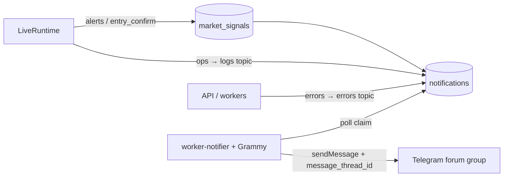

# Telegram Grammy + Live notifications (design) / Telegram Grammy + Live-уведомления (дизайн)

**RU.** Дата: 2026-11-16  
**EN.** Date: 2026-11-16

**RU.** Статус: approved  
**EN.** Status: approved

## Problem / Проблема

**RU.** Live Mode уже пишет `signal.telegram` в outbox-stub, но реального Bot API нет. Токен/чат не настроены. Параллельно на ветках BL-106…109 есть цепочка `market_signals` + `notifications` + `worker-notifier` (через raw `fetch`). Нужна единая durable-доставка в Telegram **forum group с topics**, с Grammy, и подключением Live.

**EN.** Live Mode already enqueues a `signal.telegram` outbox stub, but there is no real Bot API delivery. Token/chat are unset. Branches BL-106…109 already have `market_signals` + `notifications` + `worker-notifier` (raw `fetch`). We need one durable delivery path into a Telegram **forum group with topics**, using Grammy, with Live wired in.

## Goals / Цели

**RU.**

- Cherry-pick полный стек BL-106 → BL-109 на ветку от Live tip.
- Заменить HTTP-клиент notifier на **Grammy** (send-only, без long polling).
- Доставка в один forum chat: topics **alerts** (сигналы), **logs** (ops), **errors** (ошибки платформы, не только Live).
- Live level alerts + TSE `entry_confirm` → atomic `market_signals` + `notifications`.
- Env: `TELEGRAM_BOT_TOKEN`, `TELEGRAM_CHAT_ID`, `TELEGRAM_TOPIC_ALERTS`, `TELEGRAM_TOPIC_LOGS`, `TELEGRAM_TOPIC_ERRORS`.
- Никогда не логировать bot token; credentials не в payload.

**EN.**

- Cherry-pick the full BL-106 → BL-109 stack onto a branch from Live tip.
- Replace the notifier HTTP client with **Grammy** (send-only, no long polling).
- Deliver into one forum chat: **alerts** (signals), **logs** (ops), **errors** (platform errors, not Live-only).
- Live level alerts + TSE `entry_confirm` → atomic `market_signals` + `notifications`.
- Env: `TELEGRAM_BOT_TOKEN`, `TELEGRAM_CHAT_ID`, `TELEGRAM_TOPIC_ALERTS`, `TELEGRAM_TOPIC_LOGS`, `TELEGRAM_TOPIC_ERRORS`.
- Never log the bot token; no credentials in payloads.

## Non-goals / Вне scope

**RU.**

- Inbound bot commands / updates webhook.
- Email и прочие каналы BL-105.
- Admin UI для настройки topic id.
- Multi-chat routing.
- Менять fib/VP math или TSE setup set (`FAILED_BREAKOUT` / `RANGE_REVERSAL`).

**EN.**

- Inbound bot commands / update webhooks.
- Email and other BL-105 channels.
- Admin UI for topic id configuration.
- Multi-chat routing.
- Changing fib/VP math or expanding TSE setups (`FAILED_BREAKOUT` / `RANGE_REVERSAL`).

## Decisions locked / Зафиксированные решения

| Topic / Тема          | Choice / Выбор                                                            |
| --------------------- | ------------------------------------------------------------------------- |
| Delivery architecture | Notifications queue + `worker-notifier` (not in-process Live HTTP)        |
| Library               | Grammy (`pnpm add` explicitly approved)                                   |
| Scope bring-up        | Cherry-pick full BL-106…109, then wire Live                               |
| Branch                | `cursor/bl-109-grammy-live-notify` from `cursor/independent-live-runtime` |
| Forum topics          | Alerts + Logs + Errors topics                                             |
| ADR clash             | Keep Live `ADR-011`; renumber market-triggers ADR to **012** if needed    |

## Architecture / Архитектура

**RU.** Процессы не вызывают Telegram напрямую. Ставят строки в очередь; worker доставляет с retry. Topic **errors** — общий для платформы (API, Live, workers), не только Live.

**EN.** Processes do not call Telegram directly. They enqueue rows; the worker delivers with retries. The **errors** topic is platform-wide (API, Live, workers), not Live-only.

## Data model changes / Изменения модели

**RU.** Поверх BL-107 migration `004_market_signals_notifications.sql`:

1. Расширить `market_signals.kind`: добавить `consolidation`, `entry_confirm` (рядом с `approach`, `cross`).
2. `notifications.thread_id INTEGER NULL` — Telegram `message_thread_id`.
3. `notifications.signal_id` сделать **NULLABLE** для log-only строк (нет market signal).
4. `target` = `TELEGRAM_CHAT_ID`; topic выбирается через `thread_id`.

**EN.** On top of BL-107 migration `004_market_signals_notifications.sql`:

1. Widen `market_signals.kind`: add `consolidation`, `entry_confirm` (alongside `approach`, `cross`).
2. `notifications.thread_id INTEGER NULL` — Telegram `message_thread_id`.
3. Make `notifications.signal_id` **NULLABLE** for log-only rows (no market signal).
4. `target` = `TELEGRAM_CHAT_ID`; topic selected via `thread_id`.

### Live → signal mapping / Маппинг Live → signal

| Live event            | `kind`                    | `eval_mode` | Topic  |
| --------------------- | ------------------------- | ----------- | ------ |
| APPROACH              | `approach`                | `intrabar`  | alerts |
| CROSS                 | `cross`                   | `intrabar`  | alerts |
| LEVEL_CONSOLIDATION   | `consolidation`           | `intrabar`  | alerts |
| entry_confirm         | `entry_confirm`           | `close`     | alerts |
| Live/notifier ops log | *(no market_signals row)* | —           | logs   |
| Platform error log    | *(no market_signals row)* | —           | errors |

**RU.** `trigger_id` для Live: `live.level_alert` / `live.entry_confirm`. Dedupe key включает instrument, level/signal id, kind, time bucket — вместе с Live engine dedup.

**EN.** Live `trigger_id`s: `live.level_alert` / `live.entry_confirm`. Dedupe key includes instrument, level/signal id, kind, time bucket — alongside Live engine dedup.

**RU.** Разделение topics: **logs** = штатные ops-события (start/stop/degraded); **errors** = сбои и исключения (stream failure, unhandled route error, worker crash summary). Без firehose каждого `logger.warn`.

**EN.** Topic split: **logs** = routine ops (start/stop/degraded); **errors** = failures/exceptions (stream failure, unhandled route error, worker crash summary). No firehose of every `logger.warn`.

## Components / Компоненты

### 1. Cherry-pick BL-106…109 / Черри-пик BL-106…109

**RU.** Коммиты по порядку: `b4ac0f9` → `649f4bc` → `3e9d4c5` → `4d24d57`. Разрешить конфликты с Live tip. ADR market-triggers → **012**.

**EN.** Commits in order: `b4ac0f9` → `649f4bc` → `3e9d4c5` → `4d24d57`. Resolve conflicts against Live tip. Market-triggers ADR → **012**.

### 2. Grammy Telegram client / Клиент Grammy

**RU.** В `apps/worker-notifier`: зависимость `grammy`. Обёртка сохраняет `sendMessage({ chatId, text, threadId? })`. Ошибки: 429 → retryAfter; 5xx/network → retry; прочие 4xx → dead. Без `bot.start()`.

**EN.** In `apps/worker-notifier`: add `grammy`. Wrapper keeps `sendMessage({ chatId, text, threadId? })`. Errors: 429 → retryAfter; 5xx/network → retry; other 4xx → dead. No `bot.start()`.

### 3. Live TelegramNotifier / Live TelegramNotifier

**RU.** Заменить stub delivery path: при наличии `TELEGRAM_CHAT_ID` + topic ids — atomic insert в queue; outbox `signal.telegram` остаётся **audit-only** (`delivery: 'notifications_queue'`). Без env — только local log, Live не падает.

**EN.** Replace stub delivery path: when `TELEGRAM_CHAT_ID` + topic ids are set — atomic queue insert; outbox `signal.telegram` stays **audit-only** (`delivery: 'notifications_queue'`). Without env — local log only; Live does not fail.

### 4. Logs + Errors topic publishers / Публикаторы logs/errors

**RU.** Общий helper (API-compose, доступен Live и другим сервисам): enqueue notification без `signal_id`, HTML-escaped text, `thread_id` = `TELEGRAM_TOPIC_LOGS` или `TELEGRAM_TOPIC_ERRORS`.

- **logs:** Live start/stop/degraded, штатные lifecycle события.
- **errors:** ошибки платформы (Live stream/lease failures, API fatal handlers, worker failure summaries) — не только Live.

**EN.** Shared helper (API compose, usable by Live and other services): enqueue notification with no `signal_id`, HTML-escaped text, `thread_id` = `TELEGRAM_TOPIC_LOGS` or `TELEGRAM_TOPIC_ERRORS`.

- **logs:** Live start/stop/degraded and routine lifecycle events.
- **errors:** platform failures (Live stream/lease failures, API fatal handlers, worker failure summaries) — not Live-only.

## Config / Конфиг

| Variable                | Purpose                            |
| ----------------------- | ---------------------------------- |
| `TELEGRAM_BOT_TOKEN`    | Bot API token (secret)             |
| `TELEGRAM_CHAT_ID`      | Forum group chat id                |
| `TELEGRAM_TOPIC_ALERTS` | Thread id for signals              |
| `TELEGRAM_TOPIC_LOGS`   | Thread id for ops logs             |
| `TELEGRAM_TOPIC_ERRORS` | Thread id for platform error logs  |
| `NOTIFIER_POLL_MS`      | Worker poll interval (from BL-109) |

**RU.** Пустые значения = доставка выключена. Worker без token не стартует (fail fast). API без token работает, очередь не шлёт.

**EN.** Empty values = delivery disabled. Worker without token does not start (fail fast). API without token still runs; nothing is sent.

## Error handling / Ошибки

**RU.**

- Worker: existing claim/markSent/markFailed loop; Grammy errors mapped as above.
- Duplicate `dedupe_key` → insert skipped, no second notification.
- Missing topic id for a path → skip that enqueue + warn log (do not throw across Live candle path).

**EN.**

- Worker: existing claim/markSent/markFailed loop; Grammy errors mapped as above.
- Duplicate `dedupe_key` → insert skipped, no second notification.
- Missing topic id for a path → skip that enqueue + warn log (do not throw on Live candle path).

## Testing / Тесты

**RU.**

- Grammy wrapper: mock API; assert `message_thread_id` for alerts / logs / errors.
- Persistence: `thread_id`, nullable `signal_id`, new kinds round-trip.
- Live notifier: alert → alerts; ops → logs; failure → errors; missing env → no throw.
- Keep BL-106…109 unit tests green after cherry-pick.

**EN.**

- Grammy wrapper: mock API; assert `message_thread_id` for alerts / logs / errors.
- Persistence: `thread_id`, nullable `signal_id`, new kinds round-trip.
- Live notifier: alert → alerts; ops → logs; failure → errors; missing env → no throw.
- Keep BL-106…109 unit tests green after cherry-pick.

## Docs / Документация

**RU.** README Live algorithm: real delivery via notifications + forum topics. STATUS: BL-106…109 + Live wire. ADR-011 Live: убрать «stub only». ADR-012: market triggers + Grammy + topics.

**EN.** README Live algorithm: real delivery via notifications + forum topics. STATUS: BL-106…109 + Live wire. Live ADR-011: remove “stub only”. ADR-012: market triggers + Grammy + topics.

## Implementation order / Порядок реализации

1. Create branch `cursor/bl-109-grammy-live-notify` from Live tip (done with this spec).
2. Cherry-pick BL-106…109; fix ADR numbering conflicts.
3. Schema follow-up migration (kinds, `thread_id`, nullable `signal_id`).
4. Add Grammy; rewrite notifier client; adjust poll loop for `threadId`.
5. Wire Live notifier + logs/errors publishers + compose/config.
6. Tests + bilingual docs + STATUS.
7. Commit stage when green (`pnpm lint` / `pnpm typecheck`).
